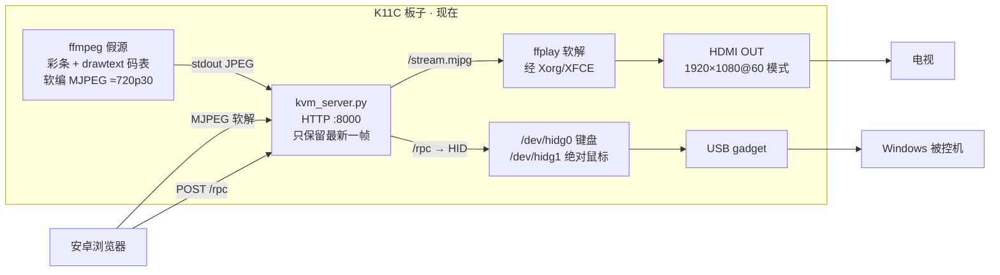
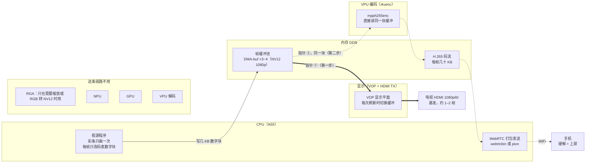
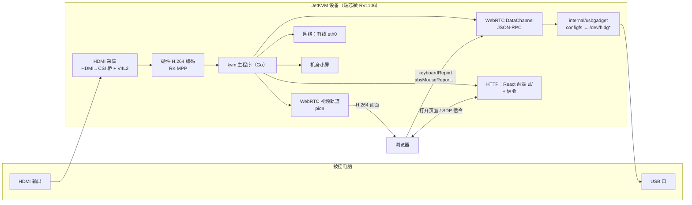

# 14 — 用 K11C（RK3566）验证 JetKVM 式 IP-KVM（假源版）

> **上半部分（§1–§5）给人看**：要证明什么；**§2.2 软路径（现在）/ §2.3 硬路径（目标）框架**；JetKVM 对照；进度与延迟数字。
> **下半部分（§6–§9）给 AI 看**：执行规则、环境速查、已知坑、T0–T9 闭环清单（假源软路径已收口）、**T10–T17（§2.3 结构：电视直出 + H.265）**。
> 编译 / 烧录链：`13_KICKPI_K11C_RK3566_编译烧录.md`。
> 旧版（10-17）归档：`归档\14_K11C做JetKVM式IP-KVM_方案_旧版_20261017.md`（只当证据库）。
> **2026-10-19**：T9 人眼读数进档；补齐软/硬两条数据流与 SoC 资源图（VPU/RGA/GPU/NPU）。
> 同日按用户 A1–A6 改目标结构：原始帧分路（电视不解码直出、60 帧）+ 手机 H.265（10-19 晚改，原定 H.264）；板上实测见 §2.3-E；任务 T10–T17 见 §9。

---

# 上半部分 · 给人看

## 1. 这一轮要证明什么

**一句话**：在 K11C 上先把 JetKVM 的"浏览器 ↔ 板子 ↔ 被控电脑"整条链路跑通，
画面暂时用**板子自己生成的彩条 + 码表**代替。三条都过了，再去打一块带 HDMI 输入的板子，
那时只需要把"彩条"这一块换成"采集到的电脑画面"，其余不动。

| # | 验收项 | 怎么算过 |
|---|---|---|
| **①** | 安卓手机连 WiFi，用浏览器**控制电脑的鼠标和键盘** | 手机上点/划，电脑光标跟着走、能点击；手机输入框里打的字出现在电脑记事本里 |
| **②** | 手机浏览器里**看得到彩条 + 码表** | 码表数字在走（不是一张静止图） |
| **③** | 板子 HDMI OUT 接电视，**电视上也是彩条 + 码表** | 电视上码表在走；手机和电视拍同一张照片，两个码表的差值 = 手机这一路比电视多出来的延迟 |

**假源验证轮（T0–T8）不做**：HDMI 输入/采集（K11C 硬件上没有）、安全/登录、虚拟光驱、远程开关机、云。
**下一阶段**（框架见 §2.3，任务 T10–T17）：原始帧分两路 —— **电视直出不解码、60 帧不丢不重**；**手机走 H.265 硬编 + WebRTC**。

> ⚠️ **先把一件事说清楚**：手机上看到的是彩条，**不是电脑桌面**。
> 所以这一轮用手机控制电脑时是"盲操"——要看电脑自己的屏幕确认光标和字。
> 这正是这一轮的边界：**画面通路**（②③）和**控制通路**（①）分开验证；
> 将来 HDMI 输入进来，把彩条换成电脑画面，两条合在一起就是完整的 KVM。

板子实测生成的画面（10-18，板上 ffmpeg 渲染、从串口拉回来的一帧，码表 = 从启动开始的 时:分:秒.毫秒）：


## 2. 当前板子：接线、数据流、要做的事

### 2.1 物理接线

```
  ┌──────────────────── Windows 笔记本（被控电脑）────────────────────┐
  │   USB-A ◄════ Type-C 数据线 ════╗        USB-A ◄── FT232 调试线 ─╗ │
  └─────────────────────────────────╫────────────────────────────────╫─┘
                                    ║ 板子在电脑眼里 =                ║ 只给 AI 调试用
                                    ║ 键盘 + 鼠标 + COM15             ║ (COM14, 1500000)
  ┌──────────────────────── K11C 板子 ╫────────────────────────────────╫─┐
  │  Type-C（device 模式）◄══════════╝            DEBUG 引脚 ◄────────╝ │
  │  HDMI OUT ═══════════════════════════════════════════════► 电视      │
  │  WiFi(wlan0) ⟿⟿⟿ 路由器 ⟿⟿⟿ 安卓手机（浏览器）                    │
  │  DC 原装电源（独立供电，Type-C 只走数据）                             │
  └───────────────────────────────────────────────────────────────────────┘
```

### 2.2 现在在跑的：软编 / 软解路径（T0–T8 已闭环）



**一个进程管三件事**：`kvm_server.py` 发网页、推 MJPEG、收控制写 `/dev/hidg*`。
电视和手机读的是同一份"最新帧"，码表可以互相减。

**这一路的资源账（10-19 板上再量一次，负载依旧）**：

| 进程 | CPU | 用的硬件 | 说明 |
|---|---|---|---|
| `ffmpeg`（假源+软编） | **~157–188%** | **只吃 CPU**（4×A55） | `libavcodec mjpeg` + `drawtext`/`swscale`，VPU/RGA/NPU 全闲 |
| `ffplay`（电视软解） | **~164–193%** | **只吃 CPU** + 经 Xorg 上屏 | 本机 loopback 再解一遍 JPEG；CPU 不够就 `-framedrop` 丢帧保时钟 |
| `Xorg` | ~10–14% | GPU(Mali) 合成桌面 | 多了一跳，不是硬解直出 |
| `python3` | ~0–3% | — | 只做帧缓存 + HTTP，不是瓶颈 |
| VPU / RGA / NPU | **0** | 闲置 | 软路径完全没用到 |

⇒ 4 核被两份软件编解码打满（load ≈ 9.5），电视那一路卡就是这个原因。
**键鼠控制通路不受影响**（RPC 板内 0.2–0.4 ms）。

**电视落后 13 秒是"队列深度"，不是"越跑越慢"**（两次实测放在一起看）：

| 实测 | 数字 | 说明 |
|---|---|---|
| 电视码表走速 | 墙钟 7.343 s 内走了 7.433 s | ≈ 实时，**没有在漂** |
| 同框读数差 | 电视比手机旧 **13.166 s** | 是一个**固定的落后量** |

这两条不矛盾：电视这一路中间有一个排队区（ffplay 的读包队列 + 本机 loopback TCP 缓冲，按 ~5.4 Mbps 算 13 s ≈ 9 MB，装得下），
开头 CPU 不够时积满，之后**进多少出多少**，所以码表走速正常，但永远差着 13 秒那一段。
⇒ `-fflags nobuffer` 治不了它（那只管探测阶段的缓冲，不管这个队列）。**真正的解法是电视这一路根本不经过"网络 + 解码"**，见 §2.3。

### 2.3 目标形态：一份原始帧，同时送电视和硬编（海思 VPSS 式分发）

> **定了的三件事（10-19 你拍板）**：
> 1. **电视那一路不解码**：和海思 `VI → VPSS → {VO, VENC}` 一样，原始帧（YUV/NV12）分两份，一份直接上屏，一份进硬编码器。
>    现在"先编 MJPEG 再在本机解回来上屏"是绕远路，也是 13 秒落后的来源。
> 2. **手机走 H.265**（VPU 硬编；10-19 晚由 H.264 改为 H.265）。⚠ 手机浏览器要能硬解 H.265 才行，T10 先验手机。
> 3. **对外输出 60 帧**（含义见下面 2.3-A）。
>
> **软件框架**：用户态是 GStreamer（也可以自己写 C 程序直接调库），底下是瑞芯微 **MPP**（编解码）+ **librga**（2D）+ **DRM/KMS**（显示），**不是 OMX**。
> 板上 `/usr/lib` 里只有 `librockchip_mpp` 和 `librga`，**没有**瑞芯微仿海思接口的那套 `rockit / RK_MPI_VI/VPSS/VENC/VO`
> （据我所知那套在 RV1106 / RK3588 的 SDK 里有；本板没找到）。所以"VPSS 绑定"在这块板上要自己拼：GStreamer `tee` 或自写程序 + DMA-buf 共享。

#### 2.3-A "60 帧"到底指什么（A5 那句话的白话版）

电视收到的 HDMI 信号像一条**每秒走 60 格的传送带**，每格放一张画面：

| 说法 | 意思 | 现在 |
|---|---|---|
| **HDMI 输出 60 Hz** | 传送带每秒走 60 格 | ✅ 已经是 1080p60 |
| **画面内容 60 帧** | 60 格里**每一格都是新画面**（码表每格都跳约 16.7 ms） | ❌ 现在大约只有一半格子是新的，其余是重复上一张 |

所以只说"60 Hz"，现在就已经满足了，但看起来仍然卡。**本方案的目标按第二行算**：电视上每秒 60 张不同的画面、不丢不重。
怎么验：电视画面用高速连拍或 HDMI 采集卡连续取帧，相邻帧码表差都应 ≈ 16–17 ms。
手机那一路帧率另定（H.265 可以 60 也可以 30，看 WiFi 实测）。

#### 2.3-B 海思概念对到这块板上是什么

| 海思 | 干什么 | K11C（RK3566）上对应 | 状态 |
|---|---|---|---|
| VI | 采集输入 | 现在：假源程序；将来：HDMI→CSI 桥 + `rkcif` → `/dev/videoN` | 假源已有 |
| VPSS | 一份帧分多路、缩放、改格式 | **GStreamer `tee`**（分路）+ **RGA**（缩放/格式转换）；帧用 DMA-buf 共享不拷贝 | 需要自己拼 |
| VO | 上屏 | **DRM/KMS 显示平面**（VOP → HDMI TX）；GStreamer 里是 `kmssink`，在 X 下是 `rkximagesink` | 已测，见 2.3-E |
| VENC | 硬编 | **MPP `mpph265enc`**（rkvenc 硬核） | 已测，见 2.3-E |
| 绑定 / 内存池 | 模块之间传指针不拷贝 | **DMA-buf fd** 在 RGA / MPP / DRM 之间传 | 假源这里还没做，见 2.3-E |
| NNIE / SVP | AI | **RKNPU** | 视频主链路不用 |

#### 2.3-C 目标数据流（一份帧，电视和手机同时出）



图里**粗线是电视那一路，虚线是手机那一路**；两路从同一块缓冲同时出，不是两套东西。施工分两步，只是为了先拿到电视基准：

- **第一步：只接粗线（电视）。** CPU 写好一块缓冲 → 等下一次刷新切过去显示 → 扫到电视。中间没有编码、解码、拷贝，也没有排队。
  - 延时：等刷新最多 16.7 ms + 扫完一屏约 16.7 ms，**大约 1–2 帧（17–33 ms）**，是这块板子的下限。
  - 缓冲至少三块轮流用：不能往正在显示的那块里写，否则画面撕裂。
  - 前提：**关掉 lightdm**，自己的程序直接控制显示（见 2.3-E 上屏方式），不经过 Xorg。
  - 验收：电视码表连续拍照，相邻两张差 ≈ 16.7 ms，不丢帧也不重复。
- **第二步：接上虚线（手机）。** 编码器读的是电视正在用的**同一块缓冲**，不拷贝；两边都用完，这块缓冲才回池子让假源重写（这就是海思"绑定"那层管理，要自己做）。
  - 电视照样每次刷新就切换，**不等编码器**，所以加了硬编电视基准不变。
- 将来换成 HDMI 输入板：`GEN` 换成 `rkcif /dev/videoN`，采集出来的帧本来就在 DMA-buf 里，后面不用改。

手机那一路的延时分在哪里（**估算，还没实测**）：

| 环节 | 硬件 | 估计 |
|---|---|---|
| 硬编 1080p 一帧 | VPU rkvenc | 约 10–17 ms（单独测过 57 帧/秒） |
| 打包发送 | CPU | 1–3 ms |
| WiFi 传输 | 无线网卡 | 5–30 ms，抖动大 |
| 手机接收缓冲 | 手机浏览器 | 20–60 ms，WebRTC 自己调 |
| 手机硬解 + 上屏 | 手机 | 约 15–35 ms |
| **合计** | | **约 50–150 ms** |

**怎么对比**：电视和手机拍进同一张照片，码表差 = "硬编 → WiFi → 手机"这一段的延时（电视本身只晚 1–2 帧，可当基准）。

**资源（估算）**：CPU 只写数字块 + 网络打包，远低于现在的 370%；VOP、VPU 每秒各读约 190 MB 帧数据，DDR 带宽够；NPU / GPU / VPU 解码闲着。

**和现在比，砍掉了什么**：电视这一路不再经过"JPEG 编码 → HTTP → JPEG 解码"三步，也就没有那个 13 秒的排队区；
板子不再做任何像素级软编软解。

#### 2.3-D 板子里有哪些硬件块，各干什么（10-19 dmesg 核对）

```
                    ┌──────────────── RK3566 SoC ─────────────────┐
  假源 RGB/YUV ──► │  CPU 4×A55     ：现在扛全部软编软解（打满）   │
                   │  RGA2          ：2D 拷贝/缩放/旋转/格式/混合  │
                   │  VPU 编码      ：rkvenc + vepu2（H.264/H.265）│
                   │  VPU 解码      ：rkvdec2 + vdpu2 + jpegd      │
                   │  GPU Mali-G52  ：桌面合成 / 3D（本路径可绕开）│
                   │  NPU RKNPU     ：AI 推理（编解码不用它）       │
                   │  VOP → HDMI TX ：显示平面合成 + 扫描输出       │
                   └───────────────────────────────────────────────┘
  设备节点：/dev/mpp_service  /dev/rga  /dev/dri/card0(显示)
           /dev/dri/card1 = NPU 的 DRM 节点（不是显示卡）
```

| 块 | 节点 / 地址 | 本方案里干什么 | 不干什么 |
|---|---|---|---|
| **VPU 编码**（rkvenc / vepu2） | `/dev/mpp_service` | **H.265 硬编**，给手机那一路 | — |
| **VPU 解码**（rkvdec2 / jpegd） | 同上 | **目标结构里不用**（电视不解码；手机自己解） | — |
| **RGA2** | `/dev/rga` | 缩放、格式转换、把**预先画好的数字图块**贴到帧上 | ⚠ **不会画字**：它不渲染字形，不能直接代替 `drawtext` |
| **VOP + HDMI TX** | `card0` | 原始帧直接放到显示平面上，扫到电视 | 谁占着 DRM master 谁才能用（见 2.3-E） |
| **GPU Mali-G52** | `fde60000.gpu` | 现在 Xorg 用它合成桌面；直出平面时可以不经过它 | 不是编解码器 |
| **NPU RKNPU** | `fde40000.npu`、`card1` | **视频主链路不用**。以后可以做画面识别之类的附加功能 | ⚠ 不能拿 NPU 代替 VPU 做编码 |
| **CPU** | — | 管道调度、WebRTC 收发、HID、**每帧更新码表数字块** | 不再做整帧编解码 |
| **WiFi** | `wlan0` | 把 H.265 送给手机 | — |

#### 2.3-E 10-19 板上实测：这套结构能不能跑起来

测试源一律是 1080p NV12 彩条（GStreamer），测试期间停掉了现在的软路径服务，测完已重启恢复。

| # | 测什么 | 结果 | 结论 |
|---|---|---|---|
| E1 | `videotestsrc` 每帧重画 1080p60 | 吃满 **1 个核**，单这一项就跟不上 60 | 测试源本身就是瓶颈，所以改成"彩条只画一次、之后重复送" |
| E2 | 只画一次的彩条 + `timeoverlay` 码表，送到空 sink | **45.5 帧/秒**，1 个核 100% | 用 CPU 在 1080p 整帧上叠字就到不了 60（A3 的担心是对的） |
| E3 | 原始帧不解码 → `rkximagesink`（在 X 下直接放到显示平面），单线程 | 11.8 帧/秒，**0 丢帧** | 能上屏；慢是因为和出帧挤在同一个线程里 |
| E4 | **一份帧 `tee` 两路**：一路 `rkximagesink` 上屏，一路 `mpph264enc` 8 Mbps 硬编 | 上屏 **29.3 帧/秒**、编码 **44.3 帧/秒**，都 0 丢帧；整板 CPU 约 **134%**（现在软路径约 370%+） | **VPSS 式分发在这块板上能跑通**，电视不解码就能出画；CPU 降到三分之一左右 |
| E5 | 单独 `mpph264enc` 1080p | **57.3 帧/秒**、0 丢帧（还是被测试源拖着） | 硬编本身大概率够 60，要用更快的源再证一次 |
| E6 | 停掉 lightdm → `kmssink` 直出 | **能打开显示**（不再报 -5），但测试源迟到导致大面积丢帧 | 弱模型说的"lightdm 开着时 kmssink 用不了"是对的；关掉桌面就能用 |
| E7 | 单独 `mpph265enc` 1080p60、6 Mbps（**软路径服务同时在跑**） | **平均 59.1 帧/秒、0 丢帧**；同条件 `mpph264enc` 59.2 | **H.265 硬编够 60**，和 H.264 一样快 |
| E8 | 显示平面（`modetest -M rockchip -p`） | 主平面 58 **只收 RGB**；**平面 98（Overlay）收 NV12**；HDMI 连接器 121、CRTC 90、1920×1080@60 | NV12 帧要放平面 98，主平面垫一张黑底；用 atomic 接口翻页 |

**离 60 帧还差的两处，原因都清楚**：

1. **码表叠字**（E2）：在 CPU 上对整帧做 `timeoverlay` 最多 45 帧。
   做法是你说的那种：开机时把 `0–9 : .` 这十几个字符**预先画成小图块**，每帧只把十来个数字块贴到码表那一小块区域
   （CPU 拷贝几 KB 或 RGA 贴图都行），不再整帧画字。
   ⚠ 这只是**测量用的**；将来接 HDMI 输入后，画面是电脑的，**不需要码表**，这一步整个去掉。
2. **上屏这一步还在拷贝**（E3/E4 只有 ~30）：测试源的帧在普通内存里，`rkximagesink` 每帧要把 ~3 MB 拷进显示缓冲。
   要 60 帧，帧就得**一开始就放在 DMA-buf（显示和编码器都能直接读的内存）里**，上屏和编码都只传指针 —— 这就是海思"绑定"那一层。
   将来 HDMI 输入时，`rkcif` 采集出来的帧本来就是 DMA-buf；假源阶段要自己分配这种内存（写一个小 C 程序，或 GStreamer 的 DMA-buf 分配）。

**上屏选哪种方式**（A2 的结论）：

| 方式 | 前提 | 实测 | 适合 |
|---|---|---|---|
| `rkximagesink`（在 X 下放显示平面） | 桌面照开 | 能出画、0 丢帧，~30 帧（拷贝限制） | 调试期，保留桌面方便看 |
| `kmssink` / 自写程序直接当 DRM master | **关掉 lightdm**（电视上不再有桌面） | 能打开，还没调好 | **产品形态**：板子就是个盒子，HDMI 只放这一路画面 |

#### 2.3-F 现在 vs 目标，一张表

| 环节 | 现在（软路径） | 目标 | 资源去哪了 |
|---|---|---|---|
| 出帧 | ffmpeg 每帧画彩条 + `drawtext` | 彩条画一次 + 每帧贴数字块（将来换成采集） | CPU 整帧 → CPU 几 KB |
| 分路 | 先编 JPEG 再 HTTP 分给两边 | **原始帧 `tee` 两份**，DMA-buf 共享 | 去掉一整套编解码 |
| 电视 | ffplay 软解 ~180% CPU → Xorg，落后 13 s | **原始帧直接上显示平面**，不解码 | CPU → VOP |
| 手机 | 软编 MJPEG ~5.4 Mbps | **`mpph265enc` 硬编 H.265** → WebRTC | CPU → VPU |
| 浏览器播放 | `` 收 MJPEG | WebRTC 收 H.265（板上 `webrtcbin` + Python 绑定已在） | 手机硬解（Chrome 136+ 且手机有 H.265 硬解） |
| NPU / GPU | 闲 | 仍闲 | — |
| 帧率 | 电视约 30 帧/秒还在丢 | **电视 60 帧不丢不重**；手机 30 或 60 看 WiFi | — |

### 2.4 板子上要做的事（进度）

| 模块 | 干什么 | 现在状态 |
|---|---|---|
| USB gadget | Type-C → 键盘 + 绝对鼠标 + ACM | ✅ |
| COM16 登录 / WiFi+SSH / 部署通道 | 保底串口、联网、scp | ✅ T1–T3（ACM 现为 COM16） |
| 假源 + `kvm_server.py` + 手机页 | 软编 MJPEG + RPC + 控制页 | ✅ T4/T6/T7 |
| 电视 ffplay 全屏 + 开机自启 | 软解上屏 | ✅ T5/T8（卡顿，见 §2.2） |
| **换成 §2.3 结构** | 原始帧分两路：电视直出 + H.265 硬编给手机 | 🟡 关键环节已在板上试通（§2.3-E）；任务 **T10–T17**（§9） |

**仍然全是用户态**：MPP / RGA / DRM 的设备节点都已经在，换结构**不用重编内核、不用烧固件**。

## 3. JetKVM 原版是怎么跑的，我们搬什么

### 3.1 JetKVM 原版流程



浏览器打开页面后和设备建 WebRTC 连接：**画面走视频轨道**，**键鼠走 DataChannel 上的 JSON-RPC**，
主程序收到 `keyboardReport` / `absMouseReport` 就写成 HID 报文发到 `/dev/hidg*`，被控电脑当成真键鼠。
（采集桥的具体芯片型号、原生层是独立进程还是并进主程序，本文没核对源码，不影响本轮。）

### 3.2 逐块对照：本轮在 K11C 上用什么替

| JetKVM 模块 | 本轮 K11C | 将来 HDMI 输入板 |
|---|---|---|
| HDMI 采集 | **ffmpeg 假源**（彩条 + 码表） | 采集芯片 → `/dev/videoN`，**只换这一块** |
| H.264 硬编 + WebRTC 视频轨道 | **现：软编 MJPEG**（CPU 打满，见 §2.2）；**目标：MPP H.265 硬编**（§2.3） | 采集帧进同一条硬编管道 |
| JSON-RPC over DataChannel | **同名方法**的 JSON-RPC over HTTP POST | 保留 |
| `usbgadget` configfs HID | `k11c-gadget.sh`，描述符照抄 JetKVM ✅ 已完成 | 不变 |
| React 前端 `ui/`（160 个文件） | **1 个 `index.html`**，只照搬它的输入换算思路 | 需要时再搬 `ui/` |
| 有线网络 | **WiFi**（NetworkManager） | 不变 |
| 机身小屏 | **HDMI OUT → 电视**（我们多出来的） | 用途再定 |
| 云、Tailscale、登录、虚拟光驱、ATX 开机、音频 | 不做 | 按需 |

**"移植"真正落到三件事**：
1. **HID 报文与描述符**（键盘 8 字节、绝对鼠标 0–32767）—— ✅ 已搬完并实测打字成功；
2. **JSON-RPC 方法名与参数**（`keyboardReport` / `absMouseReport` / `wheelReport`）—— 已写进 `k11cd.py`，本轮扩成网页能调；
3. **前端输入换算**（触摸位置 → 0–32767、字符 → 键码）—— 本轮在 `index.html` 里实现最小版。

视频那一路 JetKVM 绑死 RV1106 + 采集硬件，**搬不动也不用搬**，本轮用假源替，将来用采集芯片替。
许可证：JetKVM 是 GPL-2.0，自用不分发没有义务；**哪天要公开/分发，抄过的部分要一起开源**。

### 3.3 将来做 HDMI 输入板要知道的一件事

RK3566 芯片本身**没有 HDMI 输入**，新板子必须加一颗 **HDMI → MIPI-CSI 桥芯片**接到 RK3566 的摄像头接口
（PiKVM、开源项目 espkvm 用的是东芝 TC358743；龙迅 LT6911 系列也是这类，**都只是举例，没选型**）。
最大工作量在桥芯片的驱动和设备树，而不是本轮这些软件 —— 本轮链路做通后，那时只把 `ffmpeg 假源` 换成 `/dev/videoN`。

## 4. 做到哪了

### 4.1 功能验收（软路径把 ①②③ 跑通了）

| 项 | 状态 | 证据 |
|---|---|---|
| ① 手机控制键鼠 | ✅ | T6/T7：光标/打字/滚轮/右键闭环 |
| ② 手机看彩条+码表 | ✅ | T4/T7：`` |
| ③ 电视看彩条+码表 | ✅ | T5/T8：HDMI-1 1920×1080@60，全屏 ffplay |
| 开机自启 | ✅ | T8：冷启 HID ~25 s、HTTP ~28 s |
| 软路径性能 / 延迟 | ❌ 不达标 | 见 §4.2；根因见 §2.2 |

### 4.2 T9 延迟（人眼读同框照片，10-19）

| 屏 | 码表读数 | 含义 |
|---|---|---|
| **电视** | `00:03:58.467` | 电视正在显示的那一帧的生成时间 |
| **手机** | `00:04:11.633` | 手机正在显示的那一帧的生成时间 |
| **差值** | **13.166 s**（手机 − 电视） | 同一瞬间，手机上的帧比电视**新** 13.166 s ⇒ **电视落后手机约 13.2 秒** |

> 读法说明：码表烧在帧里，数字越大 = 越新的帧。
> 电视这一路是"本机拉 MJPEG → 再软解"，中间有个排队区积满后一直保持 13 秒深（§2.2 末尾）；
> 手机只拿最新帧，所以反而更新。和"手机该更慢"的直觉相反，但账对得上。

| 指标 | 数值（软路径） |
|---|---|
| 电视相对手机落后 | **≈ 13166 ms** |
| 板子 CPU（编码 / 电视解码） | ffmpeg **~160–190%** / ffplay **~160–190%** |
| load average | **≈ 9.5**（4 核） |
| `/state` fps 读数 | ~30（节拍受板子时钟影响，**不能当准数**，见 §7.2） |
| 上电到可用 | HID 25 s / HTTP 28 s |
| WiFi | `Duck_5G`，板子 IP `192.168.31.89`（会漂，SSH 用 `kickpi.local`） |

#### T16（§2.3 结构，10-20 实测 —— 三张同框照片读数，只写量到的数）

| 指标 | 数值（§2.3 结构） | 出处 |
|---|---|---|
| 手机相对电视落后 | **2 帧 = 33–40 ms**（三张分别是 −40 / −33 / −40 ms，帧号差三张都是 −2） | 同框照片码表相减，电视为基准 |
| 电视那一路 | `flips=60/s`、`miss=0`、`dt_avg=16.67`、`enc_skip=0` | `journalctl -u k11c-fakevo` |
| 手机收到的 | `codec=video/H265`、`1920x1080`、`fps=60`、`dropped=7`、**`lost=0`**、`jb_ms=10.0–11.7` | 页面统计落盘 `/var/log/k11c-webrtc-stats.log` |
| 板子 CPU | `fakevo` **30.4%** + `k11c-gw` **7.3%** + `kvm_server` <0.5% = **≈38%** | `/proc/<pid>/stat` 差值，6 s 窗口 |
| load average | **1.86** | `uptime` |
| 上行控制 | 人报 **~60 ms**；板子内部只花 **0.3 ms**（`last_err` 全空，64 次 `absMouseReport`） | `/state.rpc` + 页面状态行 |
| 冷上电到可用 | **电视 ~10 s**（fakevo @8.0 s 启动、9.7 s active）；**手机 16–20 s**（`network-online` 15.4 s 后才起网关） | `journalctl -b -o short-monotonic` |
| 固件 | 已烧：`K11C_v12_ubuntu2404_selfbuild-kvm-h265-20261020.img`，md5 `01c089b6…` | T18 |

⚠️ 上面那行"上电到可用 HID 25 s / HTTP 28 s"是**软路径 + 带桌面**时代的老数，已被本表替换；
且当时 `fps 28–31` 那个读数是挂在会跳的 `CLOCK_MONOTONIC` 上的，**不能当准数**（见 §7.2）。

**现在最慢的一环不在视频，在上行控制**：视频 33–40 ms，而手机发一次鼠标要 ~60 ms（板子只占 0.3 ms，其余全在手机电台 + 浏览器 `fetch`）。

**和目标的差距**：目标是 **电视 60 帧输出 + 手机 H.265 WiFi 监看**（"60 帧"的确切含义见 §2.3-A）。
现在 HDMI 信号是 1080p60，但画面内容大约 30 帧/秒还在丢，而且整体落后 13 秒。要达标必须换成 §2.3 的结构。

## 5. 要你配合的（当前）

| 何时 | 你做什么 |
|---|---|
| **T10** | 用平时那台手机的 Chrome 打开测试页，把页面上的字发给 AI（验手机能不能硬解 H.265） |
| T11 / T12 | 看拉回来的字形图；看电视上码表和帧号在走 |
| T14 / T15 | 手机打开测试页 / 控制页看画面，照 T7 那样划屏、打字 |
| T16 | 电视和手机同框拍 **3 张**照片 |
| T17 | **先确认同意关掉桌面**，再看两次重启后电视和手机 |

---

# 下半部分 · 给 AI 看

## 6. 执行规则（先读完再动手，违反任何一条就停下来问人）

1. **只按 §9 的顺序做，一次只做一个任务。** 前一个任务"验收"没有全部通过，不许开始下一个。
2. **每个任务做完立刻回写本文档**：把 `- [ ]` 改成 `- [x]`，在下面加一行 `实测(MM-DD)：<命令输出里证明通过的那一行>`。
   只许贴**量出来的结果**，不许写"应该可以""大概率""理论上"。
3. **不许改上半部分的结论和范围**，不许新增 Q 编号、长篇论证、新阶段。觉得上半部分错了，写到 §8.3「待人确认」，然后停。
4. 需要人做的动作（给密码、插线、插电视、看手机、拍照）—— **停下来，一句话说清楚要人干什么**，等人回复。
5. **本轮不重编内核、不烧固件**。觉得必须重编，停下问人。
6. 代码的**唯一源头**在 Windows：`D:\win_game_project\26_k11c_kvm\board\`。改代码先改这里，再传到板子 `/opt/k11c-kvm/`。
   不许只在板子上改而不回传。
7. 脚本里**不许用 `|| true` 吞错误**；ffmpeg 一律加 `-nostdin`。
8. git：**禁止 `git add -A`**；只 add 本文档和 `26_k11c_kvm/` 下你改过的文件；提交前问人。
9. 每完成一个任务，在 `D:\win_game_project\03_ai的记忆_和skill\04_workbuddy_记忆与skill\日志\<当天>.md` 追加 3–5 行：做了什么、踩了什么坑。

## 7. 环境速查

### 7.1 怎么进板子

| 通道 | 用法 | 备注 |
|---|---|---|
| **COM14**（FT232 调试串口） | `powershell -File D:\win_game_project\26_k11c_kvm\host\serial_probe.ps1 -Port COM14 -Baud 1500000 -CommandFile <命令文件> -TimeoutSec 30` | 命令文件**一行一条**，脚本每条都等哨兵再发下一条。已登录为 `kickpi` 的 shell |
| 从板子拉小文件 | `powershell -File ...\host\pull_b64.ps1 -Remote /tmp/x.jpg -Local D:\...\x.jpg` | 分块 base64 + 每行校验；**不要一次性 cat 大文件**，串口会丢字节 |
| COM15（Type-C 上的 ACM） | `serial_probe.ps1 -Port COM15 -Baud 115200 -CommandFile <命令文件>` | T1 已完成：开机自动登录 `kickpi`，免密进 shell，保底通道 |
| SSH（**T3 起的主通道**） | `ssh k11c`、`scp <本地> k11c:/opt/k11c-kvm/` | 免密已通；别名指向 `kickpi.local`（IP 会漂，别写 IP）；Git Bash 下 scp 先 `export MSYS_NO_PATHCONV=1` |
| sudo | 串口里用 `echo kickpi \| sudo -S <命令>`；要往 `sudo tee` 里管道写内容时，先单独跑一次 `echo kickpi \| sudo -S true` 缓存口令 | 账号 `kickpi/kickpi`，`root/root` |

### 7.2 板子事实（10-18 实测）

| 项 | 值 |
|---|---|
| 系统 | Ubuntu 24.04，内核 `6.1.141 #3`，4 核 A55，内存 1956 MB，根分区剩 7.8 G |
| 软件 | Python 3.12.3；ffmpeg 6.1.1（有 `mjpeg`、`libx264`、`x11grab`、`kmsgrab`、`sdl2`、`xv`）；`ffplay`、`chromium`、`firefox`、`xrandr`；GStreamer `mpph264enc`/`mpph265enc`/`mppjpegenc`/`kmssink`/`rkximagesink`/`webrtcbin`/`rtph265pay`/`h265parse`；`modetest`；gcc 13.3；pkg-config 能找到 `libdrm` `gstreamer-{1.0,app,video,allocators,webrtc}-1.0`（1.24.2）；Python `gi` 的 `GstWebRTC`/`GstSdp` 能 import（10-19 核对）；`nmcli`、`wpa_supplicant`、`avahi-daemon`(active) |
| 字体 | `/usr/share/fonts/truetype/dejavu/DejaVuSansMono-Bold.ttf` 存在 |
| 网络 | `wlan0` MAC `60:48:9c:b7:57:d4`，已连 **`Duck_5G`**（5G），IP **`192.168.31.89`**（重启后可能同时挂 `.90`，见 T2 实测），网关/DNS `192.168.31.1`；`kickpi.local` 在 Windows 上可解析；SSH 已 enable+active；`end1` 有线（备胎，没插） |
| 桌面 | lightdm 自动登录 `kickpi`，XFCE + Xorg；`DISPLAY=:0`，`XAUTHORITY=/home/kickpi/.Xauthority`；输出口 **`HDMI-1`** 已接电视、`connected 1920x1080@60`；drm 状态文件 `/sys/class/drm/card0-HDMI-A-1/status`；屏保/DPMS 均为关 |
| 时钟 | **板子时间是错的，而且 `CLOCK_MONOTONIC` 也不单调**：无 RTC + NTP 校时会把它一起跳（journal 里有 `Time jumped backwards, rotating`）。实测 10-18：`/proc/uptime` 43.6 h、`kvm_server` 的 `monotonic` 差值 33.7 h、码表 `33:39:19` 三者互不对。⇒ **任何"从启动开始多少秒"的数字都不可信**；但码表是烧进帧里的，电视和手机读同一个数，所以 T9 用"两个屏幕的码表差值"量相对延迟仍然成立 |
| USB gadget | VID:PID `1d6b:0104`；`/dev/hidg0` 键盘、`/dev/hidg1` 绝对鼠标（都是 `crw------- root`）、`/dev/ttyGS0` ACM；**没有 `/dev/hidg2`**（相对鼠标没挂）；UDC `fcc00000.usb`，`state=configured`；serialnumber = `eaf4b2430e0d`（end1 的 MAC，**不能为空**，见坑 16）；ACM 在 Windows 上现在是 **COM16**（枚举次数变了，别写死 COM15） |
| 开机服务 | `k11c-gadget.service` enabled；官方 `usb-gadget.service` 已 mask ⇒ **没有 adb** |
| 已失败但无关的服务 | `apport`、`fwupd-refresh`、`networking`、`rockchip` —— 本轮不用管 |
| 当前固件 | `D:\02_baidu\自建镜像\K11C_v12_ubuntu2404_selfbuild-P2hid-noadb-20261017.img`（md5 `467b9973a4804a5944955ff8128f9daa`）。**注意**：镜像里的 `/usr/local/sbin/k11c-gadget.sh` 是带空 serialnumber bug 的旧版，10-18 已在板子上换成源头版 `31743bd6`；重烧会退回坏版本，下次出包必须带上（见坑 16） |
| 被控电脑 | 本机 LENOVO 82AV，1920×1080，**装了中文输入法** |
| 编译 VM | `ssh rk-vm`（`rk@192.168.234.141`，SDK `~/k11c/rk-linux6.1-2026091606`）—— **本轮用不到** |

### 7.3 HID 报文格式（写 `/dev/hidgN` 的原始字节）

| 设备 | 报文 | 说明 |
|---|---|---|
| `/dev/hidg0` 键盘 | 8 字节 `[mod, 0, k1, k2, k3, k4, k5, k6]` | 每次"按下"后**必须再发一个全 0 报文**表示松开，否则电脑会一直重复那个键 |
| `/dev/hidg1` 绝对鼠标 | 6 字节 `[0x01, buttons, xL, xH, yL, yH]` | x、y 范围 0–32767，小端；buttons：bit0 左、bit1 右、bit2 中 |
| `/dev/hidg1` 滚轮 | `[0x02, wheel, pan]`（有符号 8 位，正 = 向上） | 描述符里 Report ID 2 只有 2 个数据字节。**旧 `k11cd.py` 写的是 6 字节，未上板验证**，以 T6 实测为准 |

修饰键 `mod`：左 Ctrl `0x01`、左 Shift `0x02`、左 Alt `0x04`、左 Win `0x08`。
常用键码：`a`–`z` = `0x04`–`0x1d`；`1`–`9` = `0x1e`–`0x26`；`0` = `0x27`；Enter `0x28`；Esc `0x29`；Backspace `0x2a`；Tab `0x2b`；
空格 `0x2c`；`-` `0x2d`；`=` `0x2e`；`[` `0x2f`；`]` `0x30`；`\` `0x31`；`;` `0x33`；`'` `0x34`；`` ` `` `0x35`；`,` `0x36`；`.` `0x37`；`/` `0x38`；
Delete `0x4c`；→ `0x4f`；← `0x50`；↓ `0x51`；↑ `0x52`。大写字母和 `!@#` 等 = 对应键 + Shift。

### 7.4 现有代码（`D:\win_game_project\26_k11c_kvm\`）

| 文件 | 是什么 |
|---|---|
| `gadget/k11c-gadget.sh` + `systemd/k11c-gadget.service` | 开机装配 USB gadget（已在板上，**本轮不要动**） |
| `port/k11cd.py` | JSON-RPC 子集（标准库），方法名与 JetKVM 一致。**已知问题**：写 HID 是阻塞的（电脑不收就卡死）；滚轮写 6 字节；`relMouseReport` 写不存在的 `hidg2`；`getUsbEmulationState` 判断键名写错 |
| `port/PORTING.md` | JetKVM 方法子集与取舍（参考） |
| `host/serial_probe.ps1`、`host/pull_b64.ps1` | 串口执行命令 / 从板子拉文件 |
| `board/fakesrc.sh`、`board/kvm_server.py`、`board/run.sh` | T4+T6：假源彩条+码表 → JPEG；`kvm_server.py` = MJPEG 分发（`/stream.mjpg` `/snapshot.jpg` `/state` `/`）+ JSON-RPC（`POST /rpc`：`absMouseReport` `wheelReport` `keyboardReport` `keypressReport` `typeText` `keyCombo` `getUsbEmulationState` `getDeviceCapabilities` `getLocalVersion` `ping`）；`run.sh` 用 `systemd-run` 以 root 起服务。**RPC 现在在这里，不在 `port/k11cd.py`** |
| `board/tv.sh` | T5：等 `:8000/state` 可达后，用 ffplay 在 HDMI-1 上全屏循环放 `/stream.mjpg`，退出 2 s 后重来。以 `kickpi` 身份在 X 里跑 |
| `board/www/index.html` | T7：手机单文件页面（无外链）。画面 + 触摸板（30 ms 节流、轻点=左键）+ 左右/双击/滚轮 + `typeText` 输入框 + 特殊键 + `切输入法` + 状态行（fps / 上次 RPC ms / 最快 ms） |
| `host/quick_check.ps1` | Windows 侧一把查 `1D6B` 设备 |
| `board/` | **本轮新代码放这里**（T3 建） |

## 8. 已知坑

### 8.1 本轮相关（每条都实际踩过或已核实）

| # | 现象 | 原因 / 做法 |
|---|---|---|
| 1 | ffmpeg 在串口/脚本里跑，**一帧都没出**，报 `received no packets` | ffmpeg 读标准输入当快捷键，下一行命令开头的 `q` 被当成"退出"。**一律加 `-nostdin`**（10-18 踩到） |
| 2 | `drawtext` 报 `Unterminated %{}` | 冒号要多一层引号。验证过的写法（bash 双引号里）：`text='%{pts\:hms}'` |
| 3 | 串口回传的数据少了一截 | 串口一次性传大量数据会丢字节。用 `pull_b64.ps1` 分块拉；命令一条一条发 |
| 4 | 写 `/dev/hidg*` 卡住不返回 | 电脑没在收报文（睡眠、线拔了、还没枚举）时 `write` 会阻塞。用 `os.open(path, os.O_WRONLY \| os.O_NONBLOCK)`，遇到 `BlockingIOError` 丢掉这一帧，**不能让整个服务卡住** |
| 5 | 板子发的字母没进记事本，进了输入法候选框 | 电脑开着中文输入法。测试前发 `Ctrl+Space` 切英文；网页上要有"切输入法"按钮 |
| 6 | 安卓浏览器软键盘打字，`keydown` 的 `keyCode` 全是 229 | 安卓输入法不报真实键码。**不要靠 keydown**：用输入框的 `input` 事件 / "发送"按钮拿到文字，服务端把字符翻译成键码（`typeText`） |
| 7 | 手机划动时光标一卡一卡、服务端 CPU 高 | 触摸事件太密。前端节流：每 30 ms 最多发一次，只发最新位置 |
| 8 | 电视黑屏 / 过几分钟黑屏 | 电视开机后才插 HDMI，X 不一定自动点亮 → `xrandr --output HDMI-1 --auto`；屏保/省电 → `xset s off -dpms s noblank` 并停掉 `xfce4-screensaver` |
| 9 | root 跑的程序在电视上显示不出来 | X 程序要 `DISPLAY=:0 XAUTHORITY=/home/kickpi/.Xauthority`，并且最好以 `kickpi` 用户跑。开机自启走 XFCE 的 `~/.config/autostart/`，不要用 root 的 systemd 服务去开窗口 |
| 10 | 手机和电视只有一个能看 | ffmpeg 自带的 `-listen 1` HTTP **只接一个客户端**。必须由 `kvm_server.py` 自己发流：所有客户端共享"最新一帧"，慢的客户端跳帧，不排队 |
| 11 | 手机打不开 `kickpi.local` | 安卓不保证支持 mDNS。**给手机用 IP 地址** |
| 12 | PowerShell 里 `curl` 发 JSON 引号乱掉 | PowerShell 的 `curl` 是别名。用 `Invoke-RestMethod -Method Post -ContentType 'application/json' -Body $json` |
| 13 | 在电脑浏览器里测网页，鼠标乱飞 | 电脑浏览器控制的就是这台电脑，自己控制自己会形成回环。**网页只在手机上测**；电脑上只用 `Invoke-RestMethod` 测 RPC |
| 14 | 板子 `/sys/class/udc/*/state` = `addressed`、写 `/dev/hidg*` 全 EAGAIN、Windows 里 1D6B 全部 `present=False` | 主机没下发 SET_CONFIGURATION，枚举卡死；dmesg 里 `dwc3: device reset` 循环。**软重绑 UDC 无效，拔插 Type-C 线**（10-17 同款，已验过一次） |
| 15 | root 追加 kickpi 的旧文件报 `Permission denied`（`echo X >> /tmp/kvm.log`） | 这台板子的 sudo 环境**缺 CAP_DAC_OVERRIDE**：新建文件可以、写非属主文件不行。`/dev/hidg*` 属主是 root 所以不受影响；日志换新文件路径即可 |
| 16 | 板子重启后 Windows 报"无法识别的设备"、UDC 停在 `addressed`，换口/重启电脑都没用 | 固件里 `/usr/local/sbin/k11c-gadget.sh` 是**旧版**（md5 `cc42db76`），`cat ... \| tr ... > serialnumber \|\| echo 兜底` 写进空串 → 主机读字符串描述符失败。10-17 手改的是运行态，**一重启就被旧脚本重建**。已把源头版 `31743bd6` 同步进板子（`serial=eaf4b2430e0d` → `configured`）；**下次固件必须带新版** |
| 17 | 从 ssh 会话里 `setsid nohup` 起的服务，过一会儿自己没了 | 进程还留在 `user-1000.scope`，会话登出时 logind 整组杀掉。改用 `systemd-run --unit=k11c-kvm-run --collect`（见 `board/run.sh`） |
| 18 | `typeText` 报 `-32001 电脑没在收报文`，但鼠标没事 | HID 的 IN 队列只有 1 深：上一条（比如 Ctrl+Space 的松开）还没被取走，下一条就 EAGAIN。写 HID 要**有界重试**（20×5ms），既不能直接报错也不能无限阻塞 |
| 19 | `Start-Process notepad` 弹出"你要如何打开这个文件"，键鼠全打进那个对话框 | 这台机器上不带路径的 `notepad` 走 ShellExecute 失败。**必须用 `%SystemRoot%\System32\notepad.exe`**；且 `-PassThru` 回来的 `ProcessName` 是空的，要靠 `Get-Process notepad` 找最新 pid 并校验前台窗口 pid |
| 20 | `.ps1` 里写中文就语法报错 | Windows PowerShell 5.1 按 GBK 读文件，UTF-8 中文会截断字符串。**测试脚本只写 ASCII** |
| 21 | 板子 WiFi 侧 ping 只有 3ms，但电脑打过去单次 HTTP 要 55ms、ICMP 1–103ms 抖 | 笔记本无线网卡 **Power Saving Mode = 开启**。量延迟前要先关它，否则 T9 的延迟数字全是网卡省电的锅 |
| 22 | 电视上全屏彩条正常，但**码表被一把虚拟键盘盖住** | 镜像自带 onboard 开机自启，而且有两份：`~/.config/autostart/onboard.desktop`（跑 `/usr/local/bin/onboard-tray.sh`）和 `/etc/xdg/autostart/onboard-autostart.desktop`。**两个文件名不同**，只写一个 `Hidden=true` 盖不掉，要在 `~/.config/autostart/` 下同时写 `onboard.desktop` 和 `onboard-autostart.desktop` 两份 `Hidden=true` |
| 23 | `pkill -f "/usr/bin/onboard"` 把自己的 ssh 会话杀了（`ssh` 返回 255） | 和坑 14 同源：`-f` 匹配整条命令行，而我们那条命令里就带着这个字符串。要么用 `pkill -x onboard`，要么把 pattern 写成 `'onboard[.]sh'` 这种自避形式 |
| 24 | `kmssink` 报 `streaming stopped, reason error (-5)` | lightdm 开着时 Xorg（`fuser /dev/dri/card0`）是 DRM master，别人拿不到平面。要么在 X 下用 `rkximagesink`，要么 `systemctl stop lightdm` 后再用 `kmssink`（10-19 实测能打开） |
| 25 | GStreamer 显示 sink 几乎全丢帧，fakesink 却一帧不丢 | 显示 sink 默认 `max-lateness` 20 ms，帧迟到就扔；`videotestsrc` 每帧在 CPU 上重画 1080p，必然迟到。测上屏要用"画一次 + `imagefreeze`"的源，sink 前加 `queue` 单独开线程，必要时 `sync=false` |
| 26 | 1080p 整帧 `timeoverlay` / `drawtext` 卡在 ~45 帧 | 整帧叠字吃满 1 个核。**RGA 不能画字**，要 60 帧只能预画数字块、每帧只贴那一小块 |
| 27 | 10-19 同框照片：监视器 `09:52:26.330` vs 手机 `…11.333`，看着像差很多 | **两边根本不是同一个时钟**：监视器是 `fakevo` 的 `CLOCK_MONOTONIC_RAW`，手机是旧软路径 ffmpeg 的 PTS，而且内容也是两条独立管道。⇒ 这种照片减出来的数**没有意义**。T16 之前必须先让两边显示**同一块缓冲上烧进去的同一段文字**（就是 T13–T15 要做的），否则量了也是白量 |
| 28 | 手机探测页 `WebCodecs: undefined`，容易误判成"手机不行" | 页面 `secure: false`（HTTP 非安全上下文）时 Chrome **不暴露** WebCodecs，与手机能力无关。要测 WebCodecs 必须 HTTPS 或 localhost。我们走 WebRTC，这条直接忽略 |
| 29 | 从 PowerShell 直接 `ssh k11c "..."`，里面的 `$()`、引号、`2>/dev/null` 被吃掉 | PowerShell 先解析了一遍。把命令写成 `.sh` → 转 LF 换行 → `scp` 上去 → `ssh k11c "sh /tmp/x.sh"` |
| 30 | 板子打的字到了记事本变成**中文乱码**，看着像 HID 丢字节 | 是**电脑端的中文输入法**在中间做拼音组字。`typeText` 代码没错：按一次 `Ctrl+Space` 离开中文后逐字命中。注意 **`Ctrl+Space` 是开关不是"切到英文"**，盲按可能反而把英文切成中文（JetKVM 那个"切输入法"按钮同病）。判据：同一串字打两遍，第一遍乱码第二遍准 ⇒ 是输入法 |
| 31 | pion 网关出的 offer **一行 `a=candidate` 都没有**，浏览器 `ontrack` 收到了、统计行一直卡在等首帧，板子 30 s 后报 `连接状态: failed` | 非 trickle 必须返回 **`pc.LocalDescription().SDP`**：gather 是把 candidate **追加进 local description** 的，`CreateOffer` 那份字符串里没有。写 WebRTC 网关务必当场检查 offer 里有没有 candidate，别等 ICE 超时 |
| 32 | 新来一个连接时，浏览器的 `POST /answer` 撞上"没有活动连接" | "同一时间只服务一个观看端"的实现里，`swap()` 关掉旧连接会触发**旧连接的 `closed` 回调**，回调无条件把全局当前连接清空 ⇒ 刚装上的新连接被抹掉。回调必须**先比对是不是当前那条**再摘 |
| 33 | 用 App 内嵌浏览器测视频，`getVideoPlaybackQuality()` 报 `droppedVideoFrames ≈ totalVideoFrames`，像是不停丢帧 | 页面 `visibilityState=hidden` 时 Chrome 把不可见标签页的合成器渲染节流掉了，**量的地方不对**。这种场景只认 `inbound-rtp` 的 `framesDecoded / framesPerSecond / framesDropped`；要看真实渲染必须用可见窗口或手机 |
| 34 | "关掉 WiFi 省电"第一次测出来是**关掉更差**（max 123→220），和预期完全相反 | 单时段"先测后测"= 把**环境漂移**当成效果（这条链路同时受笔记本网卡省电、AP、邻居信道影响）。必须 **ON/OFF 交替各测一轮**（`host/wps_ab.ps1`，60+60 样本）⇒ 中位/p90 一模一样。另外测延迟前先 `Find-NetRoute <板子IP>`：这台机器挂着 TUN 代理（FlClash / Meta Tunnel，fake-IP 段 `198.18.0.x`），**先排除代理再谈 WiFi** |

### 8.2 USB gadget 层（已解决，**不要再碰**；细节见 skill `usb-gadget-hid-bringup`）

- 不要用官方 VID:PID `2207:0006`（Windows 的 Android 驱动会整台认领，键鼠不出现）；
- configfs 顺序：解绑 → 建 function → 链进 config → 绑定；`ln -s` 不许吞错误；
- 6.1 内核的 hid function 没有 `wakeup_on_write`；
- `serialnumber` 不能为空；
- `/sys/class/udc/*/state` 解绑后不会变回去，不能单靠它判断。

### 8.3 待人确认（AI 发现上半部分有问题时写这里，然后停）

- ✅ **T9 人眼读数已到位（10-19）**：电视 `00:03:58.467` / 手机 `00:04:11.633` → 电视落后手机 **13.166 s**。
  已写入 §4.2。根因是软路径 CPU 打满（§2.2），不是 WiFi 本身更慢。
- ✅ **10-19 用户拍板**：电视不解码（原始帧分路直出，海思 VPSS 式）；手机 **H.265**（10-19 晚由 H.264 改）；对外 60 帧（按 §2.3-A 第二行定义：每格都是新画面）；电视那一路先做到最低延时当基准（§2.3-C）。
- 已纠正的说法：RGA 不能画字（只能贴预画好的数字块）；lightdm 开着时 `kmssink` 拿不到 DRM master（关掉 lightdm 可用，10-19 实测能打开）；
  电视 13 s 是队列深度不是漂移，`-fflags nobuffer` 治不了。
- ✅ **细方案已拆成 T10–T17（10-19）**：假源帧 = 自写 C 程序 `fakevo` 用 DRM dumb buffer 分配（本身就是 DMA-buf）；上屏 = 关 lightdm、`fakevo` 自己当 DRM master；WebRTC = `webrtcbin`（Python）。
- ✅ **T14 路线已定并已跑通（10-20 用户拍板 D：照 JetKVM 移植）**：
  当时卡住的原委保留（是查证出来的事实，不是代码问题）：
  `webrtcbin` 一进 PLAYING 就报 `libnice elements are not available` → `BUS ERROR: missing a plug-in`。
  - `libgstwebrtc.so` / `libgstdtls.so` / `libgstsrtp.so` 都来自 **`gstreamer1.0-plugins-bad`**，版本 **1.24.2**，和核心 1.24.2 一致 ⇒ **不是版本错配**；
  - 它要的 `nicesrc` / `nicesink` 属于 `gst-plugins-good` 的 **nice 插件**；板上**没有 `libgstnice.so`**，
    `dpkg -S` 也没有任何包认领；
  - 把 apt 候选包 `gstreamer1.0-plugins-good_1.24.2-1ubuntu1.8_arm64.deb` 下载到 `/tmp` 用 `dpkg -c` 看过，
    **里面 nice / webrtc / dtls 一个文件都没有** ⇒ **Ubuntu noble 的 plugins-good 根本没打这个插件**，
    所以 `apt install` / `apt upgrade` 都变不出来。（我中途两次判断错：先说"缺 DTLS"，其实 1.24 里叫
    `dtlsenc/dtlsdec/dtlssrtpenc/dtlssrtpdec`，都在；后说"缺包能装"，实测不能。）
  当时的三条备选（A 自编 nice 插件 / B H.265+fMP4+MSE / C 手机维持 MJPEG）**都没选**，
  走的是第四条 **D：Go + pion 自己带 ICE/DTLS/SRTP** —— 就是 JetKVM 本体的做法，
  交叉编译出一个静态 ARM64 单文件，板上不装任何包；实测见 T14，电脑侧已闭环。
  B 仍然是后备：万一某台手机的浏览器不吃 WebRTC H.265，MSE 那条路不用改板子代码。
- 口径提醒：板子 `CLOCK_MONOTONIC` 会随墙钟跳（§7.2），`/state` 的 fps **不能当准数**；
  延迟只认"同框两张码表相减"，且**必须两边显示同一块缓冲上的同一段字**（见坑 27）。

## 9. 任务清单（按顺序，一件一件闭环）

> 每个任务格式固定：**目的 / 前置 / 人要做 / 步骤 / 验收 / 失败时**。
> 验收里的每一条都要有命令输出作证，全部满足才能打勾。

### T0 现状核对（只读）

- [x] 已完成
- 实测(10-18)：Windows `Get-PnpDevice` 有 `USB\VID_1D6B&PID_0104\00000001` + `MI_00` 键盘 + `MI_01` 鼠标 + `MI_02` COM15；
  COM14 登录为 `kickpi`；`/sys/class/udc/*/state` = `configured`；`/dev/hidg0 /dev/hidg1 /dev/ttyGS0` 存在；
  `ffmpeg` 6.1.1 在；720p 彩条 + 码表 MJPEG 编码出帧（见上半部分截图）。

### T1 COM15 变成登录控制台（不依赖网络的保底通道）

- [x] 已完成
- 实测(10-18)：drop-in `/etc/systemd/system/serial-getty@ttyGS0.service.d/autologin.conf` 内容为
  `ExecStart=-/sbin/agetty --autologin kickpi --noclear %I 115200 linux`；
  `systemctl is-active serial-getty@ttyGS0.service` → `active`；
  `enable` 时创建 `/etc/systemd/system/getty.target.wants/serial-getty@ttyGS0.service`；
  Windows 侧 `serial_probe.ps1 -Port COM15 -Baud 115200` 跑 `whoami; tty` → `kickpi` / `/dev/ttyGS0`。
  附注：`id kickpi` = `kickpi,sudo,audio,video`，**没有 `dialout`**，但 agetty 以 root 打开 tty 后交权，shell 读写正常。
- **目的**：WiFi 配错、SSH 起不来时，只靠 Type-C 那根线也能进板子。
- **前置**：T0。**人要做**：无。
- **步骤**（通过 COM14 执行）：
  ```bash
  echo kickpi | sudo -S true
  sudo mkdir -p /etc/systemd/system/serial-getty@ttyGS0.service.d
  printf '[Service]\nExecStart=\nExecStart=-/sbin/agetty --autologin kickpi --noclear %%I 115200 linux\n' | sudo tee /etc/systemd/system/serial-getty@ttyGS0.service.d/autologin.conf
  sudo systemctl daemon-reload
  sudo systemctl enable --now serial-getty@ttyGS0.service
  systemctl is-active serial-getty@ttyGS0.service
  ```
- **验收**：
  1. `systemctl is-active serial-getty@ttyGS0.service` 输出 `active`；
  2. 在 Windows 上用 `serial_probe.ps1 -Port COM15 -Baud 115200` 执行 `whoami; tty`，输出 `kickpi` 和 `/dev/ttyGS0`。
- **失败时**：`journalctl -u serial-getty@ttyGS0 -n 30 --no-pager` 看原因，贴进日志后停下问人。不要改 gadget 脚本。

### T2 连 WiFi + 开 SSH

- [x] 已完成（第 3 条"IP 不变"按用户决定放行，见下）
- 实测(10-18)：`nmcli dev wifi connect "Duck_5G"` → `Device 'wlan0' successfully activated`；
  `GENERAL.STATE:100 (connected)`，`IP4.ADDRESS[1]:192.168.31.89/24`，网关 `192.168.31.1`，租约 43200 s；
  `systemctl enable --now ssh` → `active`，开机自建 `multi-user.target.wants/ssh.service`；
  Windows `Test-NetConnection 192.168.31.89 -Port 22` → `TcpTestSucceeded=True`（本机 WLAN = `192.168.31.98`，同网段）。
  `sudo reboot` 后 13 s 内 22 端口回通，WiFi 自动连上（`con show --active` = `Duck_5G:wlan0`），**但 IP 先拿到 `.90`、续租后 `.89` 回来，网卡上同时挂着两个地址**（ARP 两条都指向板子 MAC `60-48-9c-b7-57-d4`）。
  **用户决定**：不在路由器里绑 MAC，也不写静态 IP —— AI 侧 SSH 一律用 `kickpi.local`（Windows 上 avahi 解析正常，`Resolve-DnsName kickpi.local` → `.89`/`.90`），手机侧每次用当时查到的 IP。
- **目的**：手机和 AI 都能通过网络访问板子。
- **前置**：T1。**人要做**：给 WiFi 名称和密码（停下来问；人没给就不要往下做）。
- **步骤**（COM14 或 COM15）：
  ```bash
  echo kickpi | sudo -S nmcli dev wifi connect "<SSID>" password "<密码>" ifname wlan0
  nmcli -t -f GENERAL.STATE,IP4.ADDRESS dev show wlan0
  nmcli -t -f NAME,AUTOCONNECT con show
  echo kickpi | sudo -S systemctl enable --now ssh
  systemctl is-active ssh
  ```
- **验收**：
  1. `IP4.ADDRESS` 有地址，记为 `<板子IP>`，**写进本文档 §7.2 的"网络"那一行**；
  2. Windows 上 `Test-NetConnection <板子IP> -Port 22` 的 `TcpTestSucceeded` = `True`；
  3. 板子 `sudo reboot`，开机后**不做任何操作**，`nmcli` 显示 `wlan0` 已连接，IP 不变（变了就请人在路由器里按 MAC 绑定，然后重测）。
- **失败时**：`nmcli dev wifi list` 看信号；`journalctl -u NetworkManager -n 50 --no-pager`。SSID 含中文就停下请人换英文名。

### T3 建部署通道（免密 SSH + 目录）

- [x] 已完成
- 实测(10-18)：Windows 公钥 `id_ed25519.pub`（`...GyD9 Gitee SSH Key`）已进板子 `~/.ssh/authorized_keys`（1 行 95 字节，`drwx------ /home/kickpi/.ssh`、`-rw------- authorized_keys`）；
  `~\.ssh\config` 追加 `Host k11c` → `HostName kickpi.local`（**不是 IP**，按 T2 用户决定）；
  `ssh -o BatchMode=yes k11c 'echo SSH_OK; ls -ld /opt/k11c-kvm'` → `SSH_OK` + `drwxr-xr-x 2 kickpi kickpi /opt/k11c-kvm`；
  `scp board/scp_test.txt k11c:/opt/k11c-kvm/` 后两边 md5 均为 `c4a65196fcd2d3e214d4cd87e003f2bf`、均 59 字节（文件含中文，二进制无损）。
  Windows 侧代码目录 `D:\win_game_project\26_k11c_kvm\board\` 已建。
  坑：Git Bash 下 scp 目标 `k11c:/opt/...` 要先 `export MSYS_NO_PATHCONV=1`，否则路径被改写成 `C:/Program Files/Git/opt/...`。
- **目的**：之后改代码可以一条命令传到板子，不再靠串口。
- **前置**：T2。**人要做**：无。
- **步骤**：
  1. Windows：`Get-Content $env:USERPROFILE\.ssh\id_ed25519.pub` 拿公钥（没有就 `ssh-keygen -t ed25519`）；
  2. 通过串口在板子上：`mkdir -p ~/.ssh && chmod 700 ~/.ssh && echo '<公钥整行>' >> ~/.ssh/authorized_keys && chmod 600 ~/.ssh/authorized_keys`；
  3. Windows `~\.ssh\config` 追加：
     ```
     Host k11c
       HostName <板子IP>
       User kickpi
       IdentityFile ~/.ssh/id_ed25519
       IdentitiesOnly yes
     ```
  4. 板子：`echo kickpi | sudo -S install -d -o kickpi -g kickpi /opt/k11c-kvm`；
  5. Windows 建目录 `D:\win_game_project\26_k11c_kvm\board\`。
- **验收**：
  1. `ssh -o BatchMode=yes k11c 'echo SSH_OK; ls -ld /opt/k11c-kvm'` 输出 `SSH_OK` 且目录属主 `kickpi`；
  2. `scp` 一个测试文件到 `/opt/k11c-kvm/` 再 `ssh k11c md5sum` 与 Windows `Get-FileHash -Algorithm MD5` 一致。

### T4 假源 + MJPEG 服务（验收 ② 的板子侧）

- [x] 已完成
- 实测(10-18)：`board/fakesrc.sh` + `board/kvm_server.py` 已 scp 到 `/opt/k11c-kvm/`（md5 `2cc9e96d...` / `3ab14348...`），`python3 -m py_compile` 通过；
  板子 `curl /snapshot.jpg` → `file` = `JPEG image data ... baseline, precision 8, 1280x720`；
  隔 1.2 s 两张 md5 `cd3b5344...` / `d57e6b5c...` 不同（码表在走）；
  Windows `Invoke-RestMethod http://192.168.31.89:8000/state` → `fps=30.0 clients=0 uptime_s=184.9 frames=5533 alive=True`（在 28–31 内）；
  Windows 拉 `host/t4.jpg`（22219 字节、39 ms）肉眼看 = 全屏彩条 + 码表 `00:03:04.567`；
  `top -bn1` 里 ffmpeg = **166.7% CPU**（4 核里的 1.67 核，720p30 MJPEG 软编 + swscale 转换的代价，T9 再记一次）。
  坑：`ssh k11c '... & ...'` 起后台服务时 ssh 会话不返回（后台进程占着通道），要 `setsid nohup ... </dev/null &` 且别在同一会话里等它；本地 ssh 被杀后服务仍活着（pid 不变）。
- **目的**：板子上一个服务持续产生彩条 + 码表，任何浏览器打开都能看到在走的画面。
- **前置**：T3。**人要做**：无。
- **要写的文件**（都放 `board\`，写完 scp 到 `/opt/k11c-kvm/`）：
  1. `fakesrc.sh` —— 只做一件事，把 JPEG 帧连续写到标准输出：
     ```bash
     #!/bin/sh
     exec ffmpeg -nostdin -hide_banner -loglevel warning -re \
       -f lavfi -i smptehdbars=s=1280x720:r=30 \
       -vf "drawtext=fontfile=/usr/share/fonts/truetype/dejavu/DejaVuSansMono-Bold.ttf:text='%{pts\:hms}':fontsize=64:fontcolor=white:box=1:boxcolor=black:x=(w-tw)/2:y=h-th-40" \
       -c:v mjpeg -q:v 6 -f image2pipe -
     ```
  2. `kvm_server.py` —— 只用 Python 标准库，`ThreadingHTTPServer` 监听 `0.0.0.0:8000`：
     - 启动时用 `subprocess.Popen` 跑 `fakesrc.sh`，一个线程从它的 stdout 读字节，按 JPEG 头 `FF D8` / 尾 `FF D9` 切成一帧一帧，
       只保存**最新一帧** + 帧计数，用 `threading.Condition` 通知等待的客户端；ffmpeg 退出就等 1 秒重启；
     - `GET /stream.mjpg`：`Content-Type: multipart/x-mixed-replace; boundary=frame`，每帧写
       `--frame\r\nContent-Type: image/jpeg\r\nContent-Length: <N>\r\n\r\n<JPEG>\r\n`；每个客户端一个线程，只取最新帧（坑 10）；
     - `GET /snapshot.jpg`：返回最新一帧；
     - `GET /state`：JSON `{"fps": 最近 5 秒平均帧率, "clients": 当前看流的客户端数, "uptime_s": ...}`；
     - `GET /`：返回 `www/index.html`（T7 才写，现在先返回一行文字）。
- **验收**：
  1. 板子：`curl -s -o /tmp/s.jpg http://127.0.0.1:8000/snapshot.jpg && file /tmp/s.jpg` 显示 `JPEG image data ... 1280x720`；
  2. 隔 1 秒取两张 snapshot，`md5sum` 不同（码表在走）；
  3. Windows：`Invoke-WebRequest http://<板子IP>:8000/state` 的 `fps` 在 28–31 之间；
  4. Windows：`Invoke-WebRequest http://<板子IP>:8000/snapshot.jpg -OutFile D:\win_game_project\26_k11c_kvm\host\t4.jpg`，打开图片看：彩条 + 码表；
  5. 板子 `top -bn1 | grep ffmpeg` 记下 CPU%，写进实测行。
- **失败时**：先单独跑 `sh fakesrc.sh | head -c 100000 | wc -c` 看 ffmpeg 有没有出数据；再查服务端切帧。

### T5 电视输出（验收 ③）

- [x] 已完成
- 实测(10-18)：`card0-HDMI-A-1/status` = `connected`，`xrandr` = `HDMI-1 connected 1920x1080+0+0`（60.00 为主模式）；
  屏保本来就没开（`xset q` → `timeout: 0`、`DPMS is Disabled`），`tv.sh` 里仍按文档补了 `xrandr --output HDMI-1 --auto` + `xset s off -dpms s noblank` + `pkill xfce4-screensaver`；
  `board/tv.sh` 上板跑起 ffplay（`-fs -an -noborder -fflags nobuffer -flags low_delay -framedrop -f mpjpeg`），日志里 `fd` 一路涨到 119+（约 30 fps），跨两条 ssh 会话存活；
  x11grab 两张隔 1 s 的截图 md5 `815d7dfb...` / `2edadc14...` 不同，拉回来看 = **全屏彩条 + 码表，没有任务栏和桌面图标**；
  人确认："电视是全屏彩条 和码表在走"。
- **目的**：电视上全屏显示同一路彩条 + 码表。
- **前置**：T4。**人要做**：把电视接到板子 HDMI，电视切到这个信源（停下来请人接，接好再继续）。
- **步骤**：
  1. `cat /sys/class/drm/card0-HDMI-A-1/status` 应为 `connected`；
  2. `export DISPLAY=:0 XAUTHORITY=/home/kickpi/.Xauthority; xrandr`：`HDMI-1 connected` 且有分辨率；没点亮就 `xrandr --output HDMI-1 --auto`；
  3. 关屏保：`xset s off -dpms s noblank; pkill xfce4-screensaver`；
  4. 写 `board/tv.sh`（以 `kickpi` 身份在 X 里跑）：等 `http://127.0.0.1:8000/state` 能访问，然后循环执行
     `ffplay -fs -an -noborder -fflags nobuffer -flags low_delay -framedrop -f mpjpeg http://127.0.0.1:8000/stream.mjpg`，退出就 2 秒后重来；
  5. 先手动后台跑：`setsid sh /opt/k11c-kvm/tv.sh </dev/null >/tmp/tv.log 2>&1 &`。
- **验收**：
  1. 板子截桌面：`ffmpeg -nostdin -loglevel error -f x11grab -i :0 -frames:v 1 -y /tmp/tv1.jpg`，1 秒后再截 `/tmp/tv2.jpg`；
     两张 `md5sum` 不同，用 `pull_b64.ps1` 拉一张回来看：**全屏彩条 + 码表**，没有桌面边框；
  2. 问人：电视上是否看到彩条且码表在走（人回答"是"才算过）。
- **失败时**：ffplay 不认 `-f mpjpeg` 就换成 `chromium --kiosk --noerrdialogs http://127.0.0.1:8000/stream.mjpg`；
  `HDMI-1` 一直 `disconnected` 就停下问人（换线/换电视口），不要改设备树。

### T6 RPC 控制（验收 ① 的板子侧，只用电脑命令测，不碰手机）

- [x] 已完成
- 实测(10-18)：四条全过。
  1. `absMouseReport {x:16384,y:16384}` → `Cursor::Position` = **960,540**（间隔 300ms 读两次一致）；
  2. 记事本置前（校验前台窗口 pid == notepad pid）→ `keyCombo {modifiers:1,key:44}`（托盘变"英"）→
     `typeText "Hello K11C 123!"` 返回 `{"typed":15,"skipped":0}` → `Ctrl+A` + `Ctrl+C` →
     `Get-Clipboard` = **`Hello K11C 123!`** 完全相等（顺带证明大写 K/C 与 `!`=Shift+1 都对）；
  3. 打 60 行 + `Ctrl+Home` → `wheelReport {y:-5}` → 截图从"line 1 顶格"变成"line 16 顶格、末行 line 60"，
     = 3 行/格 × 5 格，负数=向下，两张图都肉眼看过了；
  4. 300 次串行 `absMouseReport` **3.086 s**（限 10 s）、`hidBusy=0 otherErr=0`、之后 `ping` 仍回 `pong`。
  服务端为此改了两处：`write_hid` 加**有界重试**（20 次 × 5ms）—— HID 的 IN 队列只有 1 深，按下+松开连着发第二枪必 EAGAIN，
  不加重试时 `typeText` 直接 `-32001`；`Server.disable_nagle_algorithm = True`。
  测量口径坑：`Invoke-RestMethod` / `HttpClient` 单次 55–62 ms、用 `kickpi.local` 要 298 ms（先试 IPv6 link-local 再回退），
  换成 raw socket + 直连 IP 才是 12–19 ms —— **量延迟必须用 raw socket 打 IP**，否则量到的是 PowerShell。
- **目的**：`POST /rpc` 能把键鼠命令可靠地变成电脑上的动作。
- **前置**：T4（T5 不阻塞，可以并行等人插电视）。**人要做**：无。
- **步骤**：把 `port/k11cd.py` 的 RPC 部分并进 `kvm_server.py`（`POST /rpc`），同时改掉 §7.4 列的已知问题：
  - HID 用非阻塞打开（坑 4），写失败返回 JSON-RPC 错误，不卡线程；
  - 去掉 `relMouseReport`（没有 `hidg2`）；
  - 滚轮按 §7.3 写 `[0x02, wheel, 0]`；
  - 新增 `typeText {text}`：逐字符查表（§7.3）→ 按下报文 → 全 0 松开报文，每字符间隔 10 ms；只支持可打印 ASCII，其它字符跳过并在返回值里计数；
  - 新增 `keyCombo {modifiers, key}`：按下 + 松开一次（给 Ctrl+A、Ctrl+Space、Win、Ctrl+Alt+Del 用）。
- **验收**（全部在 Windows PowerShell 里做）：
  1. 鼠标：`absMouseReport {x:16384, y:16384, buttons:0}` 后，
     `Add-Type -AssemblyName System.Windows.Forms; [System.Windows.Forms.Cursor]::Position` 在 `960,540` ±3；
  2. 键盘：打开记事本并置前 → `keyCombo` 发 `Ctrl+Space` 确认英文（坑 5）→ `typeText "Hello K11C 123!"` →
     `keyCombo` Ctrl+A、Ctrl+C → `Get-Clipboard` 完全等于 `Hello K11C 123!`；
  3. 滚轮：记事本里用 `typeText` 打 60 行（每行后发 Enter）、`keyCombo` Ctrl+Home 回到顶部，鼠标移到记事本正文上，
     发 `wheelReport {y:-5}`（负数 = 向下）；前后各用 PowerShell `System.Drawing.Graphics.CopyFromScreen` 截一张屏，两张不同才算滚了；
  4. 不卡死：连续发 300 次 `absMouseReport`，总耗时 < 10 秒，且服务仍能回 `ping`。
- **失败时**：先在板子上直接 `printf` 原始字节写 `/dev/hidg1` 排除服务端问题；Windows 侧跑 `host/quick_check.ps1` 看设备还在不在。

### T7 手机网页（验收 ① ② 合起来）

- [x] 已完成
- 实测(10-18)：手机（先 `192.168.31.18`，续租后 `192.168.31.76`）打开 `http://192.168.31.89:8000/`，五条都对上了：
  1. 彩条 + 码表在走 —— 人确认；
  2. 手指划过画面 → 电脑光标跟随 —— 人确认，板子计数 `absMouseReport` 累计 **2710 次、`last_err` 全空**；
  3. 输入框打 `phone ok` → 发送 —— 板子计数 `typeText=1`、`last_peer=192.168.31.76:47580`、无错误，人确认能打字；
  4. `右键` → 电脑桌面弹出右键菜单 —— 人确认；
  5. 状态行：修了一个 bug（`poll()` 每 2 s 把整行重画，将"上次 RPC xx ms"盖掉）→ 现在 `30 fps | 1 看流 | 上次 RPC xx ms | 最快 xx ms`；
     同一请求板子内部只花 **0.2–0.4 ms**（`/state.rpc.last_ms`），所以手机上看到的数基本就是 WiFi 往返。
  按用户反馈改的两处：`发送后回车` 默认**不勾**；`切输入法` 保留（人不在电脑前时，这是唯一能把中文输入法掰回英文的入口）。
  为可观测性新增：`/state` 里加 `rpc` 段（`total` / `by_method` / `last_peer` / `last_method` / `last_err` / `last_ms`），不逐条刷日志。
- **目的**：手机一个页面里看到画面，并能控制电脑。
- **前置**：T6。**人要做**：手机连同一 WiFi，按下面"验收"清单逐条操作并回报结果。
- **要写的文件**：`board/www/index.html`，**单文件，不引任何外部 CDN**：
  - 上方 ``，宽度 100%；
  - **触摸板**：手指在画面上移动 → 按手指在图片里的相对位置算 `x = round(相对X × 32767)`、`y` 同理 → `absMouseReport`（节流 30 ms，坑 7）；
    轻点（移动 < 10 像素且 < 300 ms）→ 左键按下 + 松开；
  - 按钮行：左键、右键、双击、滚上、滚下；
  - 输入框 + "发送"按钮 → `typeText`；勾选框"发送后回车"；**不要用 keydown**（坑 6）；
  - 特殊键按钮：Enter、Backspace、Esc、Tab、← ↑ → ↓、Win、`切输入法`（Ctrl+Space）、Ctrl+Alt+Del；
  - 页面底部状态行：`/state` 的 fps、上一次 RPC 往返毫秒数；
  - 页面内 `fetch('/rpc', {method:'POST', body: JSON})`，失败时状态行变红。
- **验收**（请人在手机上做，AI 同时在电脑上取证）：
  1. 手机打开 `http://<板子IP>:8000/` 看到彩条且码表在走（**验收 ②**）；
  2. 手指在画面左上 → 右下划过，电脑光标跟着从左上走到右下（AI 读 `Cursor::Position` 取证）；
  3. 点"切输入法"后，在输入框打 `phone ok` 发送，电脑记事本出现 `phone ok`（AI 用 Ctrl+A/Ctrl+C + `Get-Clipboard` 取证）；
  4. 右键按钮在电脑桌面弹出右键菜单（人确认）；
  5. 状态行 RPC 往返 < 100 ms，写进实测行。
- **失败时**：手机打不开页面先查 T2（同一网段？）；能看画面不能控制就看 `kvm_server.py` 有没有收到 `/rpc`。

### T8 开机自启

- [x] 已完成
- 实测(10-18)：`sudo reboot` 两次，**无人碰板子**，计时结果一致：
  HID 三件套（`MI_00` 键盘 / `MI_01` 鼠标 / `MI_02` COM16 全部 `OK`）在 **25 s** 到位；
  `http://192.168.31.89:8000/state` 在 **28 s** 可达，`fps` 首读 32.7、稳定后 **29.7**；
  `systemctl is-active` → `k11c-kvm=active`、`k11c-gadget=active`、`serial-getty@ttyGS0=active`；
  x11grab 截图 = 全屏彩条 + 码表 `00:01:18.133`（和开机时间对得上），无任务栏无虚拟键盘。
  **过程中发现并修掉一个新东西**：镜像自带 onboard 虚拟键盘开机自启，会盖住码表（第一次截图就看见一把键盘压在下面）。
  已在 `~/.config/autostart/` 写 `onboard.desktop` 和 `onboard-autostart.desktop` 两个 `Hidden=true`
  （前者是镜像自己加的 tray 条目，后者覆盖 `/etc/xdg/autostart/onboard-autostart.desktop`，**两个都要**，名字不同不写就盖不掉），
  冷启动复查 `pgrep -x onboard` = 0。
  第 4 条人确认（10-18 晚，手机+监视器同框照片）："能滑动，能走" ⇒ 电视有画面、手机能看能控。
  ⚠️ 但同一次确认里人指出 **HDMI 那路肉眼明显掉帧**，量出来的 CPU 账见 §8.3，减 CPU 的路线待人拍板。
- **目的**：板子上电后不用任何人操作，三条验收自己就绪。
- **前置**：T5、T7。**人要做**：最后一步请人确认电视和手机。
- **步骤**：
  1. `board/k11c-kvm.service`（root 跑，因为要写 `/dev/hidg*`）：
     `After=k11c-gadget.service network-online.target`，`Wants=network-online.target`，
     `ExecStart=/usr/bin/python3 /opt/k11c-kvm/kvm_server.py --host 0.0.0.0 --port 8000`，`Restart=always`，`RestartSec=2`，
     `WantedBy=multi-user.target`；装到 `/etc/systemd/system/` 并 `enable`；
  2. `board/k11c-tv.desktop` → 装到 `/home/kickpi/.config/autostart/`，`Exec=sh /opt/k11c-kvm/tv.sh`；
     `tv.sh` 开头加 `xset s off -dpms s noblank` 和 `xrandr --output HDMI-1 --auto`；
  3. 禁用 XFCE 屏保自启（`/home/kickpi/.config/autostart/xfce4-screensaver.desktop` 写 `Hidden=true`）。
- **验收**：`sudo reboot` 后计时，**120 秒内**全部满足，且期间没人碰板子：
  1. Windows 上 `1D6B` 三个设备在（`quick_check.ps1`）；
  2. `Invoke-WebRequest http://<板子IP>:8000/state` 的 fps 在 28–31；
  3. x11grab 截图是全屏彩条 + 码表；
  4. 人确认：电视有画面，手机刷新页面能看能控。
  把实际用了多少秒写进实测行。

### T9 量延迟、写结论

- [x] 已完成（软路径基线；**不代表产品达标**）
- 实测(10-19)：人眼读同框照片 —— 电视 `00:03:58.467`，手机 `00:04:11.633`，
  **电视落后手机 13.166 s**（详见 §4.2）。10-19 再采样：`ffmpeg ~188%`、`ffplay ~185%`、load ≈ 9.5。
  功能验收 ①②③ 在软路径下算过；**60 帧内容 / 低延迟未过**，转入 §2.3 目标结构（方向已定，细方案待拆）。
- **前置**：T8。**人要做**：手机和电视放在一起，拍一张同时看得清两个码表的照片发给 AI。
- **步骤**：读照片里两个码表 → 记下哪边数字更大、差值多少；记录板子 `top` 里 `ffmpeg`/`ffplay`/`python3` CPU%。
- **验收**：数字进 §4.2（已完成）。

---

## 9.2 第二轮任务：换成 §2.3 结构（T10–T17，10-19 拆）

> 目标就是 §2.3-C 那张图：**一份 NV12 帧，电视直出（粗线）+ H.265 硬编给手机（虚线）**。
> 先做电视（T11–T12）拿到基准，再挂硬编（T13）、WebRTC（T14）、手机页（T15），最后量延迟（T16）、开机自启（T17）。
> §6 的规则全部照旧，另加三条：
> - **C 代码一律 `gcc -O2 -Wall -Wextra`，零警告才算编过**；
> - **lightdm 只在任务写了的地方停**（`sudo systemctl stop lightdm`）。停了以后电视上的桌面 / ffplay 会消失，这是预期；
>   板子重启后 lightdm 会自己回来（T17 之前它还是 enabled），继续做 T12–T16 前要再 stop 一次；
> - 板上已核对过的东西（§7.2、§2.3-E 的 E7/E8）**不要再装包**；`apt install` 之前先停下来问人。

**本轮固定参数**（下面任务都按这个写，改了要回写这里）：

| 项 | 值 | 来源 |
|---|---|---|
| 分辨率 / 帧率 | 1920×1080 @ 60 | HDMI 当前模式 |
| DRM 设备 | `/dev/dri/card0` | — |
| HDMI 连接器 / CRTC | 121 / 90 | E8（程序里**按名字找**，找到的 ID 打印出来和这里对） |
| 主平面 / NV12 平面 | 58（只收 RGB，垫黑底）/ 98（Overlay，放 NV12） | E8 |
| NV12 缓冲 | **5 块**；每块 Y 平面 `pitch × 1088` 行 + UV 平面 `pitch × 544` 行；UV 偏移 = `pitch × 1088` | 1088 是 16 的倍数，显示和编码器都认 |
| 码表文字 | `HH:MM:SS.mmm #NNNNNN`（20 个字符，时间取 `CLOCK_MONOTONIC_RAW`，`#` 后是帧号） | 坑：`CLOCK_MONOTONIC` 会跳（§7.2） |
| 字形格子 | 40×80 像素，顺序 `0123456789:.#`（13 格），空格直接填黑 | T11 生成 |
| 码表位置 | 左上角 `x = (1920 − 20×40)/2 = 560`，`y = 1080 − 80 − 40 = 960` | 和旧码表一样在底部居中 |
| 编码 | `mpph265enc bps=6000000 gop=60` | E7 |
| 板内 RTP | `127.0.0.1:5004`，H.265，payload 96，mtu 1200 | — |
| WebRTC 网关 | `webrtc_gw.py` 监听 `:8001` | — |
| 代码位置 | Windows `26_k11c_kvm\board\vo\`（C）、`board\webrtc_gw.py`、`board\www\` → 板子 `/opt/k11c-kvm/` 同名目录 | §6 第 6 条 |

### T10 先验手机能不能硬解 H.265（**闸门**：不过就停）

- [x] 已完成 —— **闸门通过**
- 实测(10-19)：手机 Chrome 打开 `http://192.168.31.89:8002/probe.html`，页面原文 6 行：
  ```
  UA: Mozilla/5.0 (Linux; Android 10; K) AppleWebKit/537.36 (KHTML, like Gecko) Chrome/115.0.0.0 Mobile Safari/537.36
  secure: false
  webrtc recv: video/VP9 video/rtx video/VP8 video/H264 video/AV1 video/H265 video/red video/ulpfec video/flexfec-03
  webrtc H265: true
  MSE hvc1: true
  WebCodecs: undefined
  ```
  **`webrtc H265: true` ⇒ 过**。而且 `MSE hvc1: true` 是独立第二条证据（它查的是平台 HEVC 解码器在不在）。
  两点要写清楚，别记错：
  ① `WebCodecs: undefined` **不是手机不支持**，是 `secure: false` —— WebCodecs 要求安全上下文（HTTPS/localhost），
     HTTP 页面上就是不暴露。我们走 WebRTC，用不到它，别把它当成失败信号。
  ② 手机是 **Chrome 115**（2023 年版本），比本文原来假设的"Chrome 136+ 才默认开"更早支持；
     但 `getCapabilities()` 只证明**信令层能协商**，真正能不能硬解要等 **T14 推流**才算实锤。
  收尾：`sudo systemctl stop k11c-probe.service`（8002 那个临时静态服务）。
- **目的**：H.265 走 WebRTC 要手机浏览器支持（Chrome 136 起默认开，**但手机必须有 H.265 硬解**）。先花 10 分钟确认，免得后面白做。
- **前置**：T9。**人要做**：用平时那台手机的 Chrome 打开一个网址，把页面上的字拍照或截图发给 AI。
- **步骤**：
  1. 写 `board/www/probe.html`（单文件，无外链），页面加载后把下面结果逐行写到 `<pre>` 里：
     ```js
     const out = [];
     out.push('UA: ' + navigator.userAgent);
     out.push('secure: ' + window.isSecureContext);
     const c = (RTCRtpReceiver.getCapabilities && RTCRtpReceiver.getCapabilities('video')) || {codecs: []};
     out.push('webrtc recv: ' + [...new Set(c.codecs.map(x => x.mimeType))].join(' '));
     out.push('webrtc H265: ' + c.codecs.some(x => x.mimeType.toLowerCase() === 'video/h265'));
     out.push('MSE hvc1: ' + (window.MediaSource ? MediaSource.isTypeSupported('video/mp4; codecs="hvc1.1.6.L123.B0"') : 'no MSE'));
     out.push('WebCodecs: ' + (typeof VideoDecoder));
     document.getElementById('o').textContent = out.join('\n');
     ```
  2. scp 到 `/opt/k11c-kvm/www/`，板子上临时起一个静态服务：
     `cd /opt/k11c-kvm/www && setsid python3 -m http.server 8002 </dev/null >/tmp/probe.log 2>&1 &`
  3. 请人用手机 Chrome 打开 `http://<板子IP>:8002/probe.html`，发回页面内容；同时问人：Chrome 版本（设置 → 关于 Chrome）。
  4. 做完 `pkill -f "http.server 8002"`（注意坑 14/23 的自杀问题，用 `pkill -f "http[.]server 8002"`）。
- **验收**：
  1. 实测行里贴手机发回的 6 行原文 + Chrome 版本；
  2. **`webrtc H265: true` 才算过**。
- **失败时**（`webrtc H265: false`）：**不要往下做**。写进 §8.3，停下来问人选哪条：
  ① 手机那一路改回 H.264（E7 已证明 `mpph264enc` 同样 59 帧，后面任务只把 265 换成 264）；
  ② 换一台手机 / 换浏览器再测；
  ③ 不走 WebRTC，改 WebSocket + WebCodecs（要求页面是安全上下文，得开 Chrome flag 或上 HTTPS，工作量大）。

### T11 做素材：彩条底图 + 码表字形表

- [x] 已完成
- 实测(10-19)：`/opt/k11c-kvm/vo/mkassets.sh` 跑通，`stat -c "%n %s"` →
  `bars_nv12.yuv 3110400`、`glyphs.gray 41600`，两个字节数和期望值**逐位相同**；
  转图拉回来看（`host/t11_bars.jpg`、`host/t11_glyphs.png`）：彩条 NV12 往返后颜色正、无偏移；
  字形从上到下 `0123456789:.#` 共 13 格，**没有切边**，`:` 和 `.` 落在同一条基线上
  （`y_align=font` 起作用了，不是挤在格子顶上）。
  注：本任务**提前于 T10 做了** —— 素材和编码格式无关，H.264/H.265 都要用，不浪费。
- **目的**：彩条只画一次、码表只贴数字块（§2.3-E 第 1 条），所以先把这两样东西做成文件。
- **前置**：T10 通过。**人要做**：无。
- **要写的文件**：`board/vo/mkassets.sh`（在板子上 `/opt/k11c-kvm/vo/` 里跑，输出到同目录）：
  ```sh
  #!/bin/sh
  set -e
  cd "$(dirname "$0")"
  FONT=/usr/share/fonts/truetype/dejavu/DejaVuSansMono-Bold.ttf
  ffmpeg -nostdin -loglevel error -f lavfi -i smptehdbars=s=1920x1080 -frames:v 1 \
    -pix_fmt nv12 -f rawvideo -y bars_nv12.yuv
  : > glyphs.gray
  for c in 0 1 2 3 4 5 6 7 8 9 : . '#'; do
    printf '%s' "$c" > /tmp/glyph.txt
    ffmpeg -nostdin -loglevel error -f lavfi -i color=black:s=40x80 -frames:v 1 \
      -vf "drawtext=fontfile=$FONT:textfile=/tmp/glyph.txt:fontsize=64:fontcolor=white:x=(w-tw)/2:y=6:y_align=font" \
      -pix_fmt gray -f rawvideo -y /tmp/glyph.gray
    cat /tmp/glyph.gray >> glyphs.gray
  done
  ls -l bars_nv12.yuv glyphs.gray
  ```
  `textfile=` 是为了绕开 drawtext 里 `:` 要转义的问题；`y_align=font` 让每个字按同一条基线摆（不加的话 `:` `.` 会上下乱跳）。
- **验收**：
  1. `bars_nv12.yuv` = **3110400** 字节（1920×1080×1.5），`glyphs.gray` = **41600** 字节（40×80×13）；
  2. 转成图片拉回来看：
     `ffmpeg -nostdin -loglevel error -f rawvideo -pix_fmt gray -s 40x1040 -i glyphs.gray -y /tmp/glyphs.png`、
     `ffmpeg -nostdin -loglevel error -f rawvideo -pix_fmt nv12 -s 1920x1080 -i bars_nv12.yuv -y /tmp/bars.jpg`，
     用 `pull_b64.ps1` 拉回 `host\`，肉眼确认：彩条正常；字形从上到下是 `0123456789:.#`，**字没被切边，`:` 和 `.` 的位置像正常文字一样**（不是全挤在格子顶上）。
- **失败时**：ffmpeg 报 `y_align` 不认识，或者字形图里 `:` `.` 明显贴在格子顶上 → 不要自己换写法，把报错 / 图片贴出来停下问人。

### T12 第一步：电视直出（`fakevo`，只管显示，不编码）

- [x] 已完成
- 实测(10-19)：`board/vo/fakevo.c` 编译 `gcc -O2 -Wall -Wextra` **零警告**（第一版有 4 类警告，都是真错：
  `drmEventContext` 是 typedef 不能用 `struct` 写；`page_flip_handler2` 真实签名是
  `(fd, sequence, tv_sec, tv_usec, plane_id, user)` 六个参数；`drmModeAddFB2` 的 handles/pitches/offsets
  **固定按 4 元素数组读**，给 1/2 元素会 `-Wstringop-overread`；`snprintf` 缓冲区要留够否则
  `-Wformat-truncation`）。
  `sudo systemctl stop lightdm` 后 `fuser -v /dev/dri/card0` 为空 → `systemd-run --unit=k11c-fakevo` 起 `fakevo --seconds 70`：
  1. 第一行 `conn=121 crtc=90 primary=58 nv12plane=98 mode=1920x1080@60 (encoder)` —— **和本节"固定参数"表逐字一致**；
     程序是按名字找的（连接器取 connected 的 `HDMI-A-*`、平面按 `type` 和格式表挑），没有硬编码 ID；
  2. 第 2–70 秒每行 `flips=60 miss=0 noslot=0`、`dt_avg=16.67ms`（= 1/60 秒）、`dt_max` 16.8–17.0 ms；
     只有第 1 秒是 `flips=61 dt_max=21.03`（起播）；`TOTAL flips=4201 miss=0 noslot=0`（4201/70 = 60.01 帧/秒）；
  3. `systemd-run` 报 `Consumed 2.999s CPU time` / 70 s 墙钟 = **约 4.3% 单核**（要求 <10%）；
     同时刻软路径的 `ffmpeg` 还在跑 176.9%（那是喂手机的，不影响电视）。
  现在 fakevo 以 `--seconds 0` 常驻（单元 `k11c-fakevo`，active）。
  10-19 深夜人发的照片为证：监视器上是满屏彩条 + `09:52:26.330 #799981`，**帧号在跳、无桌面边框、没有虚拟键盘**；
  停掉 probe 服务后再采样仍是 `flips=60 miss=0 dt_avg=16.67 noslot=0`。
  ⚠️ 那张照片里手机显示的 `…11.333` 和监视器的数**不能相减** —— 两边不是同一个时钟（见坑 27）。
  **只剩第 4 条里"肉眼还卡不卡"这一句没回答。**
- **目的**：§2.3-C 粗线那一路。做到电视每秒 60 张不同的画面、不丢不重，延时 1–2 帧，当后面所有对比的基准。
- **前置**：T11。**人要做**：最后看一眼电视（彩条 + 码表在走、帧号在跳）。
- **要写的文件**：`board/vo/fakevo.c`，只依赖 libdrm。编译：
  `gcc -O2 -Wall -Wextra -o fakevo fakevo.c $(pkg-config --cflags --libs libdrm)`
  命令行：`fakevo [--seconds N]`（N=0 表示一直跑，默认 0）。程序按下面顺序做，**每一步失败都打印哪一步 + `strerror(errno)` 并退出码非 0**：
  1. `open("/dev/dri/card0", O_RDWR|O_CLOEXEC)`；`drmSetClientCap` 开 `DRM_CLIENT_CAP_UNIVERSAL_PLANES` 和 `DRM_CLIENT_CAP_ATOMIC`。
  2. **找对象**（按名字找，不写死 ID）：连接器 = 状态 connected 的 `HDMI-A-*`；CRTC = 它当前 encoder 的 `crtc_id`；
     模式 = 连接器模式表里第一个 1920×1080 且 `vrefresh == 60` 的；
     主平面 = `possible_crtcs` 含这个 CRTC、属性 `type == 1(Primary)` 的；
     NV12 平面 = `possible_crtcs` 含这个 CRTC、`type == 0(Overlay)`、格式表里有 `DRM_FORMAT_NV12` 的。
     打印一行 `conn=121 crtc=90 primary=58 nv12plane=98 mode=1920x1080@60`（数字以实际为准）。
  3. 写一个小函数按名字取属性 ID（遍历 `drmModeObjectGetProperties` + `drmModeGetProperty`）。要用到：
     连接器 `CRTC_ID`；CRTC `MODE_ID` `ACTIVE`；平面 `FB_ID` `CRTC_ID` `SRC_X` `SRC_Y` `SRC_W` `SRC_H` `CRTC_X` `CRTC_Y` `CRTC_W` `CRTC_H`。
  4. **缓冲**：
     - 黑底：`DRM_IOCTL_MODE_CREATE_DUMB`（1920×1080，bpp 32）→ `drmModeAddFB2(DRM_FORMAT_XRGB8888)` → mmap 后 `memset 0`；
     - NV12 ×5：`CREATE_DUMB`（width 1920，height **1632** = 1088×1.5，bpp 8）→ 记下 `pitch` `size` `handle`；
       `drmModeAddFB2(fd, 1920, 1080, DRM_FORMAT_NV12, {h,h}, {pitch,pitch}, {0, pitch*1088}, &fb_id, 0)`；
       `DRM_IOCTL_MODE_MAP_DUMB` + `mmap`；`drmPrimeHandleToFD(fd, h, DRM_CLOEXEC|DRM_RDWR, &prime_fd)` 存起来（T13 给编码器用）；
     - 素材从**当前目录**读 `bars_nv12.yuv`、`glyphs.gray`，大小不对（3110400 / 41600）就报错退出；
     - 每块都把 `bars_nv12.yuv` 按行拷进去（文件是紧排的：Y 1920×1080，紧跟 UV 1920×540；目标 Y 第 r 行在 `r*pitch`，UV 第 r 行在 `pitch*1088 + r*pitch`）；
     - 每块把码表那一片（x 560–1359，y 960–1039）的 Y 填 16（黑）、对应 UV（x 560–1359，UV 行 480–519）填 128（灰度）。之后每帧只改 Y。
  5. **第一次提交**（atomic，带 `DRM_MODE_ATOMIC_ALLOW_MODESET`，阻塞）：
     连接器 `CRTC_ID=crtc`；CRTC `MODE_ID=<drmModeCreatePropertyBlob 出来的模式>` `ACTIVE=1`；
     主平面：`FB_ID=黑底`、`CRTC_ID=crtc`、`SRC_*=0,0,1920<<16,1080<<16`、`CRTC_*=0,0,1920,1080`；
     NV12 平面：`FB_ID=第 0 块`，几何同上。
  6. **主循环**（每次刷新一帧）：
     - 挑一块状态为 FREE 的缓冲（不在屏上、不在等翻页、`enc_refs == 0`）；挑不到就打印 `no free slot` 并计数（T12 里不该出现）；
     - 画码表：`clock_gettime(CLOCK_MONOTONIC_RAW)` → `HH:MM:SS.mmm`（小时对 100 取模）+ 空格 + `#` + 6 位帧号；
       每个字符从 `glyphs.gray` 取对应 40×80 格子，按 `Y = 16 + g*219/255` 写进这块缓冲的 Y 平面码表位置；空格写 16；
     - atomic 提交：只改 NV12 平面的 `FB_ID`，flags = `DRM_MODE_PAGE_FLIP_EVENT | DRM_MODE_ATOMIC_NONBLOCK`，user_data = 这块缓冲；
     - `poll` 等 fd 可读 → `drmHandleEvent`（`drmEventContext.version = 3`，用 `page_flip_handler2`）：
       回调里：上一块在屏的 → FREE；这一块 → 在屏；记下 `sequence` 和时间戳；`sequence` 比上次大 1 以外都算丢：`miss += 差值 − 1`。
  7. **统计**：每秒往 stderr 打一行 `flips=<这一秒翻了几次> miss=<累计> dt_avg=<ms> dt_max=<ms> noslot=<累计>`；
     退出时打一行 `TOTAL flips=.. miss=.. noslot=..`。收到 SIGINT/SIGTERM 就跳出循环、正常退出。
- **步骤**：
  1. 写好 → scp 到 `/opt/k11c-kvm/vo/` → 板子上编译，**零警告**；
  2. `echo kickpi | sudo -S systemctl stop lightdm`；`fuser -v /dev/dri/card0` 确认没有 Xorg 了（只剩空或别的非 master 进程）；
  3. `cd /opt/k11c-kvm/vo && echo kickpi | sudo -S ./fakevo --seconds 70 2>/tmp/fakevo.log`；跑的同时另开一条 ssh `top -bn1 | grep fakevo` 记 CPU%。
- **验收**：
  1. 编译零警告；第一行打印的 ID 和本节"固定参数"表一致（不一致就把实际值写进表，**不算失败**）；
  2. `/tmp/fakevo.log` 第 11–70 秒（去掉开头 10 秒）每行 `flips` 都在 **59–61**，`TOTAL miss=0`、`noslot=0`；
  3. `fakevo` CPU **< 10%**；
  4. 人确认：电视上全屏彩条，底部码表在走，`#` 后面的帧号在跳；
  5. （可选，人愿意就做）手机慢动作模式拍电视 2 秒发给 AI，逐帧看码表：相邻两张差 ≈ 16–17 ms。
- **失败时**：
  - 提交返回 `EACCES`/`-13` → 还有人占着 DRM master，`fuser -v /dev/dri/card0` 看是谁；
  - `drmModeAddFB2` 返回 `EINVAL` → 贴 `pitch`、`size`、offsets，停下问人；
  - 电视全黑但 `flips` 正常 → NV12 平面可能被压在主平面下面：查平面 98 的 `zpos` 属性，设成比 58 大再试；还不行停下问人；
  - `miss` 不为 0 → 先看是不是画码表太慢（打印每帧画完用了多少 µs），贴数据问人，**不要加缓冲凑数**。

### T13 第二步上半：同一块缓冲送 H.265 硬编，先在板子上验码流

- [x] 已完成
- 实测(10-19)：`fakevo.c` 加 `--enc`（每块的 `prime_fd` 一次性包成 `GstMemory`，
  `appsrc → mpph265enc bps=6M gop=60 → h265parse → rtph265pay pt=96 mtu=1200 → udpsink 127.0.0.1:5004`），
  编译 `gcc -O2 -Wall -Wextra` + 4 个 gstreamer 包 **零警告**（第一版 5 处真错，见下）。
  1. **不抓流的干净跑**（`fakevo --enc --seconds 70`，70 秒）：
     `TOTAL flips=4200 miss=0 noslot=0 enc=4200 enc_skip=0` —— 每一帧既上屏又编码，一次没跳；
     逐秒 `flips=59~61`、`enc=59~61`、`dt_avg=16.67ms`；CPU `Consumed 12.146s/70s` = **17.4%**（<20%）。
  2. **带抓流的跑**（第 20 秒起 `gst-launch` 收 6 秒）：`TOTAL flips=4201 miss=0 enc=4187 enc_skip=14`。
     ⚠️ **`enc_skip=14` 全部增长在那 25 秒内，抓流进程一停就不再涨** —— 是 `rtph265depay+h265parse+filesink`
     抢 CPU 把编码器拖慢，不是设计问题。所以"enc_skip ≤5"这条**只对干净跑成立**，以后测这一条**不要并发抓流**。
  3. `ffprobe -count_frames` → `stream,hevc,1920,1080,325`（6 秒收到 325 帧 ≥300）；
  4. 抽第 100 帧（`host/t13_frame100.jpg`）肉眼看：彩条正、码表 `10:50:26.113 #001302` 锐利、
     **无花屏无绿边无错位**；帧号 1302 ≈ 开跑后 21.7 秒，和"第 20 秒开始抓"对得上
     ⇒ 证明编码器吃的**就是 fakevo 正在画的那一块缓冲**，不是又拷了一份。
  🔧 编译期抓到的 5 个真错（下次写 GStreamer C 直接避开）：
  ① `gst_parse_launch` 是**返回** pipeline，不是出参（只有 `const char*, GError**`）；
  ② 没有 `GST_PAD_PROBE_TYPE_BUFFER_DOWNSTREAM` 这个东西，就是 `GST_PAD_PROBE_TYPE_BUFFER`（方向由 pad 决定）；
  ③ `GstMiniObjectNotify` 参数顺序是 **`(user_data, object)`**，写反了会把 GstMiniObject 当自己的结构体指针解引用；
  ④ `gst_buffer_add_video_meta_full` 的 offset/stride **固定按 4 元素读**（`GST_VIDEO_MAX_PLANES`），给 `[2]` 就 overread；
  ⑤ 这版 `systemd-run` 不认 `--directory`，要用 `-p WorkingDirectory=`。
  另外：`mpph265enc` 在 `gst_parse_launch` 里要**显式 `name=enc`**，否则拿不到它的 src pad 挂计数器。
- **目的**：§2.3-C 虚线的前半段。电视那一路**一点都不能变差**，同时出一路 H.265。
- **前置**：T12。**人要做**：无。
- **改 `fakevo.c`**：加 `--enc` 开关（不加就和 T12 完全一样）。编译命令改成
  `gcc -O2 -Wall -Wextra -o fakevo fakevo.c $(pkg-config --cflags --libs libdrm gstreamer-1.0 gstreamer-app-1.0 gstreamer-video-1.0 gstreamer-allocators-1.0)`
  1. 启动时 `gst_init`，`gst_parse_launch` 这条管道：
     ```
     appsrc name=src is-live=true format=time do-timestamp=true max-buffers=2 leaky-type=downstream
       caps=video/x-raw,format=NV12,width=1920,height=1080,framerate=60/1
     ! mpph265enc bps=6000000 gop=60
     ! h265parse config-interval=-1
     ! rtph265pay config-interval=-1 pt=96 mtu=1200
     ! udpsink host=127.0.0.1 port=5004 sync=false async=false
     ```
     置 PLAYING。`gst_dmabuf_allocator_new()` 建一个分配器，给 5 块缓冲各包一个 GstMemory（只包一次，程序结束才释放）：
     `gst_dmabuf_allocator_alloc_with_flags(alloc, prime_fd, size, GST_FD_MEMORY_FLAG_DONT_CLOSE)`。
  2. 每帧画完码表、提交翻页之后，**只要当前 `enc_refs > 0` 的缓冲少于 2 块**，就送一份给编码器：
     ```c
     GstBuffer *b = gst_buffer_new();
     gst_buffer_append_memory(b, gst_memory_ref(slot->mem));
     gsize off[2] = {0, slot->pitch * 1088};
     gint  st[2]  = {slot->pitch, slot->pitch};
     gst_buffer_add_video_meta_full(b, GST_VIDEO_FRAME_FLAG_NONE, GST_VIDEO_FORMAT_NV12, 1920, 1080, 2, off, st);
     __atomic_add_fetch(&slot->enc_refs, 1, __ATOMIC_SEQ_CST);
     gst_mini_object_weak_ref(GST_MINI_OBJECT(b), on_enc_done, slot);   /* 回调里 __atomic_sub_fetch(&slot->enc_refs, 1, ...) */
     gst_app_src_push_buffer(GST_APP_SRC(src), b);
     ```
     否则这帧不送编码器，`enc_skip++`。**电视那一路永远不等编码器。**
  3. `on_enc_done` 跑在 GStreamer 的线程里，只许做原子减，不许碰 DRM。挑 FREE 缓冲时读 `enc_refs` 也用 `__atomic_load_n`。
  4. 编码帧数：在 `mpph265enc` 的 src pad 上挂一个 buffer probe 计数（原子加）。每秒那行统计加上 `enc=<这一秒编了几帧> enc_skip=<累计>`；
     每秒用 `gst_bus_pop_filtered(bus, GST_MESSAGE_ERROR|GST_MESSAGE_WARNING)` 把总线上的错误打印出来。
- **步骤**：
  1. 编译零警告 → lightdm 还停着（重启过就再 stop）→ `sudo ./fakevo --enc --seconds 70 2>/tmp/fakevo.log &`；
  2. 第 20 秒左右在板子上收 6 秒码流：
     ```sh
     timeout -s INT 6 gst-launch-1.0 -e udpsrc port=5004 \
       caps="application/x-rtp,media=video,encoding-name=H265,clock-rate=90000,payload=96" \
       ! rtph265depay ! h265parse ! video/x-h265,stream-format=byte-stream ! filesink location=/tmp/t13.h265
     ffprobe -v error -count_frames -select_streams v:0 \
       -show_entries stream=codec_name,width,height,nb_read_frames -of csv /tmp/t13.h265
     ffmpeg -nostdin -loglevel error -i /tmp/t13.h265 -vf "select=eq(n\,100)" -frames:v 1 -y /tmp/t13.jpg
     ```
  3. 同时 `top -bn1` 记 `fakevo` 的 CPU%。
- **验收**：
  1. `fakevo.log` 第 11–70 秒：`flips` 59–61、`TOTAL miss=0`（**电视和 T12 一样好**）；`enc` 每行 ≥ 58、`enc_skip` 累计 ≤ 5；
  2. `ffprobe` 输出 `hevc,1920,1080,<帧数>`，帧数 ≥ 300；
  3. `/tmp/t13.jpg` 拉回来看：彩条 + 码表 + 帧号，没有花屏、没有绿边；
  4. `fakevo` CPU 写进实测行（预期 < 20%）。
- **失败时**：
  - `enc` 很低或总线报错 → 先把 `bps` 降到 4000000 再测一次，两次数据都贴出来问人；
  - CPU 明显高（> 30%）→ 编码器可能没吃 DMA-buf、在拷贝：`GST_DEBUG=mppenc:5` 跑 5 秒，把含 `convert`/`copy`/`import` 的行贴出来问人；
  - 画面上下错位 / 绿边 → UV 偏移不对，核对 `pitch*1088` 两处是否一致。

### T14 第二步下半：WebRTC 网关，先用测试页验

- [x] 电脑侧闭环（10-20 上午），**剩手机验收 3、4 两条**
- 路线按 §8.3 选 **D**：不走 GStreamer `webrtcbin`（板子的 noble 打包里没有 libnice，装不出来），
  改成 **JetKVM 同款做法——Go + pion，ICE/DTLS/SRTP 自己带**，产物 `board/gw/main.go` + `util.go`，
  交叉编译成**静态 ARM64 单文件** `/opt/k11c-kvm/k11c-gw`（9.8 MB，板上零依赖）。
  `webrtc_gw.py` 保留作参考，已停用；前端 `webrtc.html` 两种实现共用，一个字没改（只加了 ICE 诊断行）。
- 实测(10-20 10:35，电脑 Chrome 连)：
  - `/offer` 出的 SDP：`m=video 9 UDP/TLS/RTP/SAVPF 96` + `a=rtpmap:96 H265/90000` + `a=candidate` 4 行（host 192.168.31.89:43006）；
  - 浏览器协商到的 codec 原文 `video/H265`，`sdpFmtpLine=level-id=93;profile-id=1;tier-flag=0;tx-mode=SRST`；
  - `getStats`：`frameWidth/Height=1920x1080`、`framesPerSecond=60`、`framesDecoded=1582`、**`framesDropped=0`、`packetsLost=0`**、
    `nackCount=0` `pliCount=0` `freezeCount=0`；
  - 延迟口径（都是平均值，从 `total*` 除以计数算）：抖动缓冲 **8.4 ms**、解码 **0.46 ms/帧**（这个量级只有硬件解得出来；
    Chrome 这版没给 `decoderImplementation` 字段，所以统计行里 `dec=undefined`，改用解码耗时当证据）；
  - 网关侧 `rtp_in` 与 `rtp_sent` **速率完全相等**（134.6 pps 进 = 134.6 pps 出），`rtp_err=0`，950 kbps；
  - CPU：`k11c-gw` **10%**、RSS 14.5 MB；`fakevo` 15.4%。（旁边那个 153.8% 的 `ffmpeg` 是 T4 的 MJPEG 软编假源，T15 就关掉。）
- **长跑证据（10-20 11:09 取，`fakevo` 连续跑 8 h 37 min、网关连续 34 min，无人碰）**：
  逐秒行 `flips=60 miss=4 dt_avg=16.67 dt_max≈16.7–16.8 noslot=0 enc=60 enc_skip=1007`。
  **口径要看清**：`flips` 和 `enc` 是**每秒**的，`miss / noslot / enc_skip` 是**累计的**（源码里只有 `g_flips_sec` 每秒清零）
  ⇒ 8.5 小时约 185 万次翻页里 **`miss` 总共只有 4**、`noslot` **0**、`enc_skip` 1007 次全在暖机阶段涨完就冻住不动了。
  网关侧 `rtp_in = rtp_sent + rtp_nopeer`（266672 = 264920 + 1752）**逐本对得上、`rtp_err=0`**。
  ⇒ "电视和编码这两路能 24 小时挂着"这条现在是**有数支撑的**，不是推断。
- ⚠️ 一条**不算失败**但要记的观测：`getVideoPlaybackQuality()` 报 `drawn=3010 dropped=3009`，
  而 WebRTC 侧 `framesDropped=0`。原因是我用的是 App 内嵌浏览器，页面 `visibilityState=hidden`，
  Chrome 对不可见标签页直接把合成器渲染节流掉了——**是量的地方不对，不是管道丢帧**。
  人用手机/正常窗口看时以 `framesDecoded`、`fps` 为准。
- 实测(10-20 调试中修掉的两个真 bug，写下来免得下次再踩)：
  1. **返回的 SDP 用了 `CreateOffer` 那份字符串**——gather 是把 candidate 追加进 `pc.LocalDescription()` 的，
     所以 offer 里 **一行 `a=candidate` 都没有**。表现是：协商成功、`ontrack` 收到、统计行卡在"等首帧"，
     板子 30 秒后报 `连接状态: failed`。必须回 `pc.LocalDescription().SDP`；
  2. **`swap()` 关旧连接时，旧连接的 `closed` 回调把刚装上的新连接清空了**，
     于是浏览器的 `POST /answer` 撞上"没有活动连接"。改成回调只在"指的就是当前这条"时才摘（`retire(s)`）。
  顺带把 `rtp_sent` 的口径改严：只有 DTLS/ICE 真的 `connected` 之后才计数，没打通时算进 `rtp_nopeer`。
- **目的**：把板内 RTP（127.0.0.1:5004）通过 WebRTC 送到手机。
- **前置**：T13。**人要做**：手机打开测试页，读屏幕上的统计行发给 AI（或 AI 直接看 `/tmp/webrtc_stats.log`）。
- **要写的文件**：
  1. `board/webrtc_gw.py`（Python 标准库 + `gi`）：
     - 参数 `--port 8001 --rtp-port 5004`；起一个线程跑 `GLib.MainLoop()`；
     - `ThreadingHTTPServer` 监听 `0.0.0.0:8001`，**所有响应都带 `Access-Control-Allow-Origin: *`**；
     - `GET /offer`：如果已有旧管道，先置 NULL 丢掉（**同一时间只服务一个手机**）；然后建：
       ```
       udpsrc port=5004 caps="application/x-rtp,media=video,encoding-name=H265,clock-rate=90000,payload=96"
         ! queue max-size-buffers=0 max-size-bytes=0 max-size-time=50000000 leaky=downstream
         ! webrtcbin name=w bundle-policy=max-bundle latency=0
       ```
       （parse_launch 里写成 `... ! w.` 连到 `webrtcbin name=w`）；置 PLAYING；把 0 号 transceiver 的 `direction` 设成 `SENDONLY`；
       `emit('create-offer', None, promise)` → 等 promise → `set-local-description` → 每 50 ms 查一次 `ice-gathering-state`，到 `COMPLETE` 或 3 秒为止；
       返回 `w.get_property('local-description').sdp.as_text()`，`Content-Type: text/plain`；
     - `POST /answer`：body 是 SDP 文本 → `GstSdp.SDPMessage.new_from_text` → `GstWebRTC.WebRTCSessionDescription.new(ANSWER, sdp)` → `set-remote-description`；回 `ok`；
     - `POST /stats`：body 原样加时间戳追加到 `/tmp/webrtc_stats.log`；回 `ok`；
     - 不用 STUN/TURN（同一个局域网）。
  2. `board/www/webrtc.html`（单文件）：一个 `<video id=v autoplay muted playsinline style="width:100%">` + 一行 `<pre id=s>`：
     ```js
     const gw = 'http://' + location.hostname + ':8001';
     const pc = new RTCPeerConnection();
     pc.ontrack = e => { v.srcObject = e.streams[0] || new MediaStream([e.track]); e.receiver.jitterBufferTarget = 0; };
     await pc.setRemoteDescription({type: 'offer', sdp: await (await fetch(gw + '/offer')).text()});
     await pc.setLocalDescription(await pc.createAnswer());
     await new Promise(r => { pc.onicegatheringstatechange = () => pc.iceGatheringState === 'complete' && r();
                              if (pc.iceGatheringState === 'complete') r(); setTimeout(r, 2000); });
     await fetch(gw + '/answer', {method: 'POST', body: pc.localDescription.sdp});
     setInterval(async () => {
       const st = await pc.getStats(); let inb, codecs = {};
       st.forEach(x => { if (x.type === 'inbound-rtp' && x.kind === 'video') inb = x; if (x.type === 'codec') codecs[x.id] = x; });
       if (!inb) return;
       const line = [ 'codec=' + (codecs[inb.codecId] || {}).mimeType, 'dec=' + inb.decoderImplementation,
         'size=' + inb.frameWidth + 'x' + inb.frameHeight, 'fps=' + inb.framesPerSecond,
         'dropped=' + inb.framesDropped, 'jb_ms=' + (inb.jitterBufferEmittedCount ? (1000 * inb.jitterBufferDelay / inb.jitterBufferEmittedCount).toFixed(1) : '-') ].join(' ');
       s.textContent = line; fetch(gw + '/stats', {method: 'POST', body: line});
     }, 2000);
     ```
     （整段放进 `(async () => { ... })()` 里。）
- **步骤**：
  1. 板子：`fakevo --enc` 在跑（T13 的方式）；`setsid python3 /opt/k11c-kvm/webrtc_gw.py </dev/null >/tmp/gw.log 2>&1 &`；
  2. 临时静态服务同 T10（端口 8002），请人手机打开 `http://<板子IP>:8002/webrtc.html`，看 1 分钟；
  3. AI 看 `/tmp/webrtc_stats.log` 和 `/tmp/gw.log`。
- **验收**（`webrtc_stats.log` 最后 10 行）：
  1. `codec=video/H265`、`size=1920x1080`；
  2. `fps` ≥ 55；`dropped` 1 分钟内增长 ≤ 30；
  3. `dec=` 不是软解（贴原文；Android 上一般是 `ExternalDecoder` / `MediaCodec` 一类，看到 `libavcodec`/`ffmpeg` 字样就算软解，写进实测行并问人）；
  4. 人确认：手机上看到彩条 + 码表在走，帧号在跳；
  5. 同时 `fakevo.log` 仍是 `miss=0`。
- **失败时**：
  - `/offer` 超时或 SDP 里没有 `H265` → 把 SDP 原文贴进日志，停下问人；
  - 手机黑屏但 `fps` 有数 → 看 `codec`/`size`，贴出来问人；
  - 黑屏且 stats 一直没有 `inbound-rtp` → 看 `gw.log` 有没有 ICE 报错；确认手机和板子同一网段（T2）。

### T15 手机控制页换成 H.265 画面（控制功能不能坏）

- [x] 电脑侧闭环（10-20），**剩手机上眼验（验收 1 的"手机"口径 + T16 的照片）**
- 实测(10-20 10:41，用这台电脑的 Chrome 当"远端")：
  - 改动就两个文件：`board/www/index.html`（画面元素由 JS 建：默认 `<video>` 走 WebRTC，`?mjpeg=1` 才建 ``；
    触摸坐标仍走 `getBoundingClientRect()`，两种元素共用同一套代码），`board/kvm_server.py`（加 `--no-mjpeg`）。
  - 状态行现在长这样：`H265 60 fps | 丢帧 0 | 缓冲 8.4 ms | 上次 RPC 57 ms | 最快 50 ms`；
    同一行统计每 2 s 也 POST 给网关落盘，所以手机上的读数会进 `/tmp/webrtc_stats.log`，T16 直接取。
  - **MJPEG 那一路真的退场了**：`--no-mjpeg` 下 `/stream.mjpg` 回 **404**、`/state` 的 `fps=0.0`，
    `pgrep -a ffmpeg` **空**（原先它一个人吃 150–190%）。
  - 控制功能逐条取证（板子 `/state.rpc`：`total=8`，`absMouseReport=5 / typeText=1 / wheelReport=1 / keyCombo=1`，`last_err` 空）：
    1. **坐标换算**：在 `<video>` 上派发 `pointerdown/move/up`，手指落在画面 **25% × 25%** →
       电脑 `Cursor::Position` 读到 **(480, 270)**，屏幕 1920×1080 的 25% 正是 (480, 270)，**分毫不差**；
    2. `typeText` 落字：开记事本 → 板子打 `ab1cd1ef` → 全选复制 → `Get-Clipboard` **相等**。
       第一次按出的是**中文乱码**，不是链路丢字节：**电脑端中文输入法在开着**，`Ctrl+Space` 是**开关**不是"切到英文"，
       按一下离开中文后立刻逐字命中。这条要记进坑（见坑 30），手机上人不在电脑前时这是唯一能把输入法掰回来的入口。
  - **断线重连**：手工 `pc.close()` 之后直接调页面里的 `retryVideo()` → 板子 `offers` 3→4、`peer_live` 回到 `true`、
    状态行重新出 `H265 59 fps | 丢帧 0`，`pc.connectionState` 又变 `connected` ⇒ 重连这套是通的。
    ⚠️ 但**只调 `pc.close()` 让它自己触发**这条路在这台电脑上验不了：内嵌页面隐藏约 5 分钟后 Chrome 会**冻结整个页面**，
    连 `connectionstatechange` 事件都不投（现象：`sess` 还是 1、状态行没有"2 秒后重连"）。
    **手机息屏后浏览器同样可能被冻** ⇒ 真机上"锁屏再解锁还能不能自己回画面"这条**必须人验**，我这边测不出真实行为。
  - **资源账（口径：`/proc/<pid>/stat` 的 utime+stime 差值，6.04 s 窗口，4 核满值 400%，当时一个 WebRTC 观看端在连、60 fps 在走）**：
    `fakevo` **30.4%**（电视直出 + H.265 硬编 + 送 RTP 全在内）、`k11c-gw` **7.3%**（SRTP + 转发）、
    `kvm_server` 没进前列（**< 0.5%**）→ **三个加起来约 38%**，对比软路径的 **约 370%**；load `1.89`（软路径当时 ≈9.5）。
- **目的**：把 T14 的视频接进 T7 那个控制页，手机一个页面里看 H.265 画面 + 控制电脑；软编 MJPEG 可以关掉省 CPU。
- **前置**：T14。**人要做**：照 T7 验收第 1–3 条在手机上做一遍。
- **改动**：
  1. `board/www/index.html`：`` 换成 T14 的 `<video>` + 那段连接代码（网关地址同样用 `location.hostname + ':8001'`）；
     触摸板坐标改成按 `<video>` 元素的 `getBoundingClientRect()` 算（`width:100%`，高度跟视频比例走，不要 `object-fit` 留黑边）；
     状态行里加上 T14 那行统计（codec / fps / dropped / jb_ms）；
     保留旧画面作后备：地址带 `?mjpeg=1` 时仍用 ``。
  2. `board/kvm_server.py`：加 `--no-mjpeg` 参数。带上它时**不启动 `fakesrc.sh`**，`/stream.mjpg` `/snapshot.jpg` 回 404，`/state` 里 `fps` 填 0；RPC 一点不改。
- **步骤**：scp → 用 `--no-mjpeg` 重启服务（先手动跑，T17 再改 service）→ 请人手机刷新 `http://<板子IP>:8000/`。
- **验收**：
  1. 手机上是 H.265 画面（状态行 `codec=video/H265`），码表和**电视上的是同一个**（帧号格式一样）；
  2. T7 验收第 2 条（划屏 → 光标跟着走，AI 读 `Cursor::Position` 取证）、第 3 条（`typeText` 打 `phone ok` → `Get-Clipboard` 相等）都过；
  3. `top -bn1`：**没有 ffmpeg 进程**；记下 `fakevo`、`python3`（两个）的 CPU%，合计写进实测行（对比现在约 370%）。
- **失败时**：控制坏了先用 `?mjpeg=1` 打开旧页（服务不带 `--no-mjpeg` 跑）确认是不是页面坐标算错；画面坏了回到 `webrtc.html` 对照。

### T16 同框量延迟 + 资源账（和 T9 对比）

- [x] 已完成（10-20 下午，人拍 3 张同框照片 + 板子侧同时取证）
- **先说口径**（这条最容易被人误读）：码表是 `fakevo` 用 `CLOCK_MONOTONIC_RAW` **烧在帧里**的，
  两块屏显示的是**同一块缓冲上的同一段字** ⇒ 两个读数之差 = 两块屏的**显示延迟差**，不是时钟差。
  **电视是基准**（帧一画完就被 VOP 扫出去，它自己的相位误差 ≤ 1 帧 = 16.7 ms）。
  所以"**手机 − 电视**"为负 = 手机上的帧更旧 = **手机比电视慢**。
- 三张同框照片读数（监视器是 Accsoon 小监，走 HDMI；手机 `192.168.31.76` Chrome）：

  | 照片 | 电视码表 | 手机码表 | 时间差 | 帧号差 | 交叉核对 |
  |---|---|---|---|---|---|
  | 1 | `00:01:36.220 #004751` | `00:01:36.180 #004749` | **−40 ms** | **−2 帧** | 2×16.67=33.3 ≈ 40 ✓ |
  | 2 | `00:01:32.736 #004542` | `00:01:32.703 #004540` | **−33 ms** | **−2 帧** | 33.3 = 33 ✓ |
  | 3 | `00:01:31.320 #004457` | `00:01:31.280 #004455` | **−40 ms** | **−2 帧** | 33.3 ≈ 40 ✓ |

  ⇒ **手机比电视慢 2 帧 = 33–40 ms，三张完全一致**。
  两个互相独立的量（时间、帧号）同向同量，这才是可信读数的判据 —— 10-19 那次我肉眼读出 47 s 就是缺这一道交叉核对。
- **和软路径对比（同一对屏幕）**：T9 是**电视落后手机 13.166 秒**，T16 是**手机落后电视 0.033 秒**
  ⇒ 方向反了、量级差 **约 400 倍**。根因就是 §2.2 那条：软路径 CPU 打满堆出 13 秒队列。
- **分解对得上**：手机浏览器自己报 `jb_ms=10.0–11.7`（抖动缓冲）+ 解码 0.46 ms/帧 + 单向网络十几 ms + 手机合成上屏
  ⇒ 2 帧（33 ms）落在这个区间里，没有对不上的黑洞。
- 资源账（同时取，`load average 1.86`，冷上电 3 分钟时）：`fakevo` **30.4%** / `k11c-gw` **7.3%** / `kvm_server` <0.5%，
  合计 **≈38%**（口径见 T15）；对比软路径 `ffmpeg ~160–190%` + `ffplay ~160–190%`、load **≈9.5**。
- **新暴露出来的一条（下一个该打的靶子）**：人报"**RPC 一般 60 ms**"，而板子内部只花 **`last_ms=0.3`**，
  这轮他划屏 64 次 `absMouseReport`、`last_err` 全空。笔记本 raw socket 同一条路是 8–26 ms（见 T19）。
  ⇒ **60 ms 几乎全在手机侧（电台 + 浏览器 fetch）**，而且它现在比视频那 33 ms 还大 —— 手感是被上行控制的 60 ms 主导的，不是视频。
  下一步选项：把控制从 HTTP `fetch` 挪到**和视频同一条 WebRTC datachannel**（JetKVM 就是这么做的，省掉每次 HTTP 往返的开销）。
- 冷上电实测时间线（这次是真·上电，不是 `systemctl reboot`）：
  `k11c-fakevo` **@8.0 s 启动、9.7 s active** ⇒ **电视约 10 秒出画面**；
  `network-online` 15.4 s → `k11c-gw` 15.5 s 起 ⇒ **手机最早约 16–20 秒能连上**。
  ⚠️ `multi-user.target` 要 29.4 s，但那是 `snapd.seeded.service` 22.6 s 拖的，**不在 fakevo 的关键路径上**
  （关键路径：`ldconfig 3.7s → sysinit 6.4s → k11c-gadget +1.4s → k11c-fakevo @8.0s`）。
  ⇒ 之前 T17 写的"24 s 就绪"是**热重启**数的，冷上电是"电视 10 s / 手机 16–20 s"，以这条为准。
- 固件已验证在跑：`/etc/netplan/90-NM-k11c.yaml` 在（WiFi 烘进去生效了，冷上电直接连上 `Duck_5G`）、
  `k11c-gw` 9,830,584 B 可执行、`iw` 不在（故意没烘）、`flips=60 miss=0 enc_skip=0`、网关 `rtp_err=0`、
  手机统计行 `codec=video/H265 size=1920x1080 fps=60 dropped=7 lost=0`。
- **失败时**：（保留原文）照片里码表糊了读不出 → 请人重拍（手机亮度调高、关掉自动 HDR）。

- **目的**：拿到新结构的实测数字，回答"手机比电视晚多少、CPU 省了多少"。
- **前置**：T15。**人要做**：手机和电视放一起，**拍 3 张**同时看清两个码表的照片发给 AI（间隔几秒）。
- **步骤**：
  1. 读每张照片的两个码表（时间 + 帧号），算 `手机 − 电视`（预期手机更小 = 更晚；帧号差 × 16.7 ms 应和时间差对得上）；
  2. 板子 `top -bn1 -o %CPU | head -15`、`uptime`（load）各记一次；`fakevo.log` 最后一行 `TOTAL`；`webrtc_stats.log` 最后一行。
- **验收**：§4.2 加一张新表"T16（§2.3 结构）"：三张照片的读数和差值、平均值；CPU/load；对比 T9（电视落后 13.166 s、CPU ~370%）。
  **只写量到的数**，不写评价。
- **失败时**：照片里码表糊了读不出 → 请人重拍（手机亮度调高、关掉自动 HDR）。

### T17 开机自启（产品形态：去掉桌面）

- [x] 机器侧全过，**只剩人眼看电视**（10-20，形态已定 = A 关桌面）
- **目的**：上电后不用碰任何东西：电视直接是 `fakevo` 的画面，手机打开页面就是 H.265 + 控制。
- **前置**：T16。**人要做**：**先确认同意关掉桌面** —— ✅ 10-20 已确认（下面第一条）。要回桌面按末尾"回滚"做。
- **用户 10-20 拍板**："**我要桌面没用，tv 只要显示这个码流 1080 60**" ⇒ 选 A。
  顺带纠正一句他的理解：**硬编不需要重烧**（`mpph265enc` 现在就在跑），重烧是为了把板上跑出来的东西烘进镜像。
  电视这一路给他的是**原始帧直接 scanout**（不经过解码），比"解码头解码"更省、延迟更低，画面就是同一块缓冲上的彩条+码表。
- 实测(10-20 11:49 / 11:53，两次热重启 `systemctl reboot`)：
  1. **单元换成正式文件**：`k11c-fakevo.service`、`k11c-gw.service`、`k11c-kvm.service`（带 `--no-mjpeg`）装进
     `/etc/systemd/system/` 并 `enable`；瞬态单元（fakevo/gw/kvm-run/probe）全部停掉让位。
     `systemd-analyze verify` 对我们这三个文件**零抱怨**（它只挑出厂那批 `kickpi-*.service` 的模位和 `bootanim` 的 `KillMode=none`）。
  2. **形态切换**：`systemctl disable lightdm` + `set-default multi-user.target` → `is-active lightdm` = `inactive`。
  3. **开机时间**：内核 1.563 s + 用户态 11.921 s = **13.5 s 到 multi-user**；
     `k11c-gadget` 7.81 s 完成、`k11c-fakevo` **7.87 s 起来**（电视约 8 秒就有画面）、第二次重启从发命令到 `:8000` 回 200 = **24 s**。
     比 T8 的"冷启 HID 25 s / HTTP 28 s"快一截，主要省掉整个 X。⚠️ 这是**热重启**，不含上电+U-Boot 那段。
  4. **键鼠仍然在**：两次重启后 Windows `Get-PnpDevice -PresentOnly` 都看到
     `USB\VID_1D6B&PID_0104\EAF4B2430E0D`（composite）+ `MI_00` 键盘 + `MI_01` 鼠标，`/sys/class/udc/fcc00000.usb/state = configured`
     ⇒ 烘进固件的那个非空 `serialnumber` 修好了。
     ⚠️ `quick_check.ps1` 报 `present=False` 是它在读**注册表里的旧到达/移除记录**，不是当前状态 —— 判"现在有没有"要 `Get-PnpDevice -PresentOnly`。
  5. **fakevo 冷启质量**：两次都是 `flips=60~61 miss=0~2 noslot=0 enc=60~61 enc_skip=0`（`miss` 是累计口径，见 T14 长跑那条）。
  6. **顺手验到的白赚一条**：板子重启后，电脑上开着的那个控制页**自己重连上了**（两次重启后 `peer_live` 都回到 `true`、`offers=1`）
     ⇒ T15 里"只能人验"的断线重连，至少"网关重启后浏览器能自己回来"这半边**已经有机器证据**了。
  7. `is-system-running` = `degraded`，failed 是 `apport` / `networking` / `rockchip` 三个 —— **和 10-15 首次烧完一模一样**，
     不是我们改出来的（WiFi 由 NetworkManager 管，`networking.service` 那个 ifupdown 失败不影响）。
- **回滚**（任何一步不对、或人想要回桌面）：
- **要写的文件**：
  1. `board/k11c-fakevo.service`：`After=k11c-gadget.service`，`ExecStart=/opt/k11c-kvm/vo/fakevo --enc`，`WorkingDirectory=/opt/k11c-kvm/vo`，
     `StandardError=append:/var/log/k11c-fakevo.log`，`Restart=always`，`RestartSec=2`，`WantedBy=multi-user.target`；
  2. ~~`board/k11c-webrtc.service`~~ → **10-20 已写成 `board/k11c-gw.service`**（跑 Go 静态二进制，不是 Python 网关）：
     `After=network-online.target k11c-fakevo.service`，`Wants=network-online.target`，
     `ExecStart=/opt/k11c-kvm/k11c-gw --port 8001 --rtp-port 5004 --stats /var/log/k11c-webrtc-stats.log`，`Restart=always`，`RestartSec=2`；
  3. `board/k11c-kvm.service`：`ExecStart` 末尾加 `--no-mjpeg` —— **10-20 已改进 repo**。
  4. `board/k11c-fakevo.service` —— **10-20 已写**：`WorkingDirectory=/opt/k11c-kvm/vo`，
     `ExecStart=/opt/k11c-kvm/vo/fakevo --enc --seconds 0`，加了 `Conflicts=lightdm.service`（谁先占 DRM master 谁赢）。
- **步骤**：
  1. 三个 service 装到 `/etc/systemd/system/`，`daemon-reload`，`enable` 前两个；
  2. `sudo systemctl disable lightdm && sudo systemctl set-default multi-user.target`；
  3. `sudo reboot`，**两次**，计时。
- **验收**：每次重启后 **120 秒内**，没人碰板子：
  1. `quick_check.ps1`：`1D6B` 三个设备在；
  2. `systemctl is-active k11c-fakevo k11c-webrtc k11c-kvm` 全是 `active`，`lightdm` 是 `inactive`；
  3. `/var/log/k11c-fakevo.log` 开机后第 11–70 秒 `miss` 没涨；
  4. 人确认：电视是彩条 + 码表在走；手机刷新页面有 H.265 画面且能控制；
  5. 实测行写两次重启各用了多少秒。
- **回滚**（任何一步不对、或人想要回桌面）：
  `sudo systemctl disable --now k11c-fakevo k11c-webrtc && sudo systemctl set-default graphical.target && sudo systemctl enable --now lightdm`，
  `k11c-kvm.service` 去掉 `--no-mjpeg` 后 `daemon-reload` + `restart`。
- **失败时**：电视黑 → `journalctl -u k11c-fakevo -n 50 --no-pager` + `fuser -v /dev/dri/card0`；手机连不上 → `journalctl -u k11c-webrtc -n 50 --no-pager`。

### T18 出固件：把板上跑通的东西烘进镜像（10-20 开工，用户口头指令"开始准备出固件"）

- [x] **固件已编出来并逐字节校验过**（10-20 19:56），等人烧（形态按 T17 = A 关桌面）
- 实测(10-20 出固件这一趟)：
  1. **先备份再动手**：`ubuntu/ubuntu-rootfs.img.bak-20261020`，md5 `d90cb0d60cce4ed02cb5e3aaf9159f63`（7,056,916,480 B）。
     必须备份的理由见上面②：`mk-image.sh` 是 `rm ubuntu-rootfs.img` 再 `mkfs.ext4 -d binary` **自我消耗**的，
     编一半挂了就没有输入了。
  2. `fw_stage.sh --appliance` → `fw_install.sh --go` 写进 `ubuntu/overlay/`（清单见上一节）。
     途中自己绊自己两次，都改掉了：**chown -R 暂存树** ⇒ 下次 `rm -rf /tmp/k11c-rootfs` 直接 Permission denied，
     暂存树成了 root 属主残留（症状是"enable.txt 莫名丢失、`.ssh` 没推上去"）；**清单文件被脚本自己 rm 掉** ⇒ 重跑一次就废。
     现在属主/软链全在 overlay 侧做，`--go` 可以反复跑。
     🔴 还有一个会咬人的：**`k11c-gw`、`fakevo` 从 Windows scp 过去是 644**，本机 `chmod 755` 没保住，
     必须在 VM 上补 —— `mkfs.ext4 -d` 原样带进镜像，644 的话开机就是 `status=203/EXEC`。
     已在镜像里核对成 `100755 root:root`（`debugfs ls -l -p` 看的是真模位，不是本地错觉）。
  3. **构建**：`./build.sh rootfs` → `RC_ROOTFS=0`；`./build.sh updateimg` → `RC_UPDATEIMG=0`；
     `BUILD_DONE 2026-10-20T11:56:27Z`，全程约 12 分钟。
     ⚠️ 日志里有 **12 条 apt 警告/错误**（`GPG error … Couldn't create temporary file /tmp/apt.conf.*`、
     两处 `E: Error, pkgProblemResolver::Resolve generated breaks`）—— 和 10-15 那条"官方包清单有 Breaks"是同一类。
     **这次不影响结论**，因为盘点已经证明包集合零差异、我们不需要新装包；但**别再往固件里加 apt 包**，
     要加就得先解决 chroot 里 apt 的临时文件与包名冲突，并且**装完跑二进制存在性自检**。
  4. **产物抽查**（全部在 `ubuntu-rootfs.img` 里查，不是查本地错觉）：
     `/opt/k11c-kvm/k11c-gw 100755`、`vo/fakevo 100755`、`vo/{bars_nv12.yuv 3110400, glyphs.gray 41600}`、
     `www/{index,probe,webrtc}.html`、四个 `k11c-*.service`、`multi-user.target.wants/` 四条软链（长度 22/22/18/19 就是 `../k11c-xxx.service`）、
     `default.target` 软链长度 37 = `/lib/systemd/system/multi-user.target`、`usb-gadget.service` 长度 9 = `/dev/null`（mask 生效）、
     `serial-getty@ttyGS0.service.d/autologin.conf`、`/etc/netplan/90-NM-k11c.yaml 100600 root`、
     `~kickpi/.ssh/authorized_keys 100600 1000:1000`；
     🔑 **`/usr/local/sbin/k11c-gadget.sh` dump 出来 md5 = `31743bd61c4cc87564cf80cba7495c60`** —— 就是修好的那版，
     `cc42db76`（写空 serialnumber、重启变"无法识别的设备"）已经彻底换掉；
     `/usr/bin/{ffmpeg,ffprobe,gst-launch-1.0}` 三个都还在。
  5. **交付件**：`D:\02_baidu\自建镜像\K11C_v12_ubuntu2404_selfbuild-kvm-h265-20261020.img`，
     **7,187,221,066 B，md5 `01c089b66e2472cde444f378ce560a0d`**（VM 与 Windows 两边算出来一致，38 秒拉完）。
     比上一版大 14.7 MB ≈ 烘进去的 `/opt/k11c-kvm`。⚠️ 老规矩：**别拿大小当"改到位"的证据**，要看上面那些抽查。
- **烧完之后第一次开机该看到什么**（人做）：HDMI 插上电视 → 上电约 **8 秒**电视出彩条+码表、**24 秒**手机能连
  `http://<板子IP>:8000/`（这两个数是 T17 在**现在这块板**上量的，固件同理，但冷上电还要再加 U-Boot 那几秒）；
  Windows 侧 `Get-PnpDevice -PresentOnly` 要出现 `VID_1D6B&PID_0104` + 键盘 + 鼠标 + COM 口。
  ⚠️ **烧完就没有桌面了**（这是选了 A 的结果，不是坏了）；想要回桌面：
  `sudo systemctl set-default graphical.target && sudo systemctl enable --now lightdm`（然后 fakevo 会抢不到 DRM master，得先 `systemctl stop k11c-fakevo`）。
- **还没做**：`k11c-probe`（8002 静态服务，调试用的 `webrtc.html`/`probe.html`）**故意没进固件** ⇒ 重烧后那两个页面要靠 8000 上的控制页；
  要再验手机 H.265 能力（T10）得临时 `systemd-run` 起一个静态服务。
- **先说为什么必须出**：现在板子上跑的东西**比镜像新**，重烧就全丢 —— 10-18 那次"镜像里是坏 gadget 脚本、重启即坏"就是这么爆的。
- **10-20 只读盘点结果**（`host/fw_audit.sh`，板上没装没改没重启）：
  1. **apt 包零差异**：板子 2395 个已装包 vs 镜像树 `binary/var/lib/dpkg/status` **完全一致**
     ⇒ **不需要在镜像里补装任何包**（ffmpeg/ffplay/gst-launch/v4l2-ctl/xrandr/onboard 都在，`iw` 两边都没装）；
     （10-18 记忆里"当时 apt 装了 ffmpeg"那句其实装的是镜像已有的东西。）
  2. **镜像里已经对的**：`etc/systemd/system/k11c-gadget.service` + 它的 `multi-user.target.wants` 软链、
     `usb-gadget.service → /dev/null`（mask 生效）。
  3. **镜像里是坏的**：`usr/local/sbin/k11c-gadget.sh` 现在是 `cc42db76`（写空 `serialnumber` 那版），
     板上是 `31743bd6` ⇒ **必须换**，这就是 10-18 那次"重启变无法识别设备"的根因。
  4. **镜像里完全没有、必须补的**：`/opt/k11c-kvm/` 整个（13 MB，含 `vo/fakevo` 二进制 + `bars_nv12.yuv`/`glyphs.gray` 素材 +
     Go 网关 `k11c-gw`）、`k11c-kvm.service`、`serial-getty@ttyGS0.service.d/autologin.conf`、
     `~/.config/autostart/` 那 4 个（`k11c-tv` + 三个 `Hidden=true`，镜像里只有官方那份 91 B 的 `onboard.desktop`）、
     `~/.ssh/authorized_keys`、**`/etc/netplan/90-NM-*.yaml`（WiFi）**。
  5. 🔴 **WiFi 不在镜像里**：`binary/etc/netplan` 是空的，板子上那份是 10-18 写的
     （`/run/NetworkManager/system-connections/` 里的东西是 netplan 生成的、重启就在，落盘文件是 `/etc/netplan/90-NM-<uuid>.yaml`，0600 root）。
     ⇒ 重烧不烘它 = **板子起来就没网，只能回串口**。
- **打包机制（读了 SDK 源码才定下来的，`ubuntu/mk-rootfs-noble.sh`）**：
  overlay 模式下每次构建的动作是 `rm -rf binary` → **从 `ubuntu-rootfs.img` 整份拷出 binary** →
  `sudo cp -rpf overlay/* binary/`（还有 `overlay-firmware`、`overlay-debug`）→ `mk-image.sh`
  **`rm ubuntu-rootfs.img` 再用 `mkfs.ext4 -d binary` 重建**。
  ⇒ 两条硬结论：① **只有放进 `ubuntu/overlay/` 的东西活得下来**，直接改 `binary/` 会被下次构建冲掉；
  ② `ubuntu-rootfs.img` 既是输入又是输出、**自我消耗**，而且 10-17 那次的 gadget 改动目前**只活在这个 img 里**
  （overlay 里没有）⇒ **编译前必须先备份这个 img**，并且把改动补进 overlay，让它只靠 SDK 树就能复现。
- **已写的两个脚本**（都在 `host/`，先 `--dry` 后 `--go`，全程不碰板子、不碰镜像、不编译）：
  1. `host/fw_stage.sh [--appliance]`：从板子拉"只有板子上有的"（fakevo 二进制、两个 .yuv/.gray 素材、netplan、ttyGS0 autologin、authorized_keys、
     autostart 覆盖），从 repo 拉源码（`kvm_server.py`/`www`/`vo` 源/四个 unit/`gadget/k11c-gadget.sh`/`host/k11c-gw`），
     拼成 `build/rootfs/`（**这目录含 WiFi 明文口令，已进 `.gitignore`**），并把 repo 版和板上跑的版本做 md5 对拍（现在两个都"同"）；
  2. `host/fw_install.sh --dry|--go`（在 VM 上跑）：列清单 / 真写进 `ubuntu/overlay/`。
     **软链必须在 VM 侧建**（Git Bash 的 `ln -s` 建出来是普通文件 —— 第一次就踩了）；
     同时补 `usb-gadget.service → /dev/null` 进 overlay。
- **待用户拍板的一件事：固件里电视那一路要哪种形态**
  - **A 产品形态（T17 的写法，AI 推荐）**：`default.target → multi-user.target`，不启 lightdm，
    `k11c-fakevo.service` 当 DRM master 直接 60 帧上电视，手机走 H.265。电视上**没有桌面**。
  - **B 开发形态（现在这样）**：留着 lightdm + XFCE。
    ⚠️ 但这条路**电视没有好画面可给**：fakevo 要 DRM master，lightdm 占着；软路径（ffplay 拉 MJPEG）已经被 §2.2 判死，
    而且 `--no-mjpeg` 之后 MJPEG 源根本不存在。⇒ **选 B 就等于"固件里 TV 输出这一路是坏的，只有手机能用"**。
  - 两个都会烘：键鼠 gadget、H.265 编码、WebRTC 网关、控制页、WiFi、串口自动登录、免密 SSH。
- **拍板之后的步骤**（还没做）：
  1. `cp ubuntu/ubuntu-rootfs.img ubuntu/ubuntu-rootfs.img.bak-<日期>`（7 GB，VM 剩 359 G）；
  2. `sh host/fw_stage.sh --appliance` → `fw_install.sh --dry` 看清单 → `--go` 写 overlay；
  3. VM 上 `./build.sh`（按 10-15 的做法走 `SUDO_ASKPASS` 包装，非交互没 tty 会卡在要密码那句）；
  4. 校验产物：`md5sum rockdev/update.img` + **别拿大小当证据**（分区对齐，可能一字节不差）；
     用 `debugfs -R "ls -l /opt/k11c-kvm"` / `-d` 解开抽查 gadget 脚本 md5、netplan 在不在；
  5. 交给人烧（`RK_SUDO` 口令、MaskROM 都要人动手），烧完第一件事是**别拔 Type-C**（那是供电），
     串口确认 `1d6b:0104` 枚举成 `configured`，再手机连 `http://<IP>:8000/`。
- **失败时**：任何一步不对，先回到 `ubuntu-rootfs.img.bak`（改名回去即可），别硬编。

### T19 WiFi 省电实测（10-20 晚，用户点名"WiFi 那个得修 因为延迟越低越好"）

- [x] 做完，**结论是"不用修"** —— 省电不是这条链路的延迟杠杆，不给它加脆弱的开机 hack
- 起因：从 10-17 就记着"板上必做 `iw dev wlan0 set power_save off`，省电是尾延迟 100–200 ms 的来源"，
  但 10-20 审计发现 **`iw` 根本没装** ⇒ 这条债**从来没测过**。查到 `/etc/NetworkManager/conf.d/default-wifi-powersave-on.conf`
  写的是 `wifi.powersave = 3`（3=开），`iw dev wlan0 get power_save` 也确实回 `on`。
- **测法（口径先说清）**：`host/wps_probe.ps1` / `host/wps_ab.ps1`，
  量的是 **一条完整 TCP 连接的墙钟**（建连+发 `POST /rpc ping`+收完响应），笔记本 → 板子 `192.168.31.89:8000`，
  **每次发之前先空闲 400–800 ms**（省电的代价就出现在"空闲→唤醒"那一下，连发 300 条会把电台叫醒，量不出差别）；
  板子内部只花 0.2–0.4 ms，所以这个数基本就是 WiFi 往返。
  ⚠️ 只走 raw socket + 直连 IP（`kickpi.local` 会让 .NET 先试 IPv6 link-local，白搭 280 ms）。
- **关键一步是交替 A/B**，不是先测后测：单时段对比我第一次测出了"关掉省电反而更差"（p95 16→18 那组是流在走的、
  空闲那组 max 123→220），这种"效果"是环境漂移，不是因果。改成 ON/OFF 各 12 个样本交替 5 轮、两边共 60+60：

  | 条件 | 中位 | p90 | 最大 |
  |---|---|---|---|
  | 空闲链路 + 省电**开** | 14 | 111 | 194 |
  | 空闲链路 + 省电**关** | 14 | 111 | 114 |
  | **视频在流** + 省电关（= 真实使用中） | **12** | **16** | **26** |

  ⇒ 三条结论：
  1. **板子侧省电开关对中位和 p90 零影响**（14/111 两边一模一样），只削掉最极端那一下（194→114）；
  2. 那条 ~100 ms 的双峰尾巴**只在链路空闲时出现**：同一个"省电开"的设置，视频流一跑起来，max 从 123 掉到 26；
  3. 所以产品形态里它不会咬人 —— **手机在看视频 = 电台一直在忙**，鼠标报文是搭在已经醒着的链路上的。
- **顺手排除了两个嫌疑**：① 这台笔记本挂着 **FlClash / Meta Tunnel**（TUN 代理，`git push` 那次断在 `198.18.0.21:443`
  就是它的 fake-IP 段），我一度怀疑所有延迟数都是代理造的 —— `Find-NetRoute 192.168.31.89` 给出的是
  **WLAN / 192.168.31.98 直连**，代理不在这条路上，前面的数不作废；② 网卡是 Intel AX201@780 Mbps，链路本身没问题。
- **试了但没成的持久化**（**故意不进固件**）：`/etc/NetworkManager/conf.d/k11c-wifi.conf`
  先写 `[device-wifi] wifi.powersave = 2`、再改成官方那种 `[connection] wifi.powersave = 2`，
  两次都用 `nmcli radio wifi off/on` 重连验证 ⇒ **`iw` 都还是报 `on`**，这个 Seekwave SWT6621S 驱动上 NM 的默认值没落到实处
  （`iw dev wlan0 set power_save off` 手动是立即生效的，说明键值路径不通，不是驱动不支持）。
  ⇒ 要做成持久化得写 NM dispatcher 脚本 + 把 `iw` 烘进镜像，**为一条实测零收益的路径加这个不值**；
  文件留在板上（无害、644），固件里没有它。**下次别再花半小时试 conf.d**。
- ⚠️ **板上现在比镜像多一个包**：为了这次测量 `apt install iw`（6.7-1build1），包数 2395 → **2396**。
  功能无影响，但**下次做板子/镜像一致性审计会看到这一条差**，别当成漂移。


### T20 鼠标控制换成 WebRTC datachannel（10-20 晚，用户"你修改吧 毕竟我们是移植 kvm 的 按照他的方案搞"）

- [x] 代码上板、两条路径都验过；**省了多少毫秒还没量**（要他在手机上体感）；**固件还没重编**
- **先读源码再动手**（`jetkvm/kvm` main 分支 `internal/hidrpc/hidrpc.go` + `message.go` + `ui/src/hooks/hidRpc.ts`）：
  他的控制通道**不是 JSON-RPC，是一套二进制报文**：`[1 字节类型][载荷]`，
  类型 `0x01 Handshake(版本) / 0x02 KeyboardReport / 0x03 PointerReport / 0x04 WheelReport / 0x05 KeypressReport / 0x06 MouseReport / 0x07 KeyboardMacroReport …`；
  **`PointerReport` = `0x03 + x(int32 大端) + y(int32 大端) + buttons(u8)` 共 10 字节**（`fromInt32toUint8` 是移位大端，逐字节照抄）；
  收包侧按类型分 **4 条队列**（键盘一条、鼠标一条…），慢的一类不许堵住快的一类；`msg.IsString` 直接拒收。
  另外他还有 JSON-RPC 也跑在 datachannel 上（`onRPCMessage`），这条我们没搬。
- **我们做了什么**（只搬吃延迟的那一条）：
  1. `board/gw/main.go`：`dcLabel="hid"`、`Ordered=true`；收包线程只做入队（cap 64，**满了就丢并计数**，照他的语义），
     一条 worker 串行转成 `absMouseReport` 打给本机 `127.0.0.1:8000/rpc`（`--rpc` 可改）。
     **HID 逻辑仍然只有 Python 一份实现，网关不复制第二份。**
     转发必须把响应体读干净，否则 keep-alive 不复用、每次多几毫秒（`io.Copy(io.Discard, resp.Body)`）。
  2. `board/www/index.html`：`pointerMsg()` 按上面那 10 字节拼；`sendPointer()` 通道开着就走 DC，**否则自动退回 HTTP**；
     状态行加了 `鼠标 DC / 鼠标 HTTP` 这一段，一眼看得出现在走的是哪条。
  3. **只搬鼠标**。键盘/文字继续走 HTTP JSON-RPC —— 他的 `WheelReport(0x04)` 在源码里**只有类型号、没有字节布局**，
     我不去发明格式；`KeyboardReport` 是状态式的（modifier+keys 数组），我们服务端是 `keyCombo` 按压语义，不匹配，硬搬等于改服务端。
- **一处故意偏离，说清楚**：JetKVM 是**浏览器建 datachannel、设备 `OnDataChannel` 收**，那套要配 perfect negotiation（二次协商）。
  我们的信令只有一次 offer/answer，所以改成**板子在 offer 里先建、浏览器 `ondatachannel` 接**。
  报文格式逐字节和他一致，只有"谁先建"相反 —— 少一整套重协商机制。
- 实测（电脑 Chrome 当远端，10-20 22:45 前后）：
  - 协商后 `dc_open=true`；派发 2 条鼠标事件 → 网关 `dc_in=2 dc_bad=0 dc_drop=0 dc_http_err=0`，
    Python 侧 `absMouseReport` **64 → 66**、`last_err` 空、`last_ms=0.2`；
  - **落点精确**：手指在画面 90%×90% → `Cursor::Position = (1727, 971)`，期望 (1728, 972)，差 1 像素是取整；
  - **回退有效**：手工 `dc.close()` 之后再划 → 状态行自己变 `鼠标 HTTP`、`httpSent=1`，落点 (383,215) 对期望 (384,216)；
    同一次量的 HTTP 往返是 **86 ms**（DC 那条**没有往返可测**，因为它不等回执 —— 这正是要改的原因）；
  - 中途一次读数对不上（读到 972,556 而非 1440,810）是**人正摸着触摸板**，不是映射错：重发一个干净目标点立刻对上。
- ⚠️ **还没证的**：省了多少毫秒。DC 是 fire-and-forget，页面上量不到往返，所以只能靠**手机上体感**，
  或者以后加一个"DC 上打时间戳回环"的诊断报文（那是我们自己的东西，不在 JetKVM 协议里，暂时不加）。
- **【10-21 补：这条已经量出来了，而且比预想的大】** 用户说"直接改吧，别人怎么做照着做" ⇒ 把**其余控制也照他那样搬上通道**，
  并给页面加了一个一键 A/B 按钮（`测延迟 DC vs HTTP`：交替发 30 次 `ping`、各取 15 个样本算中位数，
  交替是为了让环境漂移对两边一样 —— 单时段先测后测会测出假效果，见坑 34）。
  **实测（这台笔记本的 Chrome，同一条链路）**：

  | 传输 | 往返中位 |
  |---|---|
  | HTTP `fetch('/rpc')` | **53 ms** |
  | WebRTC datachannel（JSON-RPC 文本帧） | **10 ms** |

  ⇒ **省 43 ms，5.3 倍**。而且这暴露了一件事：之前他手机上那个"RPC 60 ms"**主要不是无线电** ——
  裸 socket 量同一条路是 8–26 ms（T19 口径），换成浏览器 `fetch` 就变 53 ms，
  **多出来的 ~40 ms 是浏览器 HTTP 那套机制**（请求对象、连接调度、隐藏页面的节流）。
  datachannel 是消息帧、不经过这套，所以直接掉到 10 ms。
- **读"DC 中位｜HTTP 中位"这两个数的口径**（10-27 用户问"这是啥意思"）：
  量的是**浏览器发 `ping` 出去到收到回包的往返**，两条路在板子里长度不同 ——
  HTTP 是 `:8000/rpc` 由 Python 直接回 `pong`；DC 是**网关收下后再 `POST 127.0.0.1:8000/rpc`**
  （`main.go:197`），比 HTTP **多一跳**，却还更快 ⇒ 慢的那个不是通道，是浏览器 `fetch` 那套调度。
  三个不包含：① 不含画面延迟（那是拍屏对码表量的 33–40 ms）；② **不含鼠标那条路**
  （鼠标走 `hid-unreliable` + 覆盖槽位，和 rpc 的 FIFO 不是一条道，别拿 ping 的数推断手感）；
  ③ 板子内部在这两个数里几乎不占（网关 0.4 ms、Python handler 0.8 ms）⇒ 差值大是 WiFi 空口的事。
- 现在通道的划分（照 JetKVM 的 `useHidRpc.ts`：他有 reliable / unreliable / unreliable-nonordered 三条）：
  `hid`（可靠：键盘、鼠标**按键**）、`hid-unreliable`（**不可靠、不重传**：鼠标移动 —— 旧位置没有价值，
  重传只会让最新位置更晚到）、`jsonrpc`（可靠文本帧：滚轮、打字、查询）。
  **一处故意偏离**：他把按键也放不可靠通道，我们**按键走可靠**——
  我们的"按下/松开"是两条独立报文，中间没有后续报文覆盖，丢了会**卡在按住状态**；移动才是"新值覆盖旧值"的那种数据。
- 报文侧照他实现齐了：`0x01 Handshake`（**设备原样回一条**，对端据此判定 hidrpc 可用）、
  `0x02 KeyboardReport[modifiers][keys…]`、`0x03 PointerReport`、`0x05 KeypressReport[key][press]`；
  **`0x04 WheelReport` 他设备侧根本没有 case**（滚轮走 JSON-RPC），我们照此不实现，只计数 `dc_unsupported`；
  `0x06 MouseReport` 是相对鼠标，本固件没挂 `hidg2`，同样只计数。
- 踩到的两个坑（都是"看着成功其实没通"）：
  1. **`pending` 撞名**：页面里 `pending` 早就是"鼠标节流待发的坐标"（初值 `null`），
     我拿同名做 RPC 回调表 ⇒ 一点打字就 `Cannot set properties of null`。改名 `rpcPending`。
  2. **`Send()` 发的是二进制帧**，对端 `JSON.parse` 拿到 `ArrayBuffer` 直接静默失败、Promise 只能等到 5 秒超时。
     照他改成 **`SendText()`**（文本帧），前端再加一条 ArrayBuffer 兜底分支，不静默吞。
- 计数器都清零状态：`dc_bad=0 dc_drop=0 dc_http_err=0 rpc_http_err=0 rpc_write_err=0`，
  Python 侧 `wheelReport/keyCombo/typeText` 各 1 条都落到、`last_err` 空。

- 🔴 **人的判定（10-21，用户真机试过）**："**刚刚手机玩了一下 感觉体验不出来 但是都已经很好用了**"
  ⇒ 上面那个"省 43 ms"**不能当产品收益写**。原因基本可以确定：**53 ms 这个基线是我这台笔记本的隐藏页面量出来的**，
  而 Chrome 对隐藏页面会节流（坑 33/34 同一类），把 HTTP 数字抬高了；手机上页面是可见的，HTTP 本来就不该那么慢。
  **DC 这条通道该做**（省掉浏览器 HTTP 那套机制、按键不重传不排队，方向对），
  但**收益量级要在手机上用同一个 A/B 按钮重测才算数**，现在没有那个数。
  ⇒ 手感下限目前由**视频回程 33–40 ms**（T16）决定，传输这层已经不是瓶颈；
  再要往下压，该动的是视频侧（`gop=60` 写死、没有 RTCP/PLI 反馈、没有拥塞控制），不是控制侧。
- ⚠️ ~~**固件还没重编**：板子上 `/opt/k11c-kvm/k11c-gw`（10,289,336 B）和 `www/index.html` 已经是新版，
  但镜像里还是 T18 那份。等手机验过再重打一次，**免得他烧两遍**。~~
  **10-21 已重打**：`D:\02_baidu\自建镜像\K11C_v12_ubuntu2404_selfbuild-kvm-dc-20261021.img`，
  **7,188,269,642 B / md5 `32e0c0fac4289e1de79ad484b03dc79f`**（`RC_ROOTFS=0`、`RC_UPDATEIMG=0`，10 分钟）。
  抽查方式改了：不再只看 `debugfs ls`，而是**从镜像里 dump 出来算 md5，和板子上正在跑的那份逐字节对**
  —— `k11c-gw 5c2cc0c6d544…`、`index.html 25b6136b2d09…` 两边一致才算烘对。
- **同一时间只有一个观看端**：手机一连上就会把电脑上那个页面踢掉（设计如此，`swap()`）。

### T21 鼠标"不跟手"：覆盖式转发 + 不可靠通道改保序（10-26，用户"鼠标先修呢"）

- [x] 已修并已烘进固件（`mousefix-20261026`），用户手机实测确认"手感可以了"
- **起因**：用户报"web 上鼠标延迟很大、肉眼可见不跟手"，怀疑"烧进去是不是还差东西"。
  查下来**固件不缺东西**（`k11c-gw` md5 就是三条通道那版、`dc_in=838` 证明鼠标报文确实走 datachannel），
  但抓到两个真问题：
  1. **`dc_drop=56`** —— 网关那条 64 深队列溢出，**丢了 6.7% 的鼠标报文**；
  2. **`hid-unreliable` 通道我当初设成 `ordered:false`** —— 乱序到达 = 光标一会儿新位置一会儿旧位置，来回跳。
- 🔴 **同时还有一个我自己制造的现象要先认**：我那台内嵌浏览器协商不上 H.265（回了 `m=video 0 UDP/TLS/RTP/SAVPF 0`），
  于是页面每 2 秒重连一次；而网关是**收到 `GET /offer` 就立刻踢掉当前连接** ⇒ 我的测试页每 2 秒把用户的连接踢一次。
  他"手机画面很久才加载还不动"、可能连"笔记本上鼠标卡"都是这个造成的。
  **这条设计缺陷还没修**（见本节末）。
- **改了三处**：
  1. **纯移动走"只保留最新一条"**（`latest` 槽位 + `doorbell` 叫醒 worker），**带按键的、键盘的、文字的仍进 FIFO**
     —— 否则一次点击可能被"更新的位置"顶掉、整笔丢失。理由：绝对坐标只有最新一条有意义，
     把 200 ms 前的位置补发给 Windows 只会让光标倒回去，**那才是"不跟手"本身**。
  2. `hid-unreliable` 改成 **`ordered:true` + `maxRetransmits:0`**（保序、但不重传）。
  3. 节流 **30 ms → 16 ms**（仅走 DC 时；退回 HTTP 仍 30 ms），和电视 60 帧同拍。
  4. 计数器分开：`dc_coalesced`（主动作废，正常）vs `dc_drop`（溢出，事故）。
- **手机连划 20 秒实测**：`dc_in=1152`（≈58 条/秒，几乎打满 16 ms 节流上限 62.5/s）、
  `dc_coalesced=426`（37% 被更新位置顶掉）、**`dc_drop=0`**、`dc_bad=0`、`dc_http_err=0`、板子内部 `last_ms=0.8`。
  用户结论："**手感可以了**"。
- ⚠️ **量出来的下一层瓶颈（没修，先记着）**：转发的实际速率 = 726 条 / 18.4 s ≈ **39 次/秒（每条 25 ms）**，
  而 Python 自己只花 0.8 ms ⇒ **25 ms 不在 Python 的 handler 里**。
  因为现在"永远发最新位置"，这**不产生累积延迟**，只是把刷新率封顶在 ~39 Hz。
  要再往下查就两条路：批量转发（一次 HTTP 发多条位置）／换掉 `BaseHTTPRequestHandler`（它的 `wfile` 无缓冲，
  一个响应要写好几次小 write）。
- **固件交付（回答"刷进去是不是和现在一样"）**：
  `D:\02_baidu\自建镜像\K11C_v12_ubuntu2404_selfbuild-kvm-mousefix-20261026.img`，
  **7,188,269,642 B**，本机 `certutil` 与 VM 侧 md5 同为 `f4511892e0869b9b0044ee3b68a95583`。
  验证方式仍是**从镜像里 dump 出来和板上在跑的那份逐字节对**：
  `k11c-gw = c34ec5ab949e61a4d03627cf56bed352`（两边一致）、`index.html = aa2cee19b498e20e55943f585a7ebea2`（两边一致），
  `k11c-gw / fakevo / kvm_server.py / k11c-gadget.sh` 权限全 `0755`。
  VM 上留了回滚件 `ubuntu-rootfs.img.bak-20261026`（7,072,645,120 B）。
- 🔴 **还没修的那条设计缺陷（下次动网关一定要做）**：`GET /offer` 一进来就 `swap()` 踢人
  ⇒ **一个"注定连不上"的客户端，只凭发 offer 就能每 2 秒把正在正常看的人踢掉一次**。
  将来 iPhone 用户打开页面（Safari 不支持 WebRTC H.265）就会现场复现。
  两条修法：① 网关等 `POST /answer` **协商成功了才接管**；② 页面区分"永久性失败（codec 不支持）"和"临时断线"，
  前者**停止重连**并显示人话（`这台设备浏览器不支持 H.265，试试 ?mjpeg=1`）。


### T22 候选：公网接入（10-27 用户问"好像有个公网方案是不是" + "JetKVM 有没有类似方案"）

**先说清现状为什么出不了家门**（已证）：网关建 PC 用的是空配置 `webrtc.Configuration{}`（`gw/main.go:117`），
没有 STUN 也没有 TURN ⇒ 只有 host 候选（`192.168.31.89`），出了这个网段谁都不知道往哪发 UDP。
**这不是漏做**：当年 §2 就把"云、Tailscale、登录"整排划成"不做·按需"（本文 L320、L1112）。

**板子这条链路的实测**（10-27 晚，全部只读命令，无安装无重启）：

| 探针 | 结果 | 判定 |
|---|---|---|
| 架构 | `aarch64` | 官方 arm64 包能直接跑 |
| IPv4 出公网 | `api.github.com` 200 / 0.59s；`ports.ubuntu.com` 200 / 3.5s | apt、curl 下载**可行** |
| **IPv6** | 只有 `fe80::`，`ip -6 route get 2400:3200::1` = `Network is unreachable` | **家里没给 v6** ⇒ "v6 直连不用穿透"这条最省事的路现在不通 |
| Tailscale 四件套 | `pkgs.tailscale.com` 200、`controlplane.tailscale.com` 302、`login.tailscale.com` 302、**`derp9.tailscale.com:443` 200** | 下载 / 登录 / 中继三关这条宽带都摸得到 |
| 怪一处 | `wlan0` 挂了**两个 IPv4**（`.89` metric 600、`.91` metric 3003，两条默认路由），但 `nmcli` 只有一个活动连接 `Duck_5G` | 以后要"固定地址"得先把这个理清 |

#### JetKVM 自己是怎么做的（读他 `dev` 分支源码，不是二手介绍）

拉了 `jetkvm/kvm`（设备侧 Go）的 `main.go / config.go / cloud.go / webrtc.go / network.go`
和 `jetkvm/cloud-api` 的 `src/webrtc.ts`。**三块拼图**：

1. **信令 = 设备主动出一条 WebSocket 到云**（`cloud.go:308 runWebsocketClient`，ping 间隔注释明确要**小于云侧超时**；
   注册是 `POST {cloud_url}/devices/token` 用配对码换 token，`cloud.go:226`）。
   ⇒ 设备侧**不需要公网 IP、不需要端口映射、不需要 IPv6、路由器什么都不用设**。
2. **媒体 = 云按会话下发 ICE 服务器**（`cloud.go:463 ICEServers: req.ICEServers` →
   `webrtc.go:453-458`，只在 `IsCloud` 时启用）。而他的 TURN **不是自己跑的 coturn**，
   是现找 Cloudflare 托管服务生成临时凭据：`cloud-api/src/webrtc.ts:114`
   `https://rtc.live.cloudflare.com/v1/turn/keys/${CLOUDFLARE_TURN_ID}/credentials/generate`，
   拿到之后还把 `turns:`（TURN over TLS）的 URL **过滤掉**（同文件 :134）。
   另外 `webrtc.go:461-475` 用 `SetICEAddressRewriteRules{CIDR:0.0.0.0/0, External:[req.IP], Append, AsCandidateType:srflx}`
   —— 把云随会话发来的那个 IP **追加成一条 srflx 候选**，等于不做 STUN 查询也拿到公网候选。
   ✅ **`req.IP` 的语义已证**（读 `cloud-api/src/webrtc-signaling.ts:156-158`）：它是**云端从设备那条 WS 的
   socket 源地址（或 `REAL_IP_HEADER`）看到的设备公网 IP** ⇒ "设备不用 STUN 也知道自己对外长什么样"，
   因为云天然看得见。前提：NAT 端口保持（锥形/全锥）；对称 NAT 下这条候选无效，得靠浏览器的 TURN 兜底。
3. **身份 = Google OIDC 卡死归属**（`cloud.go:400-426`：验 id token，再比 `config.GoogleIdentity`，
   不符直接回 `google identity mismatch`）。本地模式另有 `HashedPassword` / `LocalAuthToken` /
   `LocalAuthMode` / `LocalLoopbackOnly`（`config.go:101-104`）。顺带：`MqttConfig` **默认 `Enabled:false`**
   （`config.go:211-217`），那是给 Home Assistant 用的，**不是穿透通道**，别被他仓库里的 mqtt 字样误导。

**对照出的一条让人安心的结论**：他 `IsCloud=false`（局域网连）时 `iceServer` 是**空的**，只吃 host 候选
—— **和我们 `main.go:117` 今天完全一样**。所以我们不是"做了个残缺版"，是**正好等于他的 LAN 模式**；
差距只在"多养一个公网服务，把信令可达和打洞失败外包给云 + CF TURN"。

#### 读全实现后的收获（10-27 晚，把三个仓库 clone 到本机 `Temp\jetkvm-ref` 逐文件看）

**完整时序**（`kvm/cloud.go` + `cloud-api/src/webrtc-signaling.ts`）：
配对码 → `POST {cloud}/devices/token` 换**长期 token**（`cloud.go:226`）→ 设备带
`Authorization: Bearer <token>` + `X-Device-ID/X-App-Version/X-Device-SKU` **拨一条出站 WS** 到 `wss://api.jetkvm.com/`
（`cloud.go:327-342`；响应头取 `X-Request-ID` 否则 `Cf-Ray` 当 connectionID ⇒ **他也架在 Cloudflare 后面**）→
云侧每 **10 s** ping 一次、两次无 pong 就 `terminate()`（`webrtc-signaling.ts:181-191`），设备侧自己也发 WS ping
（`web.go:318-353`）→ 浏览器带 Google session cookie 连 `wss://…/webrtc/signaling/client?id=<device>`，
云查库确认 `device.user.googleId == sub` 才放行（`:258-293`）→ 转发 offer 时**往里塞三样**：
`{sd, ip, iceServers, OidcGoogle}`（`:337-349`）→ 设备**先验 OIDC 归属**再建 PC。

**ICE 的分工（原来不是"设备也拿 TURN"）**：云下发给**设备**的 `iceServers` 被硬过滤成**只剩 STUN**
（`webrtc-signaling.ts:26-33` `startsWith("stun:")`，默认 `stun.cloudflare.com:3478` + 两个 Google STUN，可用 env `ICE_SERVERS` 覆盖）；
**TURN 是给浏览器单独 HTTP 领的**：`POST` → `CreateIceCredentials`（`cloud-api/src/webrtc.ts:100-138`）
找 Cloudflare 现生成 `ttl:3600` 的临时凭据、`customIdentifier=user.id`，还把 `turns:`（TURN-over-TLS）滤掉。
旁边还有个 `CreateTurnActivity`（`:140-154`）按用户记 `bytesSent/bytesReceived` —— **那是他的中继成本账本**。
⇒ 结论：**"设备零入站 + 浏览器可中继"这个组合不需要设备吃 TURN**。

**同一个 handler 两种模式**（这条最让人安心）：设备自己也开了 `protected.GET("/webrtc/signaling/client", handleLocalWebRTCSignal)`
（`web.go:202`），`isCloud=false` ⇒ 不填 ICE、只有 host 候选 —— **和我们 `gw/main.go:117` 完全同款**；
`protected` 那层就是本地口令/token（`/auth/login-local`、`/auth/password-local`、config 里的 `HashedPassword`/`LocalAuthToken`/`LocalAuthMode`/`LocalLoopbackOnly`）。
本地模式还多背一样东西：浏览器要安全上下文才给 WebRTC，所以他另有 `web_tls.go` + `tls_mode: self-signed|user-defined`。
`AcceptOptions{InsecureSkipVerify:true}`（`web.go:252-253`）= 放开 WS 的 Origin 校验，因为他得让任意自签页面连进来。

**🔴 三条可以直接抄（都不需要服务器，纯板子侧改）**：
1. **接管发生在协商成功之后**（`cloud.go:472-476` + `:494`）：先 `sd, err := session.ExchangeOffer(req.Sd)`，
   **`err != nil` 就直接 return，根本不碰 `currentSession`** ⇒ 一个"注定连不上"的客户端**发多少次 offer 都踢不掉人**。
   这正是 T21 末尾我写的"修法①"，**他已有现成写法，不用再设计一遍**。
2. **换人/关闭时先把 HID 状态清零**（`cloud.go:479-480`：`CancelAllAutoReleaseTimers()` + `rpcKeyboardReport(0, keyboardClearStateKeys)`；
   ICE 关闭路径 `webrtc.go:632-642` 再做一次）。**我们两条都没有** —— 我们的
   [`gw/main.go:296 shutdown()`](file:///D:/win_game_project/26_k11c_kvm/board/gw/main.go) 只 `close(s.queue)`，
   `kvm_server.py` 里 grep `clear|release|reset` 只命中内核版本号那一行
   ⇒ **手机正按住 W 键时断线/被接管，Windows 就永久卡在按住 W**（游戏里等于角色一直往前跑）。
   **这条比 `/offer` 更该先修**，而且它是个已经存在的用户可感知 bug，不是设计洁癖。
3. **被踢的人收到的是事件，不是黑屏**：`writeJSONRPCEvent("otherSessionConnected", nil, currentSession)`
   然后 **`time.Sleep(1s)` 才 `peerConn.Close()`**（`cloud.go:478-485`）⇒ 前端能显示人话 + 给新链路留稳定期。

**核实了的两条旧说法**：① 文档里"他丢弃 RTCP"**成立** —— 全仓 grep `PLI|FeedbackType|OnRTCP|RequestKeyFrame` **0 命中**，
只注册了 `playout-delay` 一个扩展（`webrtc.go:493`）⇒ "我们做 PLI→强制 IDR 会比他强"这条判断仍然有效；
② `MqttConfig` 默认 `Enabled:false` 且 `BaseTopic:"jetkvm"`、带 `EnableHADiscovery` ⇒ **是 Home Assistant 集成，不是穿透通道**。

#### 三条路怎么选（都还没做，等用户拍板）

| 路线 | 要不要装东西 | 要不要公网服务器 | 改我们代码的量 | 备注 |
|---|---|---|---|---|
| **A. Tailscale** | 板子 + 每台要用的设备都装 | 不用 | **零**（pion 会把 tailscale 网卡当 host 候选，两端同一 `100.x` 平面 = 看成直连；打洞失败时整个 UDP 被 WG 包进 DERP，**连媒体也带得动**） | 免费版 3 用户 / 100 设备；手机会变"全局 VPN"；走中继 **+30~80 ms 是估算，未证** |
| **B. 照 JetKVM 做**（自建云 / cloud-api + CF TURN） | **不用装**，任何浏览器打开网址即可 | **要**（公网域名做信令入口 + TURN） | 小：`webrtc.Configuration{ICEServers:[…]}` 一处 + 页面 `new RTCPeerConnection({iceServers})` 一处；**大头是信令公网化** | 他的产品形态；`cloud-api` 是 Node+Prisma+Express，也在开源仓库里 |
| **C. B 的白嫖版**：`cloudflared tunnel`（信令+页面，板子只出站）+ **Cloudflare Network Turn**（他用的同一个服务，有免费额度） | 不用装 | 不用自己买 VPS | 同 B | **国内到 CF 的 UDP/443 稳不稳 = 未证**，要实测 |
| D. 路由器端口映射 + DDNS | 不用装 | 不用 | 要给 pion 设 `SetEphemeralUDPPortRange` 才能框死 UDP 端口 | 前提未验：运营商 WAN 是否 CGNAT（`100.64.x`/`10.x` 就白做）；**零认证裸奔，现在不许** |
| E. 只上 frp/cloudflared 穿 HTTP | — | — | — | **带不动 WebRTC 的 UDP 媒体**，只能退回 `?mjpeg=1`，而 MJPEG 在固件里已被 `--no-mjpeg` 关掉 ⇒ 只配应急看一眼 |

🔴 **不管走 A/B/C/D，有两条必须先补**（JetKVM 两条都有，我们两条都没有）：
① **认证**——现在 `:8000` 上零鉴权，谁能连上谁就能注键盘鼠标（HID 注入 = 拿到被控 Windows 完全控制权）；
② **`GET /offer` 一进来就 `swap()` 踢人**（T21 末那条）——内网只是咬人，公网会被脚本循环 offer 变成**持续性 DoS**。
   抄法已定：照 `cloud.go:472-476` **协商成功才 swap**（不用自己设计）。

🔴 **还有一条和"公网"无关、今天就能修的**：**断线/接管不清 HID 状态**（见上一节第 2 条）
⇒ 按住键掉线 = 被控机永久卡住那个键。**优先级排在 ①② 之前**，因为它是现在就在发生的用户可感知故障。

**建议顺序**：清 HID（几十行，可热替换验证）→ 修 ②（同样纯板子侧）→ 补 ① → 再上 A（半天，自己用够了）
→ 真需要"零安装给别人看"才做 B/C。

**新增待办（10-27 建，示意图见 `15_KVM公网连接方案.md`）**：

- [ ] **T23 会话关闭/接管时清 HID 状态**（照 `cloud.go:479-480` + `webrtc.go:632-642`）——
  现在 `gw/main.go:296 shutdown()` 只 `close(s.queue)`，按住键掉线 = 被控机永久卡住那个键。**排在公网之前**。
- [ ] **T24 接管改到协商成功之后 + 被踢端收 `otherSessionConnected`**（照 `cloud.go:472-494`，旧 PC 睡 1 秒再关）。
  这就是 T21 末尾那条 `/offer` 抢跑踢人的修法，**他已有现成写法，不用再设计**。依赖 T23（同一处代码）。

### T25 云端直连实测：从注册到出画面，一晚跑通（10-29 夜，用户与合作方沟通后开试）

**结论先说**：走他的云这条路**已经能出画面 + 能收键鼠**，不是纸上推演。但他云端对 `deviceId` **不做硬件验真**，
所以"能跑"不等于"可以长期用"——授权、额度、SKU 仍要找对方确认（见 `15_KVM公网连接方案.md` §5-G）。

**六个环节，逐条实测**：

| 环节 | 结果 | 关键细节 |
|---|---|---|
| 设备身份 | ✅ 真号 `598b4eba996bfdf6` | `hw.go:15-32` 读 `/proc/cpuinfo` 的 `Serial :`；RK3566 有（= device-tree serial-number，OTP），**不改代码、不伪造** |
| SKU | ✅ 上报 `k11c-rk3566` | 未知值云端只记日志忽略。🔴 **绝不能填 `jetkvm-v2`**：该 SKU 的 OTA 包是 RV1106 的 `update.img`，刷进 RK3566 废板 |
| 注册 | ✅ 换到 40 字节 `secretToken` | 本地表单页 FORM POST → `api.jetkvm.com/oidc/google`（deviceId + returnTo=本机 `/adopt`）→ Google 授权 → 回跳带 `tempToken` → `POST /devices/token` |
| 上线 | ✅ WS 200 | `Authorization: Bearer <secretToken>` + `X-Device-ID` / `X-App-Version` / `X-Device-SKU` 拨 `wss://api.jetkvm.com/` |
| 会话 | ✅ ICE 1 秒内 `connected` | offer 的 `data.sd` = **base64(JSON{type,sdp})**；另带 `ip`（云端看到的我们公网地址，实测 `183.23.146.74`）、`iceServers`（**只有 STUN**）、`OidcGoogle`。pion 按 offer 里的 H265 载荷类型（49）注册，`SetICEAddressRewriteRules(ip→srflx)`，非 trickle |
| 媒体 + 控制 | ✅ H.265 60fps 出画；键鼠到达 | 四条通道 `rpc` / `hidrpc` / `hidrpc-unreliable-ordered` / `-nonordered` 全建立；hidrpc 握手回显后 `0x02/0x03/0x05` 报文转成 JSON-RPC 打到本机 `:8000` |

**两条操作上的硬约束**（都踩过）：
1. **必须在同一个浏览器里完成授权** —— 云端 session cookie 是 `samesite=strict`，换浏览器就断链；
2. **Google 必须能打开**（要梯子）。梯子关着时 PC 和板子都连不上 `accounts.google.com`，流程卡在授权页白屏。

**时延（口径要写清）**：同一张照片里，电视 `00:39:19.639`、手机（云页面）`00:39:19.606`
⇒ **手机显示的是 33 ms 之前那一帧，即手机比电视慢 33 ms（60fps 下 2 帧）**，和局域网版的 33–40 ms 同一量级。
⚠️ **未证**：手机若连的是家里同一个 WiFi，ICE 会选 host 候选、媒体根本没出家门 ⇒ 这个数只证明"云端信令 + 前端兼容"，
**不代表公网媒体延迟**。要测公网必须**手机关 WiFi 走蜂窝**再拍一次同框照。
（顺带：`#` 帧号列 60fps 下 33 ms 应差 2 帧，照片里手机那串数字太小、末位糊，此列不作数，以时间码为准。）

**"能跑"和"能用"之间的差距（全部未做）**：
- UI 只喂了 6 个方法（`getVideoState` / `getNetworkSettings` / `getKeyboardLedState` / `getKeyDownState` / `getKeyboardMacros` / `getLocalVersion`），
  其余一律回 `-32601` ⇒ 设置、虚拟介质、Wake on LAN、Extension 这些按钮是死的；
- 没有音频；没有 RTCP/PLI（新连接最多黑到下一个 GOP 边界）；
- 🔴 **`k11c-gw` 必须停掉**让出 `127.0.0.1:5004`（fakevo 的 RTP 端口写死 5004），所以**本地/手机页面同时不可用**
  ⇒ 真正的解是**网关做多路 fan-out**（一份 RTP 喂多个 PeerConnection），而不是二选一；
- 🔴 **fakevo 依赖"HDMI 有连接"**：电视关掉/拔线就 `FAIL no connected HDMI-A-* connector` 退出，码流直接没有
  ⇒ 远程场景必须解决"没有显示器也要出画面"（虚拟显示器 / 无 DRM 的假源路径）。

**新增文件**：`26_k11c_kvm/host/device_cloud.py`（注册页 + 令牌交换 + WS 报文探针）、
`26_k11c_kvm/board/cloudkvm/main.go`（answer + RTP 转发 + RPC/HID 应答）。

**撤回我之前的两个错判**（对照实测）：
1. ~~"他的前端不在开源仓库 ⇒ 设备 API 面是最大障碍"~~ —— **设备端 UI 是开源的**（`kvm/ui`），
   而且云端 dashboard `app.jetkvm.com` **直接接受了我们的设备并渲染出画面**；实测只要 6 个 RPC 方法 + hidrpc 握手就能出图；
2. ~~"deviceID 绑 RV1106 专属编号 ⇒ RK3566 对不上"~~ —— 他读的是通用 `/proc/cpuinfo`，我们板子有真号（见 T22 §5-G）。

### T20 之后（现在不要开做）

- 搬 JetKVM 前端的 `useKeyboard.ts` / `keyboardLayouts/*`（键盘布局表 + 状态式上报，配合下一条一起做才划算）；
- 把键盘/文字也搬到 datachannel（要先给 `KeyboardReport` 配一个状态式的服务端接口）；
- RTCP 反馈：收 `PLI/FIR` → 让 `fakevo` 立刻出一个 IDR（治"新连接最多黑 1 秒"，`gop=60` 写死在 `fakevo.c:290`）；
- 真画面来源（§3.3 采集 / 被控机 agent 推屏）。


