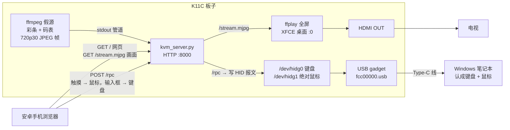
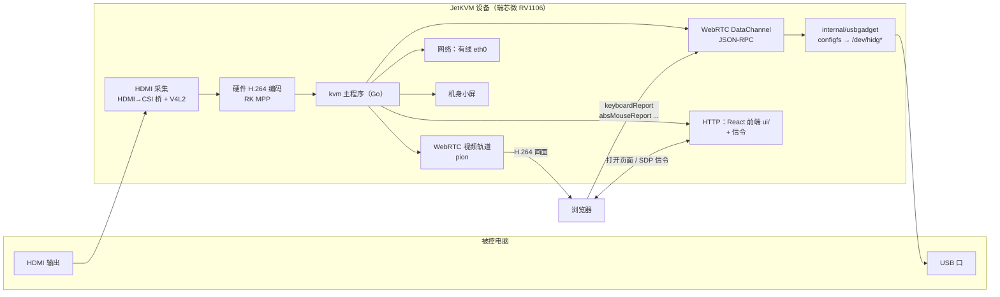

# 14 — 用 K11C（RK3566）验证 JetKVM 式 IP-KVM（假源版）

> **上半部分（§1–§5）给人看**：这一轮要证明什么、板子上数据怎么走、JetKVM 里搬什么、做到哪了、要你配合什么。
> **下半部分（§6–§9）给 AI 看**：执行规则、环境速查、已知坑、**按顺序一件一件闭环的任务清单**。
> 编译 / 烧录链：`13_KICKPI_K11C_RK3566_编译烧录.md`。
> 旧版（10-17，Q1–Q18 长篇论证）已归档到 `归档\14_K11C做JetKVM式IP-KVM_方案_旧版_20261017.md`，
> **只当证据库查，不再按它排期**（它里面有几条已被 10-18 实测推翻，见 §4 末尾）。

---

# 上半部分 · 给人看

## 1. 这一轮要证明什么

**一句话**：在 K11C 上先把 JetKVM 的"浏览器 ↔ 板子 ↔ 被控电脑"整条链路跑通，
画面暂时用**板子自己生成的彩条 + 码表**代替。三条都过了，再去打一块带 HDMI 输入的板子，
那时只需要把"彩条"这一块换成"采集到的电脑画面"，其余不动。

| # | 验收项 | 怎么算过 |
|---|---|---|
| **①** | 安卓手机连 WiFi，用浏览器**控制电脑的鼠标和键盘** | 手机上点/划，电脑光标跟着走、能点击；手机输入框里打的字出现在电脑记事本里 |
| **②** | 手机浏览器里**看得到彩条 + 码表** | 码表数字在走（不是一张静止图） |
| **③** | 板子 HDMI OUT 接电视，**电视上也是彩条 + 码表** | 电视上码表在走；手机和电视拍同一张照片，两个码表的差值 = 手机这一路比电视多出来的延迟 |

**这一轮不做**：HDMI 输入/采集（K11C 硬件上没有）、H.264/WebRTC（MJPEG 足够验证）、
安全/登录、虚拟光驱、远程开关机、云。

> ⚠️ **先把一件事说清楚**：手机上看到的是彩条，**不是电脑桌面**。
> 所以这一轮用手机控制电脑时是"盲操"——要看电脑自己的屏幕确认光标和字。
> 这正是这一轮的边界：**画面通路**（②③）和**控制通路**（①）分开验证；
> 将来 HDMI 输入进来，把彩条换成电脑画面，两条合在一起就是完整的 KVM。

板子实测生成的画面（10-18，板上 ffmpeg 渲染、从串口拉回来的一帧，码表 = 从启动开始的 时:分:秒.毫秒）：


## 2. 当前板子：接线、数据流、要做的事

### 2.1 物理接线

```
  ┌──────────────────── Windows 笔记本（被控电脑）────────────────────┐
  │   USB-A ◄════ Type-C 数据线 ════╗        USB-A ◄── FT232 调试线 ─╗ │
  └─────────────────────────────────╫────────────────────────────────╫─┘
                                    ║ 板子在电脑眼里 =                ║ 只给 AI 调试用
                                    ║ 键盘 + 鼠标 + COM15             ║ (COM14, 1500000)
  ┌──────────────────────── K11C 板子 ╫────────────────────────────────╫─┐
  │  Type-C（device 模式）◄══════════╝            DEBUG 引脚 ◄────────╝ │
  │  HDMI OUT ═══════════════════════════════════════════════► 电视      │
  │  WiFi(wlan0) ⟿⟿⟿ 路由器 ⟿⟿⟿ 安卓手机（浏览器）                    │
  │  DC 原装电源（独立供电，Type-C 只走数据）                             │
  └───────────────────────────────────────────────────────────────────────┘
```

### 2.2 软件数据流（板子里跑什么、数据往哪走）



**一个进程管三件事**：`kvm_server.py` 发网页、推画面（MJPEG）、收控制命令（JSON-RPC）写到 `/dev/hidg*`。
电视那一路就是板子自己的桌面全屏播放本机的同一路画面，所以手机和电视上的码表来自**同一帧**，能直接比延迟。

### 2.3 板子上要做的事

| 模块 | 干什么 | 现在状态 |
|---|---|---|
| USB gadget（`k11c-gadget.sh` + 开机服务） | 开机把 Type-C 变成键盘 + 绝对坐标鼠标 + 串口 | ✅ 已烘进镜像；10-18 Windows 认到 `MI_00 键盘 / MI_01 鼠标 / MI_02 COM15` |
| COM15 登录 | 不靠网络、不靠 FT232 也能进板子 | ⬜ 串口通了，但上面没挂登录程序（T1） |
| WiFi + SSH | 手机能访问板子；AI 能传文件 | ⬜ 网卡正常、能扫到 2.4G/5G 热点；**等你给 WiFi 名和密码**（T2） |
| 假源 | ffmpeg 生成彩条 + 码表 | 🟡 命令已在板上实测出帧，还没做成服务（T4） |
| `kvm_server.py` | 网页 + MJPEG + RPC 一个进程 | ⬜ 在现有 `k11cd.py`（RPC 部分已写）上扩（T4/T6） |
| 手机网页 `index.html` | 显示画面 + 触摸当鼠标 + 输入框当键盘 | ⬜（T7） |
| 电视输出 | 板子桌面全屏播放本机画面 | ⬜ 桌面已自动登录在 HDMI-1 上，**等你插电视**（T5） |
| 开机自启 | 上电后三条验收自己就绪 | ⬜（T8） |

**全部是用户态软件，不用重编内核、不用再烧固件。** 改动直接写进板子 eMMC，重启保留。

## 3. JetKVM 原版是怎么跑的，我们搬什么

### 3.1 JetKVM 原版流程



浏览器打开页面后和设备建 WebRTC 连接：**画面走视频轨道**，**键鼠走 DataChannel 上的 JSON-RPC**，
主程序收到 `keyboardReport` / `absMouseReport` 就写成 HID 报文发到 `/dev/hidg*`，被控电脑当成真键鼠。
（采集桥的具体芯片型号、原生层是独立进程还是并进主程序，本文没核对源码，不影响本轮。）

### 3.2 逐块对照：本轮在 K11C 上用什么替

| JetKVM 模块 | 本轮 K11C | 将来 HDMI 输入板 |
|---|---|---|
| HDMI 采集 | **ffmpeg 假源**（彩条 + 码表） | 采集芯片 → `/dev/videoN`，**只换这一块** |
| H.264 硬编 + WebRTC 视频轨道 | **软编 MJPEG over HTTP**（实测 720p30 约 5.4 Mbps） | 板上已有 `mpph264enc`（GStreamer 硬编插件），届时再上 H.264/WebRTC |
| JSON-RPC over DataChannel | **同名方法**的 JSON-RPC over HTTP POST | 保留 |
| `usbgadget` configfs HID | `k11c-gadget.sh`，描述符照抄 JetKVM ✅ 已完成 | 不变 |
| React 前端 `ui/`（160 个文件） | **1 个 `index.html`**，只照搬它的输入换算思路 | 需要时再搬 `ui/` |
| 有线网络 | **WiFi**（NetworkManager） | 不变 |
| 机身小屏 | **HDMI OUT → 电视**（我们多出来的） | 用途再定 |
| 云、Tailscale、登录、虚拟光驱、ATX 开机、音频 | 不做 | 按需 |

**"移植"真正落到三件事**：
1. **HID 报文与描述符**（键盘 8 字节、绝对鼠标 0–32767）—— ✅ 已搬完并实测打字成功；
2. **JSON-RPC 方法名与参数**（`keyboardReport` / `absMouseReport` / `wheelReport`）—— 已写进 `k11cd.py`，本轮扩成网页能调；
3. **前端输入换算**（触摸位置 → 0–32767、字符 → 键码）—— 本轮在 `index.html` 里实现最小版。

视频那一路 JetKVM 绑死 RV1106 + 采集硬件，**搬不动也不用搬**，本轮用假源替，将来用采集芯片替。
许可证：JetKVM 是 GPL-2.0，自用不分发没有义务；**哪天要公开/分发，抄过的部分要一起开源**。

### 3.3 将来做 HDMI 输入板要知道的一件事

RK3566 芯片本身**没有 HDMI 输入**，新板子必须加一颗 **HDMI → MIPI-CSI 桥芯片**接到 RK3566 的摄像头接口
（PiKVM、开源项目 espkvm 用的是东芝 TC358743；龙迅 LT6911 系列也是这类，**都只是举例，没选型**）。
最大工作量在桥芯片的驱动和设备树，而不是本轮这些软件 —— 本轮链路做通后，那时只把 `ffmpeg 假源` 换成 `/dev/videoN`。

## 4. 做到哪了（10-18 凌晨实测）

| 项 | 状态 | 证据 |
|---|---|---|
| 自编内核：HID gadget + Type-C 写死 device 模式 | ✅ | `uname -v` = `#3 SMP Fri Oct 16 13:32:40 EDT 2026` |
| Windows 认出键盘 + 鼠标 + COM15 | ✅ 10-18 | `Get-PnpDevice`：`USB\VID_1D6B&PID_0104` 的 `MI_00/MI_01/MI_02` 全部 OK |
| 板子发字、绝对鼠标定位 | ✅ 10-17 | 剪贴板读回 `HELLO NZS`；发 (0.5, 0.5) 光标到 `959,539` |
| 板上已有 ffmpeg 6.1、GStreamer 硬编插件、`/dev/mpp_service` | ✅ 10-18 | **不需要联网装软件** |
| 彩条 + 码表生成 | ✅ 10-18 | 上面那张图；10 秒 300 帧、6.8 MB ≈ 5.4 Mbps |
| WiFi 网卡 | 🟡 10-18 | `wlan0` 能扫到 `Duck`（2.4G）、`Duck_5G`（5G）等，**未连接** |
| 桌面在 HDMI 上 | 🟡 10-18 | 自动登录 XFCE，`xrandr` 里有 `HDMI-1`（现在 disconnected，没插电视） |
| COM15 能登录 | ❌ | 没有挂 getty |
| SSH | ❌ | 已装，未启用 |
| 网页 / 电视 / 开机自启 | ⬜ | — |

**旧版里被 10-18 实测推翻的说法**（以本表为准）：
"板子大概率没有 ffmpeg、要先联网 apt 装" → 已经装好了；
"COM15 就是控制台" → 只是 COM 口，上面没登录程序；
"HDMI OUT 前期不接" → 现在要接电视；
"Windows 不认、卡在物理连接" → 10-18 已正常枚举。

## 5. 要你配合的（按出现顺序）

| 何时 | 你做什么 |
|---|---|
| T2 前 | 给 **WiFi 名 + 密码**（扫到的 `Duck` / `Duck_5G` 是你的吗？名字必须是英文）；最好在路由器里给板子 MAC `60:48:9c:b7:57:d4` 绑固定 IP |
| T5 前 | 把电视用 HDMI 线接到板子，电视切到对应信源 |
| T7 | 安卓手机连同一个 WiFi，浏览器打开 AI 给你的地址，按清单试 5 个动作 |
| T9 | 拍一张手机和电视**同框**的照片 |

---

# 下半部分 · 给 AI 看

## 6. 执行规则（先读完再动手，违反任何一条就停下来问人）

1. **只按 §9 的顺序做，一次只做一个任务。** 前一个任务"验收"没有全部通过，不许开始下一个。
2. **每个任务做完立刻回写本文档**：把 `- [ ]` 改成 `- [x]`，在下面加一行 `实测(MM-DD)：<命令输出里证明通过的那一行>`。
   只许贴**量出来的结果**，不许写"应该可以""大概率""理论上"。
3. **不许改上半部分的结论和范围**，不许新增 Q 编号、长篇论证、新阶段。觉得上半部分错了，写到 §8.3「待人确认」，然后停。
4. 需要人做的动作（给密码、插线、插电视、看手机、拍照）—— **停下来，一句话说清楚要人干什么**，等人回复。
5. **本轮不重编内核、不烧固件**。觉得必须重编，停下问人。
6. 代码的**唯一源头**在 Windows：`D:\win_game_project\26_k11c_kvm\board\`。改代码先改这里，再传到板子 `/opt/k11c-kvm/`。
   不许只在板子上改而不回传。
7. 脚本里**不许用 `|| true` 吞错误**；ffmpeg 一律加 `-nostdin`。
8. git：**禁止 `git add -A`**；只 add 本文档和 `26_k11c_kvm/` 下你改过的文件；提交前问人。
9. 每完成一个任务，在 `D:\win_game_project\03_ai的记忆_和skill\04_workbuddy_记忆与skill\日志\<当天>.md` 追加 3–5 行：做了什么、踩了什么坑。

## 7. 环境速查

### 7.1 怎么进板子

| 通道 | 用法 | 备注 |
|---|---|---|
| **COM14**（FT232 调试串口） | `powershell -File D:\win_game_project\26_k11c_kvm\host\serial_probe.ps1 -Port COM14 -Baud 1500000 -CommandFile <命令文件> -TimeoutSec 30` | 命令文件**一行一条**，脚本每条都等哨兵再发下一条。已登录为 `kickpi` 的 shell |
| 从板子拉小文件 | `powershell -File ...\host\pull_b64.ps1 -Remote /tmp/x.jpg -Local D:\...\x.jpg` | 分块 base64 + 每行校验；**不要一次性 cat 大文件**，串口会丢字节 |
| COM15（Type-C 上的 ACM） | T1 之后可用，波特率随意（115200） | T1 之前上面没有 shell |
| SSH | T2 之后：`ssh k11c`（别名在 T3 配） | 现在未启用 |
| sudo | 串口里用 `echo kickpi \| sudo -S <命令>`；要往 `sudo tee` 里管道写内容时，先单独跑一次 `echo kickpi \| sudo -S true` 缓存口令 | 账号 `kickpi/kickpi`，`root/root` |

### 7.2 板子事实（10-18 实测）

| 项 | 值 |
|---|---|
| 系统 | Ubuntu 24.04，内核 `6.1.141 #3`，4 核 A55，内存 1956 MB，根分区剩 7.8 G |
| 软件 | Python 3.12.3；ffmpeg 6.1.1（有 `mjpeg`、`libx264`、`x11grab`、`kmsgrab`、`sdl2`、`xv`）；`ffplay`、`chromium`、`firefox`、`xrandr`；GStreamer `mpph264enc`/`mppjpegenc`/`kmssink`/`rkximagesink`；`nmcli`、`wpa_supplicant`、`avahi-daemon`(active) |
| 字体 | `/usr/share/fonts/truetype/dejavu/DejaVuSansMono-Bold.ttf` 存在 |
| 网络 | `wlan0` MAC `60:48:9c:b7:57:d4`（NetworkManager 管理，disconnected）；`end1` 有线（备胎，没插） |
| 桌面 | lightdm 自动登录 `kickpi`，XFCE + Xorg；`DISPLAY=:0`，`XAUTHORITY=/home/kickpi/.Xauthority`；输出口名 **`HDMI-1`**；drm 状态文件 `/sys/class/drm/card0-HDMI-A-1/status` |
| 时钟 | **板子时间是错的**（显示 2026-03-24，无 NTP）。码表用"从启动开始的时间"，不依赖时钟，**不用修** |
| USB gadget | VID:PID `1d6b:0104`；`/dev/hidg0` 键盘、`/dev/hidg1` 绝对鼠标、`/dev/ttyGS0` ACM；**没有 `/dev/hidg2`**（相对鼠标没挂）；UDC `fcc00000.usb`，`state=configured` |
| 开机服务 | `k11c-gadget.service` enabled；官方 `usb-gadget.service` 已 mask ⇒ **没有 adb** |
| 已失败但无关的服务 | `apport`、`fwupd-refresh`、`networking`、`rockchip` —— 本轮不用管 |
| 当前固件 | `D:\02_baidu\自建镜像\K11C_v12_ubuntu2404_selfbuild-P2hid-noadb-20261017.img`（md5 `467b9973a4804a5944955ff8128f9daa`） |
| 被控电脑 | 本机 LENOVO 82AV，1920×1080，**装了中文输入法** |
| 编译 VM | `ssh rk-vm`（`rk@192.168.234.141`，SDK `~/k11c/rk-linux6.1-2026091606`）—— **本轮用不到** |

### 7.3 HID 报文格式（写 `/dev/hidgN` 的原始字节）

| 设备 | 报文 | 说明 |
|---|---|---|
| `/dev/hidg0` 键盘 | 8 字节 `[mod, 0, k1, k2, k3, k4, k5, k6]` | 每次"按下"后**必须再发一个全 0 报文**表示松开，否则电脑会一直重复那个键 |
| `/dev/hidg1` 绝对鼠标 | 6 字节 `[0x01, buttons, xL, xH, yL, yH]` | x、y 范围 0–32767，小端；buttons：bit0 左、bit1 右、bit2 中 |
| `/dev/hidg1` 滚轮 | `[0x02, wheel, pan]`（有符号 8 位，正 = 向上） | 描述符里 Report ID 2 只有 2 个数据字节。**旧 `k11cd.py` 写的是 6 字节，未上板验证**，以 T6 实测为准 |

修饰键 `mod`：左 Ctrl `0x01`、左 Shift `0x02`、左 Alt `0x04`、左 Win `0x08`。
常用键码：`a`–`z` = `0x04`–`0x1d`；`1`–`9` = `0x1e`–`0x26`；`0` = `0x27`；Enter `0x28`；Esc `0x29`；Backspace `0x2a`；Tab `0x2b`；
空格 `0x2c`；`-` `0x2d`；`=` `0x2e`；`[` `0x2f`；`]` `0x30`；`\` `0x31`；`;` `0x33`；`'` `0x34`；`` ` `` `0x35`；`,` `0x36`；`.` `0x37`；`/` `0x38`；
Delete `0x4c`；→ `0x4f`；← `0x50`；↓ `0x51`；↑ `0x52`。大写字母和 `!@#` 等 = 对应键 + Shift。

### 7.4 现有代码（`D:\win_game_project\26_k11c_kvm\`）

| 文件 | 是什么 |
|---|---|
| `gadget/k11c-gadget.sh` + `systemd/k11c-gadget.service` | 开机装配 USB gadget（已在板上，**本轮不要动**） |
| `port/k11cd.py` | JSON-RPC 子集（标准库），方法名与 JetKVM 一致。**已知问题**：写 HID 是阻塞的（电脑不收就卡死）；滚轮写 6 字节；`relMouseReport` 写不存在的 `hidg2`；`getUsbEmulationState` 判断键名写错 |
| `port/PORTING.md` | JetKVM 方法子集与取舍（参考） |
| `host/serial_probe.ps1`、`host/pull_b64.ps1` | 串口执行命令 / 从板子拉文件 |
| `host/quick_check.ps1` | Windows 侧一把查 `1D6B` 设备 |
| `board/` | **本轮新代码放这里**（T3 建） |

## 8. 已知坑

### 8.1 本轮相关（每条都实际踩过或已核实）

| # | 现象 | 原因 / 做法 |
|---|---|---|
| 1 | ffmpeg 在串口/脚本里跑，**一帧都没出**，报 `received no packets` | ffmpeg 读标准输入当快捷键，下一行命令开头的 `q` 被当成"退出"。**一律加 `-nostdin`**（10-18 踩到） |
| 2 | `drawtext` 报 `Unterminated %{}` | 冒号要多一层引号。验证过的写法（bash 双引号里）：`text='%{pts\:hms}'` |
| 3 | 串口回传的数据少了一截 | 串口一次性传大量数据会丢字节。用 `pull_b64.ps1` 分块拉；命令一条一条发 |
| 4 | 写 `/dev/hidg*` 卡住不返回 | 电脑没在收报文（睡眠、线拔了、还没枚举）时 `write` 会阻塞。用 `os.open(path, os.O_WRONLY \| os.O_NONBLOCK)`，遇到 `BlockingIOError` 丢掉这一帧，**不能让整个服务卡住** |
| 5 | 板子发的字母没进记事本，进了输入法候选框 | 电脑开着中文输入法。测试前发 `Ctrl+Space` 切英文；网页上要有"切输入法"按钮 |
| 6 | 安卓浏览器软键盘打字，`keydown` 的 `keyCode` 全是 229 | 安卓输入法不报真实键码。**不要靠 keydown**：用输入框的 `input` 事件 / "发送"按钮拿到文字，服务端把字符翻译成键码（`typeText`） |
| 7 | 手机划动时光标一卡一卡、服务端 CPU 高 | 触摸事件太密。前端节流：每 30 ms 最多发一次，只发最新位置 |
| 8 | 电视黑屏 / 过几分钟黑屏 | 电视开机后才插 HDMI，X 不一定自动点亮 → `xrandr --output HDMI-1 --auto`；屏保/省电 → `xset s off -dpms s noblank` 并停掉 `xfce4-screensaver` |
| 9 | root 跑的程序在电视上显示不出来 | X 程序要 `DISPLAY=:0 XAUTHORITY=/home/kickpi/.Xauthority`，并且最好以 `kickpi` 用户跑。开机自启走 XFCE 的 `~/.config/autostart/`，不要用 root 的 systemd 服务去开窗口 |
| 10 | 手机和电视只有一个能看 | ffmpeg 自带的 `-listen 1` HTTP **只接一个客户端**。必须由 `kvm_server.py` 自己发流：所有客户端共享"最新一帧"，慢的客户端跳帧，不排队 |
| 11 | 手机打不开 `kickpi.local` | 安卓不保证支持 mDNS。**给手机用 IP 地址** |
| 12 | PowerShell 里 `curl` 发 JSON 引号乱掉 | PowerShell 的 `curl` 是别名。用 `Invoke-RestMethod -Method Post -ContentType 'application/json' -Body $json` |
| 13 | 在电脑浏览器里测网页，鼠标乱飞 | 电脑浏览器控制的就是这台电脑，自己控制自己会形成回环。**网页只在手机上测**；电脑上只用 `Invoke-RestMethod` 测 RPC |

### 8.2 USB gadget 层（已解决，**不要再碰**；细节见 skill `usb-gadget-hid-bringup`）

- 不要用官方 VID:PID `2207:0006`（Windows 的 Android 驱动会整台认领，键鼠不出现）；
- configfs 顺序：解绑 → 建 function → 链进 config → 绑定；`ln -s` 不许吞错误；
- 6.1 内核的 hid function 没有 `wakeup_on_write`；
- `serialnumber` 不能为空；
- `/sys/class/udc/*/state` 解绑后不会变回去，不能单靠它判断。

### 8.3 待人确认（AI 发现上半部分有问题时写这里，然后停）

- （空）

## 9. 任务清单（按顺序，一件一件闭环）

> 每个任务格式固定：**目的 / 前置 / 人要做 / 步骤 / 验收 / 失败时**。
> 验收里的每一条都要有命令输出作证，全部满足才能打勾。

### T0 现状核对（只读）

- [x] 已完成
- 实测(10-18)：Windows `Get-PnpDevice` 有 `USB\VID_1D6B&PID_0104\00000001` + `MI_00` 键盘 + `MI_01` 鼠标 + `MI_02` COM15；
  COM14 登录为 `kickpi`；`/sys/class/udc/*/state` = `configured`；`/dev/hidg0 /dev/hidg1 /dev/ttyGS0` 存在；
  `ffmpeg` 6.1.1 在；720p 彩条 + 码表 MJPEG 编码出帧（见上半部分截图）。

### T1 COM15 变成登录控制台（不依赖网络的保底通道）

- [ ] 未开始
- **目的**：WiFi 配错、SSH 起不来时，只靠 Type-C 那根线也能进板子。
- **前置**：T0。**人要做**：无。
- **步骤**（通过 COM14 执行）：
  ```bash
  echo kickpi | sudo -S true
  sudo mkdir -p /etc/systemd/system/serial-getty@ttyGS0.service.d
  printf '[Service]\nExecStart=\nExecStart=-/sbin/agetty --autologin kickpi --noclear %%I 115200 linux\n' | sudo tee /etc/systemd/system/serial-getty@ttyGS0.service.d/autologin.conf
  sudo systemctl daemon-reload
  sudo systemctl enable --now serial-getty@ttyGS0.service
  systemctl is-active serial-getty@ttyGS0.service
  ```
- **验收**：
  1. `systemctl is-active serial-getty@ttyGS0.service` 输出 `active`；
  2. 在 Windows 上用 `serial_probe.ps1 -Port COM15 -Baud 115200` 执行 `whoami; tty`，输出 `kickpi` 和 `/dev/ttyGS0`。
- **失败时**：`journalctl -u serial-getty@ttyGS0 -n 30 --no-pager` 看原因，贴进日志后停下问人。不要改 gadget 脚本。

### T2 连 WiFi + 开 SSH

- [ ] 未开始
- **目的**：手机和 AI 都能通过网络访问板子。
- **前置**：T1。**人要做**：给 WiFi 名称和密码（停下来问；人没给就不要往下做）。
- **步骤**（COM14 或 COM15）：
  ```bash
  echo kickpi | sudo -S nmcli dev wifi connect "<SSID>" password "<密码>" ifname wlan0
  nmcli -t -f GENERAL.STATE,IP4.ADDRESS dev show wlan0
  nmcli -t -f NAME,AUTOCONNECT con show
  echo kickpi | sudo -S systemctl enable --now ssh
  systemctl is-active ssh
  ```
- **验收**：
  1. `IP4.ADDRESS` 有地址，记为 `<板子IP>`，**写进本文档 §7.2 的"网络"那一行**；
  2. Windows 上 `Test-NetConnection <板子IP> -Port 22` 的 `TcpTestSucceeded` = `True`；
  3. 板子 `sudo reboot`，开机后**不做任何操作**，`nmcli` 显示 `wlan0` 已连接，IP 不变（变了就请人在路由器里按 MAC 绑定，然后重测）。
- **失败时**：`nmcli dev wifi list` 看信号；`journalctl -u NetworkManager -n 50 --no-pager`。SSID 含中文就停下请人换英文名。

### T3 建部署通道（免密 SSH + 目录）

- [ ] 未开始
- **目的**：之后改代码可以一条命令传到板子，不再靠串口。
- **前置**：T2。**人要做**：无。
- **步骤**：
  1. Windows：`Get-Content $env:USERPROFILE\.ssh\id_ed25519.pub` 拿公钥（没有就 `ssh-keygen -t ed25519`）；
  2. 通过串口在板子上：`mkdir -p ~/.ssh && chmod 700 ~/.ssh && echo '<公钥整行>' >> ~/.ssh/authorized_keys && chmod 600 ~/.ssh/authorized_keys`；
  3. Windows `~\.ssh\config` 追加：
     ```
     Host k11c
       HostName <板子IP>
       User kickpi
       IdentityFile ~/.ssh/id_ed25519
       IdentitiesOnly yes
     ```
  4. 板子：`echo kickpi | sudo -S install -d -o kickpi -g kickpi /opt/k11c-kvm`；
  5. Windows 建目录 `D:\win_game_project\26_k11c_kvm\board\`。
- **验收**：
  1. `ssh -o BatchMode=yes k11c 'echo SSH_OK; ls -ld /opt/k11c-kvm'` 输出 `SSH_OK` 且目录属主 `kickpi`；
  2. `scp` 一个测试文件到 `/opt/k11c-kvm/` 再 `ssh k11c md5sum` 与 Windows `Get-FileHash -Algorithm MD5` 一致。

### T4 假源 + MJPEG 服务（验收 ② 的板子侧）

- [ ] 未开始
- **目的**：板子上一个服务持续产生彩条 + 码表，任何浏览器打开都能看到在走的画面。
- **前置**：T3。**人要做**：无。
- **要写的文件**（都放 `board\`，写完 scp 到 `/opt/k11c-kvm/`）：
  1. `fakesrc.sh` —— 只做一件事，把 JPEG 帧连续写到标准输出：
     ```bash
     #!/bin/sh
     exec ffmpeg -nostdin -hide_banner -loglevel warning -re \
       -f lavfi -i smptehdbars=s=1280x720:r=30 \
       -vf "drawtext=fontfile=/usr/share/fonts/truetype/dejavu/DejaVuSansMono-Bold.ttf:text='%{pts\:hms}':fontsize=64:fontcolor=white:box=1:boxcolor=black:x=(w-tw)/2:y=h-th-40" \
       -c:v mjpeg -q:v 6 -f image2pipe -
     ```
  2. `kvm_server.py` —— 只用 Python 标准库，`ThreadingHTTPServer` 监听 `0.0.0.0:8000`：
     - 启动时用 `subprocess.Popen` 跑 `fakesrc.sh`，一个线程从它的 stdout 读字节，按 JPEG 头 `FF D8` / 尾 `FF D9` 切成一帧一帧，
       只保存**最新一帧** + 帧计数，用 `threading.Condition` 通知等待的客户端；ffmpeg 退出就等 1 秒重启；
     - `GET /stream.mjpg`：`Content-Type: multipart/x-mixed-replace; boundary=frame`，每帧写
       `--frame\r\nContent-Type: image/jpeg\r\nContent-Length: <N>\r\n\r\n<JPEG>\r\n`；每个客户端一个线程，只取最新帧（坑 10）；
     - `GET /snapshot.jpg`：返回最新一帧；
     - `GET /state`：JSON `{"fps": 最近 5 秒平均帧率, "clients": 当前看流的客户端数, "uptime_s": ...}`；
     - `GET /`：返回 `www/index.html`（T7 才写，现在先返回一行文字）。
- **验收**：
  1. 板子：`curl -s -o /tmp/s.jpg http://127.0.0.1:8000/snapshot.jpg && file /tmp/s.jpg` 显示 `JPEG image data ... 1280x720`；
  2. 隔 1 秒取两张 snapshot，`md5sum` 不同（码表在走）；
  3. Windows：`Invoke-WebRequest http://<板子IP>:8000/state` 的 `fps` 在 28–31 之间；
  4. Windows：`Invoke-WebRequest http://<板子IP>:8000/snapshot.jpg -OutFile D:\win_game_project\26_k11c_kvm\host\t4.jpg`，打开图片看：彩条 + 码表；
  5. 板子 `top -bn1 | grep ffmpeg` 记下 CPU%，写进实测行。
- **失败时**：先单独跑 `sh fakesrc.sh | head -c 100000 | wc -c` 看 ffmpeg 有没有出数据；再查服务端切帧。

### T5 电视输出（验收 ③）

- [ ] 未开始
- **目的**：电视上全屏显示同一路彩条 + 码表。
- **前置**：T4。**人要做**：把电视接到板子 HDMI，电视切到这个信源（停下来请人接，接好再继续）。
- **步骤**：
  1. `cat /sys/class/drm/card0-HDMI-A-1/status` 应为 `connected`；
  2. `export DISPLAY=:0 XAUTHORITY=/home/kickpi/.Xauthority; xrandr`：`HDMI-1 connected` 且有分辨率；没点亮就 `xrandr --output HDMI-1 --auto`；
  3. 关屏保：`xset s off -dpms s noblank; pkill xfce4-screensaver`；
  4. 写 `board/tv.sh`（以 `kickpi` 身份在 X 里跑）：等 `http://127.0.0.1:8000/state` 能访问，然后循环执行
     `ffplay -fs -an -noborder -fflags nobuffer -flags low_delay -framedrop -f mpjpeg http://127.0.0.1:8000/stream.mjpg`，退出就 2 秒后重来；
  5. 先手动后台跑：`setsid sh /opt/k11c-kvm/tv.sh </dev/null >/tmp/tv.log 2>&1 &`。
- **验收**：
  1. 板子截桌面：`ffmpeg -nostdin -loglevel error -f x11grab -i :0 -frames:v 1 -y /tmp/tv1.jpg`，1 秒后再截 `/tmp/tv2.jpg`；
     两张 `md5sum` 不同，用 `pull_b64.ps1` 拉一张回来看：**全屏彩条 + 码表**，没有桌面边框；
  2. 问人：电视上是否看到彩条且码表在走（人回答"是"才算过）。
- **失败时**：ffplay 不认 `-f mpjpeg` 就换成 `chromium --kiosk --noerrdialogs http://127.0.0.1:8000/stream.mjpg`；
  `HDMI-1` 一直 `disconnected` 就停下问人（换线/换电视口），不要改设备树。

### T6 RPC 控制（验收 ① 的板子侧，只用电脑命令测，不碰手机）

- [ ] 未开始
- **目的**：`POST /rpc` 能把键鼠命令可靠地变成电脑上的动作。
- **前置**：T4（T5 不阻塞，可以并行等人插电视）。**人要做**：无。
- **步骤**：把 `port/k11cd.py` 的 RPC 部分并进 `kvm_server.py`（`POST /rpc`），同时改掉 §7.4 列的已知问题：
  - HID 用非阻塞打开（坑 4），写失败返回 JSON-RPC 错误，不卡线程；
  - 去掉 `relMouseReport`（没有 `hidg2`）；
  - 滚轮按 §7.3 写 `[0x02, wheel, 0]`；
  - 新增 `typeText {text}`：逐字符查表（§7.3）→ 按下报文 → 全 0 松开报文，每字符间隔 10 ms；只支持可打印 ASCII，其它字符跳过并在返回值里计数；
  - 新增 `keyCombo {modifiers, key}`：按下 + 松开一次（给 Ctrl+A、Ctrl+Space、Win、Ctrl+Alt+Del 用）。
- **验收**（全部在 Windows PowerShell 里做）：
  1. 鼠标：`absMouseReport {x:16384, y:16384, buttons:0}` 后，
     `Add-Type -AssemblyName System.Windows.Forms; [System.Windows.Forms.Cursor]::Position` 在 `960,540` ±3；
  2. 键盘：打开记事本并置前 → `keyCombo` 发 `Ctrl+Space` 确认英文（坑 5）→ `typeText "Hello K11C 123!"` →
     `keyCombo` Ctrl+A、Ctrl+C → `Get-Clipboard` 完全等于 `Hello K11C 123!`；
  3. 滚轮：记事本里用 `typeText` 打 60 行（每行后发 Enter）、`keyCombo` Ctrl+Home 回到顶部，鼠标移到记事本正文上，
     发 `wheelReport {y:-5}`（负数 = 向下）；前后各用 PowerShell `System.Drawing.Graphics.CopyFromScreen` 截一张屏，两张不同才算滚了；
  4. 不卡死：连续发 300 次 `absMouseReport`，总耗时 < 10 秒，且服务仍能回 `ping`。
- **失败时**：先在板子上直接 `printf` 原始字节写 `/dev/hidg1` 排除服务端问题；Windows 侧跑 `host/quick_check.ps1` 看设备还在不在。

### T7 手机网页（验收 ① ② 合起来）

- [ ] 未开始
- **目的**：手机一个页面里看到画面，并能控制电脑。
- **前置**：T6。**人要做**：手机连同一 WiFi，按下面"验收"清单逐条操作并回报结果。
- **要写的文件**：`board/www/index.html`，**单文件，不引任何外部 CDN**：
  - 上方 ``，宽度 100%；
  - **触摸板**：手指在画面上移动 → 按手指在图片里的相对位置算 `x = round(相对X × 32767)`、`y` 同理 → `absMouseReport`（节流 30 ms，坑 7）；
    轻点（移动 < 10 像素且 < 300 ms）→ 左键按下 + 松开；
  - 按钮行：左键、右键、双击、滚上、滚下；
  - 输入框 + "发送"按钮 → `typeText`；勾选框"发送后回车"；**不要用 keydown**（坑 6）；
  - 特殊键按钮：Enter、Backspace、Esc、Tab、← ↑ → ↓、Win、`切输入法`（Ctrl+Space）、Ctrl+Alt+Del；
  - 页面底部状态行：`/state` 的 fps、上一次 RPC 往返毫秒数；
  - 页面内 `fetch('/rpc', {method:'POST', body: JSON})`，失败时状态行变红。
- **验收**（请人在手机上做，AI 同时在电脑上取证）：
  1. 手机打开 `http://<板子IP>:8000/` 看到彩条且码表在走（**验收 ②**）；
  2. 手指在画面左上 → 右下划过，电脑光标跟着从左上走到右下（AI 读 `Cursor::Position` 取证）；
  3. 点"切输入法"后，在输入框打 `phone ok` 发送，电脑记事本出现 `phone ok`（AI 用 Ctrl+A/Ctrl+C + `Get-Clipboard` 取证）；
  4. 右键按钮在电脑桌面弹出右键菜单（人确认）；
  5. 状态行 RPC 往返 < 100 ms，写进实测行。
- **失败时**：手机打不开页面先查 T2（同一网段？）；能看画面不能控制就看 `kvm_server.py` 有没有收到 `/rpc`。

### T8 开机自启

- [ ] 未开始
- **目的**：板子上电后不用任何人操作，三条验收自己就绪。
- **前置**：T5、T7。**人要做**：最后一步请人确认电视和手机。
- **步骤**：
  1. `board/k11c-kvm.service`（root 跑，因为要写 `/dev/hidg*`）：
     `After=k11c-gadget.service network-online.target`，`Wants=network-online.target`，
     `ExecStart=/usr/bin/python3 /opt/k11c-kvm/kvm_server.py --host 0.0.0.0 --port 8000`，`Restart=always`，`RestartSec=2`，
     `WantedBy=multi-user.target`；装到 `/etc/systemd/system/` 并 `enable`；
  2. `board/k11c-tv.desktop` → 装到 `/home/kickpi/.config/autostart/`，`Exec=sh /opt/k11c-kvm/tv.sh`；
     `tv.sh` 开头加 `xset s off -dpms s noblank` 和 `xrandr --output HDMI-1 --auto`；
  3. 禁用 XFCE 屏保自启（`/home/kickpi/.config/autostart/xfce4-screensaver.desktop` 写 `Hidden=true`）。
- **验收**：`sudo reboot` 后计时，**120 秒内**全部满足，且期间没人碰板子：
  1. Windows 上 `1D6B` 三个设备在（`quick_check.ps1`）；
  2. `Invoke-WebRequest http://<板子IP>:8000/state` 的 fps 在 28–31；
  3. x11grab 截图是全屏彩条 + 码表；
  4. 人确认：电视有画面，手机刷新页面能看能控。
  把实际用了多少秒写进实测行。

### T9 量延迟、写结论

- [ ] 未开始
- **前置**：T8。**人要做**：手机和电视放在一起，拍一张同时看得清两个码表的照片发给 AI。
- **步骤**：读照片里两个码表 → 差值 = 手机比电视多的延迟；记录板子 `top` 里 `ffmpeg` 和 `python3` 的 CPU%、`/state` 的 fps、`nmcli -f IN-USE,SIGNAL,FREQ dev wifi` 的信号与频段。
- **验收**：把下面这张表填进 §4，三条验收（①②③）的状态改成 ✅：

  | 指标 | 数值 |
  |---|---|
  | 手机相对电视延迟 | ms |
  | 手机 RPC 往返 | ms |
  | 画面帧率 | fps |
  | ffmpeg / python3 CPU | % / % |
  | WiFi 频段 / 信号 | |
  | 上电到可用 | 秒 |

- 然后更新 `03_ai的记忆_和skill\00_START_新会话入口.md` 里 K11C 那一段的"进度"，**问人后**再提交 git。

### 本轮之后（**现在不做**，列出来只为别人问起时有答案）

- 画面改 H.264：板上已有 `mpph264enc`，配 WebRTC 才能在浏览器里低延迟播放，工作量明显大于本轮；
- 搬 JetKVM 前端的 `useKeyboard.ts` / `keyboardLayouts/*`（完整键盘布局、粘贴通道）；
- HDMI 输入板（§3.3）：选桥芯片 → 画板 → 驱动 + 设备树 → 把 `fakesrc.sh` 换成读 `/dev/videoN`。
