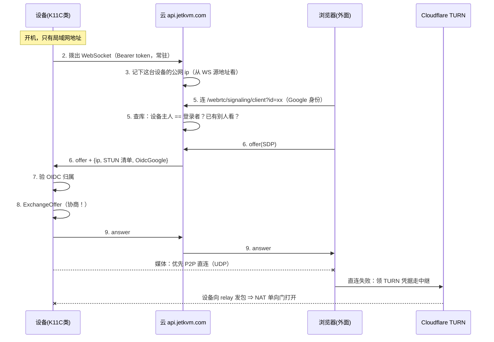

# 15 · KVM 公网连接方案（JetKVM 怎么做的 vs 我们现在是什么）

> 目的：一张图讲清"内网穿透"这件事在 IP-KVM 里到底长什么样，以及我们和 JetKVM 差在哪。
> 事实来源：他的三个仓库我 clone 到 `C:\Users\123456\AppData\Local\Temp\jetkvm-ref` 逐文件读过（10-27 晚）。
> 文中的 `cloud.go:472` 这类都是**他的文件行号**，不是我们的。我们自己的行号写全路径。
> 结论后面都带 **【已证】/【未证】**，未证的附验证方法。

---

## 0. 一句话先抓住本质

**JetKVM 不做"内网穿透"。他让设备永远只往外连，一个入站连接都不接。**

普通远程软件想的是"怎么从外面**打进来**"（端口映射 / 打洞 / 中继）。
他的思路是"既然外面进不来，那**里面先出去**"：设备开机就连一条 WebSocket 挂在云上不动，
等要看画面的人连上云，云把消息**顺着这条已经存在的洞**递给设备。
洞是设备自己挖的，所以家里路由器**什么都不用设**。

## 0.5 名词小抄（说人话版，读下面的图随时回来查）

| 名词 | 说人话 |
|---|---|
| **公网 IP** | 全世界都能找到的门牌号。家里宽带一般**没有**，只有路由器从运营商拿到的一个共享地址 |
| **NAT** | 小区门卫：里面几十台设备共用一个对外地址，**只出不进**——外面主动敲门的包会被丢掉 |
| **CGNAT** | 门卫上面还有个大门卫（运营商级共享）。判据：路由器 WAN 口拿到 `100.64.x.x`/`10.x`/`172.16-31.x` = 你根本没有独立公网地址，**端口映射白做** |
| **端口映射（转发）** | 拜托门卫："外面敲 8001 号门，请转交给 192.168.31.89"。需要① 有公网地址 ② 能在路由器上设 |
| **DDNS** | 门牌号会变，就用一个域名自动跟着变。本质还是"得有公网门牌号" |
| **内网穿透** | 不打洞也不想让门卫转发，就**从家里主动往外连一条常开的线**，外面的人顺着这条线把消息带回来 |
| **信令** | 打电话前的"接线员"：告诉双方"对方的地址、用什么端口、用什么编码"。**信令不通，后面全不通** |
| **ICE / 候选地址（candidate）** | WebRTC 自报家门的清单：`host`=自己的内网地址、`srflx`=打洞后别人看到的我的地址、`relay`=走中继拿到的地址 |
| **STUN** | 一个只会回答"我看你的来源地址是 X"的小服务器 ⇒ **只告诉你门牌号，不转发任何数据** |
| **TURN** | **中继站**：两边实在连不上，就把数据都交给它转发。一定能通，但**多一跳、要花钱/要额度** |
| **隧道 / WireGuard** | 两台机器之间封一条加密管道，各自得到一个"虚拟网内地址"（Tailscale 是 `100.x.y.z`），互相看成同一局域网 |
| **tailnet** | 你自己那一组装了 Tailscale 的设备组成的私有网络，一个账号管所有 |
| **DERP** | Tailscale 的兜底中继：打洞失败时，WireGuard 流量塞进 HTTPS 连接经它中转，**连 UDP 也带得动** |
| **OIDC / Google 登录** | 一种"让 Google 替你证明你是谁"的标准流程。JetKVM 用它来判断"这个浏览器是不是这台设备的主人" |
| **域名 / 证书** | 好记的名字 + HTTPS 需要的身份证。要走浏览器里的加密连接就绕不开 |

---

## 1. 我们现在是什么（局域网版）

```
【我们现在：两条腿都踩在局域网里】

  手机 / 笔记本（浏览器）  ──① 信令 HTTP（TCP :8001）──►  K11C 板子 192.168.31.89
                       ◄─② 画面 + 控制 WebRTC（DTLS over UDP）

  中间只有家里路由器 192.168.31.1：NAT，不转发任何端口，没有公网入口。

  板子内部（这一段全在 127.0.0.1，不出网口）：

      fakevo（读 HDMI 画面 → MPP 硬编 H.265 60fps）
           │ RTP over UDP 127.0.0.1:5004
           ▼
      k11c-gw（Go + pion，:8001 收信令、把 H.265 用 WebRTC 推给浏览器）
           │ HTTP POST 127.0.0.1:8000/rpc
           ▼
      kvm_server.py ──USB HID gadget──► 被控 Windows
      （电视是 HDMI 直出，不经过网络）

  ⇒ 出门就断的两处：
      ① 信令地址 192.168.31.89 在蜂窝网上不可路由  → 连 offer 都发不出去
      ② SDP 里只有 host 候选（局域网 IP）          → 就算信令通了也建不起来
```

**为什么出门就用不了**（两个地方同时卡死，缺一不可）：

| 卡点 | 我们的代码 | 症状 |
|---|---|---|
| **信令**：手机必须能连到 `http://192.168.31.89:8001` | `www/index.html:266` `var GW = 'http://' + location.hostname + ':8001'` | 蜂窝网上这个地址根本不可路由，第一步就失败 |
| **ICE 候选**：交换SDP 时板子只能报出自己的局域网地址 | `board/gw/main.go:117` `api.NewPeerConnection(webrtc.Configuration{})`（**空的，没 STUN 没 TURN**）；浏览器侧 `www/index.html:320` `new RTCPeerConnection()`（同样没填） | 就算信令通，两边拿到的地址互相也到不了 |

**【已证】这不是我们做坏了** —— 见下面第 4 节：JetKVM 的"局域网模式"和我们这版**行为完全一致**。

---

## 2. JetKVM 是怎么做的（公网版）

```
                    ☁ 公网：api.jetkvm.com（他自己也是架在 Cloudflare 后面）
```
【JetKVM：设备永远只往外连，入站一个都不接】

      ☁ 公网 api.jetkvm.com（他自己也挂在 Cloudflare 边缘后面），只存三样东西：
          activeConnections = deviceId → { ws, 设备的公网 ip, 版本 }
          inFlight          = 此刻正在看这台设备的观看者（只放 1 个）
          TURN 凭据          = 现场找 Cloudflare 托管 TURN 领（只发给浏览器）
        ▲                                          ▲
        │ ② 设备开机就拨一条 WS，一路挂着不断           │ ⑤ 观看者的 WS（带 Google 登录身份）
        │    Authorization: Bearer <长期 token>        │
   ┌────┴──────────────┐                   ┌─────────┴───────────┐
   │ 板子：在家里        │                   │ 浏览器：在外面        │
   │ 无公网IP、无端口映射 │                   │ app.jetkvm.com       │
   └────┬──────────────┘                   └─────────┬───────────┘
        │                                            │
        └─────── ⑨ 媒体：WebRTC UDP，**不经过云** ─────┘
                   直连成功 → P2P（最快）
                   直连失败 → 走 Cloudflare TURN 中继兜底
```

**九步走完一次连接**（括号里是他的文件行号）：

1. **配对**：App 出一个配对码 → 设备拿它换**长期 token**（`cloud.go:226` `POST {cloud}/devices/token`）。
2. **设备挂上去**：带 `Authorization: Bearer <token>` 主动拨一条 WebSocket 到云，
   头里报 `X-Device-ID / X-App-Version / X-Device-SKU`（`cloud.go:327-342`）。**这条洞就是后面所有的入口。**
3. **云顺手记下设备的公网地址**：`ip = REAL_IP_HEADER || socket.remoteAddress`（`webrtc-signaling.ts:156-158`）
   —— 云天然看得见是谁给它发的包，**这个 ip 存起来待会用**。
4. **心跳**：云每 10 秒 ping 设备，两次不回就 `terminate()`（`webrtc-signaling.ts:181-191`）；
   设备自己也发 WS ping（`web.go:318-353`）。断线重连由 `RunWebsocketClient` 的死循环负责（`cloud.go:499+`）。
5. **观看者到场**：浏览器带 Google session cookie 连 `/webrtc/signaling/client?id=<device>`，
   云查数据库确认**这台设备的主人就是当前登录者**才放行（`webrtc-signaling.ts:258-293`）；
   已经有别人在看就直接拒掉后来者（`:309-312`）。
6. **信令转发 + 加料**：浏览器的 offer 经过云时，**被塞进三样东西**再发给设备
   （`webrtc-signaling.ts:337-349`）：
   * `sd` —— 真正的 SDP；
   * `ip` —— 第 3 步记下的**设备自己的公网地址**；
   * `iceServers` —— 给设备的 STUN 清单（**注意：只有 STUN，TURN 被过滤掉了**，`:26-33`）；
   * `OidcGoogle` —— 观看者的 Google 身份 token。
7. **设备验身份**：先验这个 OIDC token，且必须等于设备绑定的主人，否则回 `google identity mismatch`
   （`cloud.go:400-426`）。
8. **设备组装 ICE**：把第 6 步收到的 `ip` **追加成自己的一条 srflx 候选**
   （`webrtc.go:461-475` `SetICEAddressRewriteRules{Append, AsCandidateType: srflx}`）
   —— **连 STUN 查询都省了**，因为云已经把答案告诉他了。
9. **媒体怎么走**：优先 P2P 直连；直连不上时靠 **浏览器手里的 TURN** 中继兜底 ——
   TURN 凭据是浏览器单独调接口领的，`ttl:3600`、`customIdentifier=user.id`，还把 `turns:` 滤掉
   （`cloud-api/src/webrtc.ts:100-138`）。**设备侧不领 TURN。**

> 🔎 第 9 步能成立的道理：设备为了发媒体，会先向"浏览器的 relay 地址"发包 ⇒ 家里 NAT 的单向门就开了 ⇒
> 中继再把包回给设备。**【未证】**：国内到 Cloudflare 那套 UDP/443 的实际成功率，得实测。

---

## 3. 时序图（同一件事，竖着看）



**注意第 8 步的位置**：协商是在**接管老会话之前**做的（`cloud.go:472-476`，`err != nil` 就直接 return，不碰 `currentSession`）。
这条正好是我们没做的那件事，见第 6 节。

---

## 4. 逐项对照（这张表就是你要的对比）

| 环节 | **我们现在** | **JetKVM** | 差多少 |
|---|---|---|---|
| 谁当信令服务器 | 板子自己 `:8001` | 云；设备拨出站 WS 挂上去 | 需要**一台公网机器**（或一条出站隧道） |
| 设备要不要公网 IP / 端口映射 | 要（其实只是要同网段可达） | **完全不要** | 这就是他方案的全部价值 |
| 设备的 ICE 候选 | 只有 host（局域网 IP） | host + 云回吐的 srflx（设备公网地址）+ STUN 清单 | 板子改 `webrtc.Configuration{}` 一处 |
| 浏览器侧 ICE | `new RTCPeerConnection()` 空的 | 领 Cloudflare TURN 临时凭据 | 页面改一处配置 |
| 中继兜底 | **没有** | 有（Cloudflare 托管 TURN，不是自建 coturn） | 要么买托管、要么自建 coturn |
| 身份认证 | 🔴 **零** | Google OIDC（设备侧还要比归属）+ 本地口令/token | 我们完全没做 |
| 多人同时看 | 后来者在 `GET /offer` 阶段**把先来者踢掉** | 云 `inFlight` **拒后来者**；设备**协商成功才 swap** | 他多一道云闸门，但**设备端也是后来者接管**（不是我们想象的"排队"） |
| 换人时 HID 状态 | 🔴 **不清** | 清（`CancelAllAutoReleaseTimers` + `rpcKeyboardReport(0, 清空键)`，两处） | **这是真 bug，见第 6 节** |
| 被踢的人看到什么 | 画面停住（硬切） | 收到 `otherSessionConnected` 事件 + 旧连接**睡 1 秒**才关 | 前端能显示人话 |
| 局域网模式 | 就是我们这版 | 他也有，`isCloud=false` 时**不填 ICE**（`web.go:202`） | **一模一样** |
| RTCP 反馈（丢包→强制关键帧） | 没做 | **也没做**（全仓 grep `PLI/OnRTCP/RequestKeyFrame` = 0 命中） | 谁先做谁领先 |

**一句话总结差距**：他不是"穿透技术更高明"，是**多养了一个公网服务**，
把"信令可达"和"打洞失败"这两件事外包给了云 + Cloudflare 的中继。

---

## 5. 我们要变成能公网用，三条路各自长什么样

### A. Tailscale（把穿透整包外包，**代码零改动**）

```
  [手机]--装App--┐                      ┌--装App--[K11C 板子]
                 ▼                      ▼
            tailnet（WireGuard mesh，两台拿到 100.x.y.z）
                 └────── 互相当成"同网段" ──────┘
   ⇒ 信令：http://100.x.y.z:8000 直接可达
   ⇒ 媒体：pion 收集 host 候选时会把 tailscale 网卡也算进去 ⇒ 还是"直连"
   ⇒ 打洞失败：整个 UDP 被 WireGuard 包进 DERP 中继，**连媒体也带得动**
```

* 优点：**不装服务器、不改一行网关代码**；免费版 3 用户 / 100 设备够用。
* 代价：**每台要用的设备都得装 App** ⇒ 借别人电脑/浏览器临时救急就做不到。
* 手机会变"全局 VPN"（所有流量先回家里）。
* 【未证】走 DERP 中继时多花多少延迟（估 +30~80 ms，要量得拍屏对码表）。
* 【已证】板子这边下载/登录/中继四个端点都通：`pkgs.tailscale.com` 200、`controlplane`/`login` 302、`derp9.tailscale.com:443` 200（10-27 实测）。

### B. 照他做（自建云 + TURN，**任何浏览器打开网址就行**）

```
  [任意浏览器] ──HTTPS──► 公网域名（你的服务器 / 复用他 cloud-api 那套 Node 代码）
                              │  ①信令：把 offer/answer 转给板子
                              ▼
  [K11C 板子] ──出站 WS──►  同一个公网域名        ←←← 板子仍然不需要公网 IP
       └── 媒体：两端都填 iceServers；直连不上就走 TURN（可买 Cloudflare 托管 TURN，有免费额度）
```

* 代码改动其实很小：网关 `webrtc.Configuration{ICEServers:[…]}` 一处 + 页面 `new RTCPeerConnection({iceServers})` 一处。
* **大头不在代码，在"你得有一台公网机器当信令入口，还得有个 TURN"**。

### C. B 的白嫖版：`cloudflared tunnel` 当信令入口 + Cloudflare 托管 TURN 当媒体兜底

* 板子上跑 `cloudflared`，它也是**主动往外连** Cloudflare 边缘 ⇒ 页面上变成 `https://一个域名`，家里照样零配置。
* 不用买 VPS，额度内免费；TURN 用的就是 JetKVM 同一个服务。
* 【未证】国内到 Cloudflare 的 UDP/443 稳不稳 —— **这条必须先实测再决定**。

### D. 传统端口映射 + DDNS（不推荐先做）

* 前提得先验：运营商给的是不是真公网 IPv4。
* 还要给 pion 设 `SetEphemeralUDPPortRange` 才能把 UDP 端口范围框死来映射。
* 🔴 **在补上认证之前绝对不许**：等于把一台能注键盘鼠标的机器裸奔在公网上。

### E. 只上 frp / 只穿 HTTP —— **不算方案**

* 它带不动 WebRTC 的 UDP 媒体，只能退回 `?mjpeg=1`；而 MJPEG 在固件里已经被 `--no-mjpeg` 关掉了。
* 只配"出门应急看一眼画面"，别指望手感。

### F. 那"直接接他的云"行不行？（10-27 把他注册流程也翻了）

**他云上的设备是怎么"入册"的**（全是代码事实）：

1. 设备屏幕出一个**配对码** → 你在 `app.jetkvm.com` 上走完 **Google 登录**；
2. 回调里云**直接把设备行写进数据库**：`device.upsert({ create: { id: deviceId, tempToken, tempTokenExpiresAt } })`
   （`cloud-api/src/oidc.ts:146-157`，tempToken **5 分钟**过期）；
3. 设备拿 tempToken 去换**长期 `secretToken`**（`devices.ts:95-110`：`findFirst({where:{tempToken}})` → 发 20 字节随机 token 存库）；
4. 以后每条 WS 都靠 `Authorization: Bearer <secretToken>` 认身份。

**他没有硬件验真** —— 第 2 步里的 `deviceId` 就是个**自由字符串**，云不会去查它是不是真 JetKVM。
所以"技术上能不能把我们板子塞进他的云"答案是"**没被密码学挡住**"。

**但四条理由让我们不该这么干**：

| # | 原因 | 证据 |
|---|---|---|
| 1 | 他的设备身份模型**和硬件绑死**，而且绑的是**他家芯片** | `kvm/hw.go:70-81`：deviceID = **读 RV1106 的芯片序列号**，读不到就直接写死 `"unknown_device_id"`。我们是 RK3566，**天生对不上** |
| 2 | 要走通就得**把他的整套设备端协议再实现一遍**（WS 消息格式、`otherSessionConnected` 等事件、hidrpc、版本/SKU 上报……） | 这比"自己搭一条隧道"贵得多，而且是他随时能改的东西 |
| 3 | 他烧的是**他自己付钱的 Cloudflare TURN 额度** | `cloud-api/src/webrtc.ts:140-154` 有个 `CreateTurnActivity` 按用户记 `bytesSent/bytesReceived` = **他的账单**。白嫖别人买单的中继不体面 |
| 4 | 前端 `app.jetkvm.com` 按他的 SKU/固件版本渲染，我们是"混进去的"设备 | 出问题没有解释权，他封一段 deviceId 就能让我们全瞎 |

**所以要分清三个"别人家的服务"**（这是最容易混的地方）：

| 服务 | 我们能用吗 | 怎么用 |
|---|---|---|
| **JetKVM 的云**（`api.jetkvm.com`） | ❌ 不能（上面四条） | — |
| **Cloudflare 托管 TURN**（他买的同一个） | ✅ 能，**自己注册** | 要有 Cloudflare 账号 + 自己的域名，开 Realtime 的 TURN key，有免费额度 |
| **Tailscale** | ✅ 能，**自己注册** | Google/GitHub 账号登录即可，免费档 3 用户 / 100 设备 |

**"自己注册"到底要做什么**（按麻烦程度排，人话版）：

* **A. Tailscale**：注册一个账号（用 Google 登录就行）→ 板子装一个包 → 手机装一个 App → 两边勾同一个账号。**我们的代码一行不改。** ← 推荐
* **B/C. 照他做**：买域名 + Cloudflare 账号 + 开 TURN + 板子上跑 `cloudflared` + 网关和页面各填一处 `iceServers`。**任何浏览器打开网址就能用**（不用装 App），但要养配置。
* **D. 自建他整套**（跑他的 `cloud-api` + 数据库 + 证书）：只有当你想做**很多台设备集中管理**时才值得，一台板子纯属自找苦吃。

---

## 6. 🔴 不管走哪条路，先修这两条（都在板子侧，**今天就能做，不用服务器**）

### 6.1 断线/换人时不清 HID 状态 —— **此刻就在发生的故障**

```
  手机上按住 W 不放 ──► 板子发 HID "W 按下" ──► Windows 里角色往前跑
        （此时 WiFi 断了 / 另一台设备接管）
  "W 松开" 那条报文永远发不出去
        ▼
  Windows 永久认为 W 还按着 ──► 角色一直往前跑到你重新插拔 HID
```

* 我们的现状：`board/gw/main.go:296` 的 `shutdown()` **只 `close(s.queue)`**，没有任何"键位清零"；
  `kvm_server.py` 里 grep `clear|release|reset` 只命中一行内核版本号。
* 他的写法：`cloud.go:479-480` 换人时清、`webrtc.go:632-642` ICE 关闭时再清一次（**两个路径都堵**）。
* 已建任务 **#26（T23）**。
* **验证命令（板上热替换 `k11c-gw` 就够，不用重烧固件）**：
  在被控机记事本里按住 `a` → 拔板子 WiFi（或让另一台设备接管）→ 看记事本是否还在不停出 `a`。
  修好后应该是：**立刻停**。

### 6.2 `GET /offer` 一进来就踢人 —— 修法他已给现成写法

* 我们的现状：收到 offer 就 `swap()` ⇒ 一个"注定连不上"的客户端（比如 iPhone Safari 不吃 H.265，每 2 秒重连）
  **能把正在正常看的人反复踢掉**。公网场景下这就是个 DoS。
* 他的写法：先 `ExchangeOffer()`，**失败直接 return，不碰 `currentSession`**（`cloud.go:472-476`）；
  成功才接管，接管时先给老端发 `otherSessionConnected`，**睡 1 秒**再 `Close()` 旧 PC（`:478-485`）。
* 已建任务 **#27（T24）**，依赖 #26（同一处代码，先清状态再动接管时机）。
* 配套（页面侧）：区分"永久性失败（codec 不支持）"和"临时断线"，前者**停止重连 + 说人话**。

---

## 7. 板子网络环境的实测底账（10-27 晚，全部只读命令，无安装无重启）

| 探针 | 命令 | 结果 | 影响 |
|---|---|---|---|
| 架构 | `uname -m` | `aarch64` | 官方 arm64 包直接能跑 |
| IPv4 出公网 | `curl -4 https://api.github.com` | 200 / 0.59 s | apt、下载可行 |
| Ubuntu 源 | `curl -4 http://ports.ubuntu.com/ubuntu-ports/dists/noble/Release` | 200 / 3.5 s | 装东西可行 |
| **IPv6** | `ip -6 route get 2400:3200::1` | **`Network is unreachable`**（只有 `fe80::`） | "v6 直连不用穿透"这条**现在不通** |
| Tailscale | `curl -4` 四个端点 | 200 / 302 / 302 / **200** | A 方案在这条宽带上摸得着 |
| 一处怪异 | `ip -4 addr` | `wlan0` 同时有 `192.168.31.89`(metric 600) 和 `.91`(metric 3003)，两条默认路由；`nmcli` 却只有一个活动连接 `Duck_5G` | 以后要"固定地址"先理清这个 |
| 是不是 CGNAT | 路由器 WAN 口地址 | **未验** | 决定 D 方案能不能做。判据：WAN 落在 `100.64.0.0/10`、`10.x`、`172.16-31.x` = CGNAT，映射白做 |

---

## 8. 我的建议（等你拍板，没动手）

1. **先修 #26（清 HID）→ 再修 #27（接管时机）**：两条都是纯板子侧、可热替换验证，
   而且和"要不要公网"无关 —— 内网今天就在咬人。
2. 自己出门用：**A（Tailscale）**，半天收工，代码零改动。
3. 要"任何浏览器打开网址就能用"（他那种产品形态）：**B 或 C**，其中 C 不用买 VPS，但**国内可达性必须先实测**。
4. **认证（#6 之外的那条）**：走 B/C/D 之前必须先加，否则就是给公网送一台能注 HID 的机器。

---

### 附：源码位置（下次要看直接用，别重新找）

* 他的仓库（clone 在本机临时目录，会随清理消失）：
  `C:\Users\123456\AppData\Local\Temp\jetkvm-ref\{kvm, cloud-api, docs}`
  设备侧仓库名是 **`jetkvm/kvm`**（默认分支 `dev`，**不叫 device**），云侧 `jetkvm/cloud-api`。
* 关键文件：设备侧 `cloud.go / webrtc.go / web.go / config.go`；云侧 `src/webrtc-signaling.ts / src/webrtc.ts`。
* 本机到 GitHub 的 HTTPS 会随代理状态时好时坏（`curl` 直接 000）。
  **土办法**：`https://cdn.jsdelivr.net/gh/<owner>/<repo>@<branch>/<path>` 取文件，
  `https://data.jsdelivr.com/v1/packages/gh/<owner>/<repo>@<branch>?structure=flat` 取文件清单。
* 我们自己的对照物：`26_k11c_kvm/board/gw/main.go`、`board/kvm_server.py`、`board/www/index.html`。
* 待办登记在 `14_K11C做JetKVM式IP-KVM_方案.md` 的 **T22 一节末尾**（清 HID、接管时机两条），示意图就是本文件。
